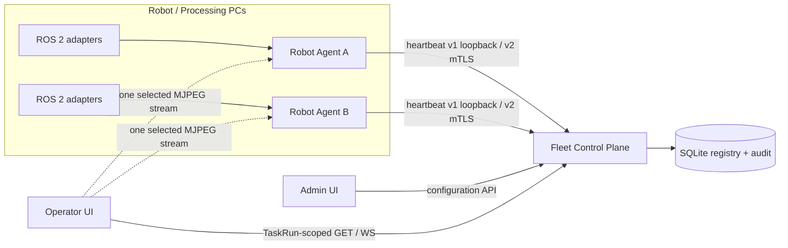
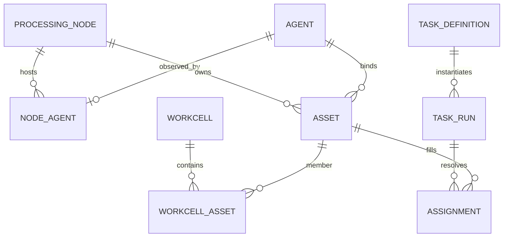
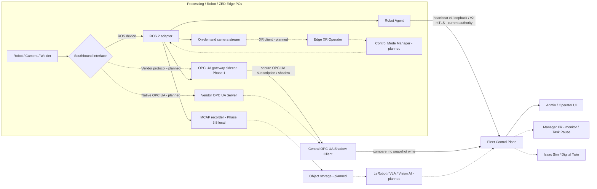

# SANG Task-Scoped Operations Architecture

## 1. 목표

랩의 SO-101, OMY, RB5-850E와 이후 추가될 로봇·카메라·EEF·공정 장비를 ROS 2 기반으로 관측하고,
여러 Processing PC에 흩어진 장비를 하나의 협업 작업으로 구성한다.

대표 작업은 OMY가 플레이트를 잡고 RB5가 용접하며 카메라가 공정을 관측하는 형태다. 동작은 동시에
실행될 수도 있고 `A 동작 -> B 동작 -> C 동작 -> A 동작`처럼 순차적으로 실행될 수도 있다. 같은
관측 데이터는 규칙 기반 프로그램, LeRobot 데이터 수집, VLA 학습과 정책 평가에 재사용할 수 있어야 한다.

이번 구현은 실행 엔진이 아니라 **운영 구성과 작업 범위 관측의 첫 vertical slice**다.

장기 목표는 로봇·카메라·용접 장비의 로컬 실시간 경로는 ROS 2 또는 vendor interface에 남기고,
Processing PC마다 read-only OPC UA Edge Server를 배치해 Monitoring PC의 OPC UA Client와 연결하는
것이다. MCAP·LeRobot·object storage, VLA/Vision AI와 Digital Twin은 이 운영 경로에 단계적으로
연결한다. 이 항목들은 현재 구현과 목표 구조를 혼동하지 않도록 §8의 단계별 상태로 구분한다.

## 2. Claude CLI 설계 검토 결과

Codex 구현 전 Claude CLI와 구조를 교차 검토했고 다음 결론을 채택했다.

- UI는 Admin과 Operator 두 개로 분리하되 backend와 데이터 모델은 하나를 공유한다.
- Asset Registry가 장비 identity를 소유하고 Task Definition이 장비를 소유하지 않는다.
- Task Definition은 버전된 역할 recipe, Task Run은 구체적인 자산 배정과 런타임 route다.
- Operator API는 전체 Fleet를 전달한 뒤 브라우저에서 숨기지 않고 서버에서 Run 범위로 필터링한다.
- SQLite 구성 생성은 `BEGIN IMMEDIATE`, FK/CHECK/UNIQUE 제약, append-only audit를 사용한다.
- READY 생성과 자산 예약은 같은 트랜잭션이어야 하며 DB 수준 중복 예약 제약이 필요하다.
- ID나 URL parameter는 인증이 아니다. 원격 배치 전 mTLS와 identity/authorization이 별도로 필요하다.

검토 중 Workcell을 단일 PC에 종속시키는 안은 폐기했다. OMY와 RB5가 서로 다른 PC에서 협업할 수
있으므로 Workcell은 여러 Processing Node의 Asset을 포함할 수 있다.

2026-08-04에는 Claude Fable 5로 Phase 3 구현과 Phase 4 계획을 한 번의 고밀도 read-only 리뷰로
재검토했다. 물리 노트북 시험 전 조건부 준비 완료라는 결론과 함께 ROS domain/discovery 일치,
실제 `--final-gate` 배포 경로, 원격 loopback preview URL 제거를 우선 보완했다. 다중 Edge는 현재
한 manifest인 OPC UA Gateway 경계를 억지로 합치지 않고, 한 Processing Node에 여러 독립
Agent/Gateway runtime을 두는 방향을 채택했다. 세부 계약은 `contracts/opcua/PHASE4_CONTRACT.md`에
분리했으며 AAS, aggregate Server, historian과 제어 기능은 아직 구현하지 않는다.

이후 Claude CLI 예산은 평상시 설계 토론과 focused follow-up에 기본 요금제 `opus`를 사용하고,
각 Phase 구현·로컬 검증이 끝난 뒤 최종 broad gate에만 `fable`(`claude-fable-5`)을 정확히 한 번
사용한다. Fable 결과와 반영 내역은 해당 Phase validation 문서에 기록한다.

## 3. 현재 시스템 경계 (loopback MVP)

이 절은 현재 구현된 heartbeat 기반 경계다. OPC UA를 포함한 목표 구조는 §8을 따른다.



### Admin UI

- 전체 Agent/robot/source 상태 진단
- Heartbeat에서 발견된 Robot/Camera 후보 확인
- Processing Node와 Agent 관계 등록
- Asset identity, capability와 observed binding 등록
- Workcell 구성
- 버전된 Task Definition 역할 작성
- Task Run 생성과 역할별 Asset 배정
- Operator Run URL 발급

### Operator UI

- URL의 canonical identity는 `run_id`
- 선택한 Run의 역할, 자산, Robot/Camera 상태만 표시
- 서버가 범위를 잘라 전달하므로 다른 작업 자산을 받지 않음
- 카메라는 목록과 health만 기본 수신하고 영상은 한 대만 on-demand MJPEG 연결
- 현재는 read-only이며 제어·녹화·정책 실행 버튼이 없음

### Robot Agent

- 하나의 Processing Node에서 여러 Agent process를 실행할 수 있음
- 하나의 Agent가 여러 robot manifest를 관측할 수 있음
- secure Phase 4 conformance는 Gateway의 현재 한-manifest 경계와 장애 격리를 위해 Agent runtime당
  manifest 하나만 사용하며, 같은 Processing Node에 runtime을 여러 개 배치함
- ROS 2 topic freshness/rate, host resource, local dataset 상태를 heartbeat로 전달
- 카메라 JPEG는 heartbeat나 Central DB에 저장하지 않고 최신 한 장만 local RAM에 유지

## 4. 핵심 도메인 모델



### Processing Node

물리 PC 또는 독립 compute runtime이다. Processing Node와 Agent는 같은 개념이 아니다. 한 PC가
SO-101 arm reader, camera reader, simulator 등 여러 Agent를 실행할 수 있다.

### Asset

운영에서 사용하는 안정적인 identity다. 종류는 `robot`, `camera`, `eef`, `welder`, `feeder`,
`mobile_robot`, `sensor`, `other`다.

권위는 다음처럼 분리한다. manifest/adapter contract는 local interface, topic, unit, health threshold의
원장이고, Asset Registry는 stable `asset_id`, 제조사 serial, ConnectionProfile, Workcell과
Task Definition/Run 배정의 원장이다. OOP와 OPC UA ObjectType은 domain representation이지 저장
기술이 아니며, OPC UA address space는 두 원장과 runtime live state를 결합한 projection이다.

- Robot Asset binding: `(agent_id, robot_id)`
- Camera Asset binding: `(agent_id, robot_id, source_key)`
- 용접기처럼 아직 Agent telemetry가 없는 장비는 binding 없이 등록하며 `UNINSTRUMENTED`로 표시
- observed binding은 한 Asset만 소유할 수 있음
- binding이 있으면 Agent는 Asset의 Processing Node에 소속되어야 함
- IP·port·ROS domain은 identity가 아니라 변경 가능한 ConnectionProfile이다. 향후
  `desired endpoint`와 실제 발견한 `observed endpoint`를 분리하며 secret과 인증서 private key는
  DB에 평문 저장하지 않고 reference만 둔다.
- 제조사 serial과 ConnectionProfile은 계획된 schema이며 현재 SQLite에는 아직 없다.
- Asset 이동은 기존 identity를 유지한 registry binding 재배정으로 표현한다. 현재 구성 수정 API가
  없으므로 §10의 수정/폐기 설계와 함께 도입한다.

### Workcell

공간, 공정 또는 안전 경계를 공유하는 Asset 집합이다. 여러 Processing Node의 Asset을 포함할 수
있으며 특정 PC나 Robot에 종속되지 않는다.

### Task Definition

구체 장비가 아닌 역할을 정의하는 immutable recipe다. 역할은 `role`, `asset_type`, `access_mode`를
가진다. 변경은 기존 버전을 수정하지 않고 다음 연속 버전을 생성한다.

예시:

```json
{
  "task_definition_id": "plate-weld",
  "version": 1,
  "roles": [
    {"role": "plate_handler", "asset_type": "robot", "access_mode": "exclusive"},
    {"role": "weld_robot", "asset_type": "robot", "access_mode": "exclusive"},
    {"role": "weld_vision", "asset_type": "camera", "access_mode": "shared_read"},
    {"role": "power_source", "asset_type": "welder", "access_mode": "exclusive"}
  ]
}
```

### Task Run과 Assignment

Task Run은 Task Definition 버전을 선택하고 각 역할에 실제 Asset을 배정한 실행 계약이다.

- `DRAFT`: 일부 역할이 비어 있어도 저장 가능, 자산을 예약하지 않음
- `READY`: 모든 역할이 정확한 type/access mode로 배정되어야 함
- Workcell을 지정하면 모든 배정 Asset이 그 Workcell에 포함되어야 함
- READY Run의 Assignment는 생성과 동시에 트랜잭션으로 예약됨
- 이번 MVP는 안전을 우선해 `shared_read`도 READY Run 간 중복 예약을 막음
- 향후 scheduler에서 capacity와 진짜 shared lease가 정의된 후 shared reservation을 완화

## 5. API 계약

### 기존 관측

- `POST /api/v1/agents/heartbeat`
- `GET /api/v1/agents`
- `GET /api/v1/summary`
- `GET /api/v1/events`
- `WS /api/v1/fleet`

### 운영 구성

- `GET /api/v1/configuration`
- `GET /api/v1/config/discovery`
- `POST /api/v1/config/processing-nodes`
- `POST /api/v1/config/assets`
- `POST /api/v1/config/workcells`
- `POST /api/v1/config/task-definitions`
- `POST /api/v1/config/task-runs`

현재 구성 write는 loopback bind에서만 허용한다. 모든 생성은 `configuration_audit`에 append-only로
남는다. 수정/삭제와 Run state transition은 이번 slice에 포함하지 않는다.

### Operator

- `GET /api/v1/task-runs/{run_id}`
- `GET /api/v1/task-runs/{run_id}/fleet`
- `WS /api/v1/task-runs/{run_id}/stream`

Robot Asset은 해당 robot의 전체 source를 범위에 포함한다. Camera Asset은 지정된 `source_key`
하나만 포함한다. binding이 없는 장비도 Run asset 목록에는 남지만 telemetry는
`UNINSTRUMENTED`로 표시한다.

## 6. 저장소 무결성

- SQLite `PRAGMA foreign_keys=ON`, WAL, busy timeout 사용
- 구성 생성은 `BEGIN IMMEDIATE` transaction 사용
- entity ID, 관계와 enum은 PK/FK/CHECK/UNIQUE로 보호
- Task Definition `(task_definition_id, version)`은 immutable
- READY Assignment의 `asset_id`는 partial unique index로 중복 예약 방지
- audit는 API에서 수정/삭제하지 않는 append-only log
- 기존 heartbeat DB에 테이블을 추가하는 additive migration이며 snapshot을 삭제하지 않음
- 데이터별 단일 원장과 파생 저장소의 경계는 §8.7의 원장 소유권 표를 따른다.

## 7. 제어와 데이터 수집의 후속 설계

이번 구현에는 actuator command가 없다. 실제 동작을 추가할 때 다음 순서를 지킨다.

1. 사용자/서비스 identity, RBAC, mTLS와 Agent allowlist
2. Control Mode Manager: `manual`, `teleop`, `program`, `policy`, `safe-stop`
3. command mux와 단일 writer lease
4. TTL/deadman, local safety gate, E-stop/interlock 상태 계약
5. Task Run lifecycle과 typed workflow/orchestrator
6. resource capacity, collision zone와 공정 interlock lock
7. dataset capture worker와 policy execution worker

Central UI가 raw actuator command를 직접 publish하지 않는다. Central은 승인·lease·workflow를
관리하고, 실시간 safety와 최종 command gate는 각 Robot/Processing Node 가까이에 둔다.

현재 SANG의 비안전(non-safety-rated) 일반 OPC UA/DDS 경로에는 E-stop 등 안전 기능을 두지 않는다.
안전 기능은 독립적으로 안전 인증된 하드웨어 또는 안전 인증 프로토콜 채널만 허용한다. Task Pause는
orchestration 신호이며 안전 기능이 아니다. 인증된 채널(예: OPC UA Safety 계열)의 채택은 인증 근거와
함께 별도 결정한다. 일반 OPC UA는 안전 상태를 보고할 수 있지만 안전 기능을 수행하지 않는다.

데이터 수집은 `run_id`, `task_definition_id@version`, `asset_id`, calibration/version과 함께 저장한다.
카메라, JointState, EEF, 공정 I/O에는 sensor timestamp와 Central receive timestamp를 모두 보존하고,
PTP 우선/NTP fallback clock 상태와 skew를 episode metadata에 기록한다. 이 timestamp/skew와 LeRobot
writer는 아직 구현되지 않았다.

MCAP은 세션의 immutable raw artifact이며 raw 관측 데이터의 원장이다. Object storage는 MCAP과
파생물(LeRobot dataset, 영상 파일)을 보관하는 durable medium이며 별도 원장이 아니다. 기본 capture
profile은 compressed image를 포함한 ROS 원본을 MCAP에 동기 기록한다. 별도 video sidecar를 쓰면
MCAP 또는 session manifest에 frame timestamp와 URI를 남긴다. Live MJPEG preview는 저장하지 않는다.
검색용 시계열은 MCAP에서 재생성할 수 있는 파생 인덱스로만 두며 DB 제품과 schema는 실제 질의·보존
요구를 측정한 뒤 결정한다.

## 8. OPC UA Northbound Architecture

### 8.1 적용 범위와 근거

OPC UA는 ROS 2를 대체하는 로봇 제어 bus가 아니라 로봇·카메라·공정 장비를 산업 시스템에
표준 의미로 노출하는 northbound plane이다. ROS 2는 Processing Node 내부의 고주파 관측·제어
평면으로 유지하고, 영상 bytes와 고주파 원본은 OPC UA로 중계하지 않는다.

참고 논문 *Digital twin-based architecture for wire arc additive manufacturing using OPC UA*
(Mahdi et al., RCIM 94, 2025)은 Physical Entity / Middleware / Digital Twin의 개념 구조를
제안한다. 다만 실증 middleware는 OPC UA address space가 아니라 Azure Blob Storage에 이미지와
CSV를 업로드·조회하는 방식이며, 논문도 flicker와 전송 지연을 한계로 보고한다. 따라서 이 논문은
계층 분리의 개념 근거와 중앙 저장소 왕복을 실시간 경로로 사용하지 말아야 한다는 근거로만 사용한다.
Edge 배치와 Companion Specification 정책은 OPC UA 표준을 별도로 따른다.

다음 그림에서 `sang_opcua_gateway`까지의 실선은 Phase 1 구현이고, 점선과 `planned` 표시는
후속 목표 구조다.



사용자 환경은 다음 배치로 해석한다.

- Robot/Processing PC: ROS adapter, Robot Agent, OPC UA gateway sidecar와 로컬 recorder를 실행
- ZED Box 또는 camera PC: camera adapter/processing과 필요 시 OPC UA gateway를 실행
- Monitoring PC: Fleet Control Plane, Central OPC UA Client와 Admin/Operator UI를 실행
- Edge XR: low-latency teleop intent를 로컬 Control Mode Manager에 전달하고 영상을 직접 on-demand 수신
- Manager XR: 중앙 상태를 관측하고 Task Pause를 요청하지만 E-stop 경로를 소유하지 않음

### 8.2 런타임 책임과 장애 격리

- `robot_agent`는 manifest 기반 ROS source health를 계산하고 loopback heartbeat v1 또는 분산 mTLS
  heartbeat v2를 전송하는 현재 원장 경로다.
- `sang_opcua_gateway`는 별도 프로세스로 배치하는 read-only sidecar다. manifest parser와 monitor
  library를 재사용하고 raw OPC 값·StatusCode를 위한 자체 ROS subscription을 가지며, gateway 장애가
  Agent·adapter를 종료시키지 않아야 한다. Phase 2부터 transport health/FSM의 단일 원장은 Agent이고,
  gateway는 검증된 versioned loopback snapshot을 투영한다.
- gateway는 Registry의 별도 Agent가 아니다. 미러 대상 `robot_agent`의 `agent_id`와 manifest를
  사용해 ApplicationUri와 NodeId를 생성하고 heartbeat를 전송하지 않는다. 현재 구현은
  `gateway 1개 = manifest 1개`다. Phase 4 secure 배포도 이 경계를 유지해
  `Agent runtime 1개 = manifest 1개 = gateway 1개`로 격리하고, 한 Processing Node에 여러 runtime을
  둘 수 있게 한다. 한 address space에 여러 manifest를 합치는 기능은 구현하지 않는다.
- Phase 2 실기에서 두 best-effort subscriber의 event set이 달라 shared algorithm만으로 rate/FSM
  parity를 보장할 수 없음이 확인됐다. tolerance로 차이를 숨기지 않고 versioned normalized local
  health snapshot contract를 채택했다. gateway의 독립 subscription은 raw value/data-quality에만
  사용하며 snapshot link가 stale이면 자체 health 계산으로 fallback하지 않는다.
- 현재 Central OPC UA 구성요소는 Client only다. 기존 Admin/Operator는 HTTP/WS를 유지하며
  브라우저가 Edge OPC UA Server에 직접 접속하지 않는다.
- ROS 관측 자산의 최신 snapshot과 health event는 기존 heartbeat/reconcile 경로만 write한다.
  Central OPC UA Client는 shadow 비교만 수행하고 OPC UA 값을 이 원장에 쓰지 않는다. Native
  OPC UA 장비의 live 상태는 Phase 4까지 shadow report에만 남기며 snapshot/health 원장 편입은
  Phase 2 evidence 이후 heartbeat 대체 여부와 함께 결정한다.
- 외부 MES 등 OPC UA 직접 소비자가 확정되기 전에는 중앙 aggregate Server를 구현하지 않는다.

### 8.3 장비 연결 3+1 분류

모든 장비에 ROS driver나 SANG gateway 재노출을 강제하지 않는다.

1. ROS 장비: adapter가 표준 ROS topic을 publish하고 Agent/gateway가 read-only로 관측
2. Vendor protocol 장비: 용접기·피더 등의 vendor adapter가 normalized OPC UA model로 투영
3. Native OPC UA 장비: binding 없는 Asset과 planned desired ConnectionProfile로 Registry에 등록하고
   Central Client가 endpoint를 직접 구독
4. 인터페이스가 없는 장비: 기존처럼 binding 없이 등록하고 `UNINSTRUMENTED`로 표시

Native 장비의 vendor model을 SANG model로 다시 투영할지는 중앙 aggregate Server가 필요한 시점에
결정한다. 장비가 어느 경로를 사용하더라도 Asset Registry identity와 Task 배정 규칙은 동일하다.

### 8.4 Identity, ConnectionProfile과 NodeId

- Edge server `ApplicationUri`의 초기 규칙은 `urn:sang:agent:<agent_id>`다.
- SANG custom type model namespace의 초기 후보는 `urn:sang:fleet:model:1`, Edge instance
  namespace의 초기 후보는 `urn:sang:fleet:edge:1`이다. Phase 0에서 둘의 역할과 URI를 확정하며
  published major version의 URI와 NodeId는 변경하지 않는다. 공식 Companion Specification의
  namespace와 NodeId는 수정하지 않는다.
- Edge NodeId는 관측 identity에서 결정적으로 생성한다. 기본 형태는
  `s=agent/<agent_id>/robot/<robot_id>[/source/<source_key>]/field/<field>`이며 각 component의
  canonical escape와 최대 길이는 Phase 0 contract에서 고정한다.
- `source_key`는 현재 `ShortText`라 `/`, 공백과 비 ASCII 문자를 포함할 수 있다. identity schema를
  소급 제한하지 않고 component 단위 escape를 적용하며 `/`, 공백, `%`, 비 ASCII 입력의 round-trip과
  collision-free test vector를 Phase 0 산출물에 포함한다.
- Edge는 중앙이 부여한 `asset_id`를 모르는 상태에서도 기동할 수 있어야 하므로 Phase 1 NodeId에
  `asset_id`를 사용하지 않는다. Central Client가 기존 observed binding
  `(agent_id, robot_id, source_key)`을 Asset Registry와 join한다.
- 서버 경계를 넘는 관측 노드는 문자열 NodeId만으로 식별하지 않고
  `(server ApplicationUri, NamespaceUri, identifier)` 조합으로 다룬다. NodeId의 유일성은 한 서버
  address space 안에서만 가정한다.
- binding이 다른 Agent로 이동하면 Edge NodeId는 바뀔 수 있다. Edge NodeId는 관측 지점 identity이고
  자산의 연속성은 중앙 `asset_id`가 담당한다.
- 향후 중앙 aggregate Server를 구현할 때만 중앙 자신의 address space에서 `asset_id` 기반 NodeId를
  검토한다. ExpandedNodeId/ServerUri 세부 의미론에 의존하는 설계는 그때 표준과 함께 확정한다.
- ConnectionProfile과 secret 취급은 §4의 Asset 규칙을 따른다.

### 8.5 Information Model 정책

- Robotics, Machine Vision, Joining Systems와 필요한 경우 Additive Manufacturing Companion
  Specification의 타입 구조를 우선 재사용한다.
- MVP는 필요한 subset과 지원 profile을 명시하며 전체 conformance나 인증을 주장하지 않는다.
- SANG model namespace에는 Workcell, TaskDefinition/Run reference, Dataset/Policy reference,
  stream reference와 clock 상태처럼 공식 모델에 없는 항목만 둔다.
- Edge projection은 local interface manifest와 live state에서 생성하고, Central projection은 여기에
  Asset Registry binding을 join한다. address space를 로봇별 수작업 코드로 중복 모델링하지 않는다.
- manifest의 capability는 장치가 보고한 기술 capability이고, Registry의 capability는 운영자가 승인한
  capability다. 현재 Task role matching은 `asset_type`/`access_mode`만 검증하며 capability는 참고
  정보다. capability 기반 matching은 reported/approved를 구분하는 schema 변경과 함께 별도 slice로
  도입한다.
- heartbeat/reconcile 경로가 생성하는 기존 `health_events`가 전이 이벤트의 원장이다. OPC UA
  Alarms & Conditions를 추가할 때는 별도 판정 로직을 만들지 않고 기존 event를 1:1 projection한다.
- 카메라는 identity, health, FPS, resolution, encoding, freshness, source timestamp, stream URI와
  분석 결과만 노출한다. 원본 frame/video bytes는 OPC UA Variable로 연속 전송하지 않는다.
- 수치 state/action 값은 무손실 stream이 아니라 최신값(current value) sampling으로 노출한다. 기본
  sampling/publishing interval과 queue/discard 정책은 Phase 0 contract에서 고정하며 전체 ROS rate의
  무손실 전달을 보장하지 않는다. 무손실 원본은 ROS/MCAP 경로가 담당한다.
- Phase 1 SANG application node는 모두 read-only이며 SANG 제어 Method는 0개다.

### 8.6 시간과 품질 규칙

- `SourceTimestamp`: 유효한 ROS message header의 센서 시각. header가 없으면 adapter acquisition
  시각을 사용하고 provenance에 fallback임을 표시
- `ServerTimestamp`: Edge gateway가 값을 수신·갱신한 시각
- `CentralReceivedAt`: Central Client가 값을 수신한 시각을 별도 기록하며 SourceTimestamp를 덮지 않음
- `StatusCode`: source freshness, decode/adapter 오류와 clock 상태를 반영하는 mapping을 Phase 0에 정의
- clock 상태는 PTP 우선/NTP fallback의 sync source, offset/skew, last check와 quality를 포함
- MCAP/session metadata와 OPC UA가 같은 SourceTimestamp 및 clock 상태 계약을 사용
- heartbeat v1의 기본 5초 interval과 12초/30초 Fleet TTL을 기준으로 Phase 2 timestamp comparison
  window는 6초, startup/reconnect grace는 40초를 v1 기본값으로 고정한다. interval/TTL contract가
  바뀌면 OPC UA comparison contract도 같은 버전 변경에서 재산정한다.

### 8.7 단일 원장과 저장 매체

| 데이터 | 원장(source of truth) | projection / durable medium |
|---|---|---|
| Local interface, topic, unit, health threshold | versioned manifest/adapter contract | Edge OPC UA projection |
| Stable `asset_id`, serial, type, approved capability, desired ConnectionProfile | SQLite Asset Registry | Central OPC UA projection |
| Workcell, TaskDefinition@version, TaskRun, reservation, audit | SQLite | HTTP/WS, 향후 OPC UA projection |
| 최신 source health와 host resource | Agent runtime -> heartbeat -> SQLite snapshot | OPC UA shadow, UI |
| Health 전이 이벤트 | SQLite `health_events` | 향후 OPC UA event 1:1 mirror |
| Local dataset/recording inventory와 진행 상태 | Agent local disk/session metadata | heartbeat summary, UI |
| Raw session observation | immutable MCAP artifact | object storage에 보관 |
| LeRobot dataset와 영상 파생물 | versioned derived artifact + provenance | object storage에 보관 |
| 검색용 시계열 | MCAP에서 재생성 가능한 파생 index | 향후 PostgreSQL/Timescale 후보 |
| Live MJPEG preview | 저장하지 않음 | Agent RAM의 최신 frame과 on-demand stream |
| Observed endpoint | runtime observation | 향후 Registry의 observed ConnectionProfile |
| Secret와 인증서 private key | secret store / protected file | Registry에는 reference만 저장 |

Object storage는 저장 매체이며 artifact의 의미상 원장이 아니다. 모든 stored artifact metadata에는
`run_id`, `asset_id`, source key, source time range, calibration/version, schema version, checksum과
부모 artifact reference를 기록한다.

### 8.8 보안 및 제어 경계

Phase 3은 HTTPS mTLS Agent ingress와 OPC UA `SignAndEncrypt`, application/user authorization,
replay 방지와 인증서 교체·폐기 도구를 구현했다. HTTPS와 OPC UA는 하나의 offline ownership Root
아래에서도 서로 다른 issuing CA와 trust bundle을 사용한다. 원격 Processing PC 완료 주장은
`contracts/opcua/PHASE3_SECURITY.md`의 입회 노트북·회전·재연결·2시간 evidence 이후에만 허용한다.

OPC UA control은 §7의 identity, Control Mode Manager, command mux/lease, TTL/deadman과 local safety
gate가 모두 구현된 뒤에만 검토한다. 허용하더라도 raw actuator target이 아니라 Task 승인·lease 요청
같은 상위 수준 Method로 제한한다. 안전 경계의 유일한 정의는 §7을 따른다.

### 8.9 저장소 배치 계획

현재 `v2_ws`를 제품 monorepo로 유지하고 로봇별 Git 저장소를 만들지 않는다. 기존 파일을 즉시
이동하지 않고 다음 경계만 단계적으로 추가한다.

```text
contracts/opcua/              NodeSet imports, SANG model, NodeIds, mapping tables (implemented)
src/sang_opcua_gateway/       read-only ROS -> OPC UA Edge sidecar (SO-101 Phase 1 implemented)
src/sang_mcap_recorder/       allowlisted ROS -> immutable local MCAP worker (Phase 3.5 implemented)
src/fleet_control_plane/      existing; Central OPC UA Client/shadow module 추가 (Phase 2)
manifests/                    existing local interface contracts
ui-admin/, ui-operator/       existing HTTP/WS clients; direct OPC UA client가 아님
docs/architecture/            decisions, threat model, conformance evidence (planned)
```

USD/URDF, MCAP, 영상, dataset와 checkpoint 같은 대용량 artifact는 Git에 넣지 않는다. LeRobot,
LeIsaac와 vendor driver는 외부 저장소/fork의 commit을 고정하고 SANG 연동 코드만 이 monorepo에 둔다.

### 8.10 단계별 구현과 Acceptance Criteria

#### Phase 0 - Model contract, 코드 없음

상태: **COMPLETE (2026-08-04)**. 산출물과 검증 근거는 `contracts/opcua/`에 있으며 공식
ModelCompiler 2.8.15 검증까지 통과했다.

- `bi_so101_01`의 12축 state/action, 5개 camera, source health를 OPC UA node에 전수 매핑
- official NodeSet version, SANG namespace, NodeId escape/length, timestamp/StatusCode mapping 고정
- Phase 1 sampling/publishing interval과 §8.6의 Phase 2 comparison/grace 수치 검증
- Phase 1 gateway off/on 성능 gate를 동일 조건 5분 측정 3회로 고정. 세 run의 host CPU p95
  중앙값 증가는 10 percentage point 이하, minimum free RAM 중앙값 감소는 512 MiB 이하로 설정
- 장비 3+1분류와 native OPC UA endpoint 등록 예시 1건 작성

통과 기준: 모든 Edge NodeId가 manifest/heartbeat의 observed identity에서 결정적으로 유도되고,
mapping 누락이 0개이며, OPC UA model validator로 custom NodeSet을 검증할 수 있는 절차가 문서화된다.

#### Phase 1 - Loopback read-only sidecar

상태: **COMPLETE (2026-08-04)**. 구현과 실기 근거는
`src/sang_opcua_gateway/`, `contracts/opcua/PHASE1_VALIDATION.md`와
`output/validation/opcua-*.json`에 있다.

- 별도 `sang_opcua_gateway` 프로세스와 loopback endpoint 구현
- 범용 OPC UA Client로 browse/read한다. fresh value-bearing source는 ROS test subscriber의 동일
  SourceTimestamp sample과 값을 비교하고, idle action/non-required source는 값 일치를 요구하지 않고
  Phase 0에서 정한 StatusCode mapping을 검증한다.
- `fleet_soak` report schema를 확장해 heartbeat의 host CPU와 free RAM을 집계하고 gateway off/on report
  comparator를 추가한다. Phase 1 loopback은 DDS wire traffic을 측정했다고 주장하지 않는다.
- SANG writable application node 0개, SANG control Method 0개

통과 기준: fresh value-bearing source의 값과 SourceTimestamp가 같은 ROS sample과 일치하고,
idle/non-required source의 StatusCode가 contract와 일치하며, gateway 강제 종료 중에도 Agent,
heartbeat와 adapter의 30초 strict soak가 통과한다. 동일 manifest와 입력 조건에서 gateway off/on
`fleet_soak` report로 host CPU·free RAM과 source rate를 비교하며 source rate 회귀가 5%를 넘지
않는다. resource delta는 baseline과 함께 evidence로 남기고 Phase 0에서 정한 예산을 적용한다.

#### Phase 2 - Loopback Central Client shadow와 soak

상태: **VALIDATING (2026-08-04)**. shared health, authoritative local snapshot, Central shadow와
Edge restart recovery는 구현됐다. 1차 검토에서 발견된 fail-open 조건을 제거해 Agent liveness,
connection epoch별 strict 비교, wall-clock replay 제한과 7,200초 final-gate를 추가했다. 강화된
physical short/reconnect 재검증은 통과했다. 2시간 final gate는 Phase 3 착수를 위해 운영자가
중단했으며, 따라서 Phase 2는 아직 `COMPLETE`가 아니다. 근거는
`contracts/opcua/PHASE2_VALIDATION.md`에 기록한다.

- Phase 2의 첫 작업은 Agent와 gateway의 freshness/rate/FSM 계산을 동일한 shared health module로
  옮기는 것이다. decode 오류 메시지의 fresh 처리와 required rate 미측정 시 `RatesOk` 처리의 알려진
  차이를 회귀 테스트로 고정하고 제거한 뒤 shadow 비교를 시작한다.
- Central Client는 reconciliation 없는 전용 read-only snapshot endpoint로 Agent를 읽고 Edge를
  구독하며 SQLite snapshot이나 `health_events`에 write하지 않음
- heartbeat health와 OPC UA health를 Phase 0 timestamp window로 비교한다. divergence는
  `output/validation/` 아래 JSON report로 저장하며 `health_events`에는 쓰지 않는다.

통과 기준: Phase 0에서 수치가 고정된 startup/reconnect grace 이후 2시간 strict soak의 status
divergence 0, Edge restart 후 subscription 자동 복구, Central 중단 중 Edge/Agent 무영향,
heartbeat 대체 여부를 판단할 JSON evidence가 남는다.

2시간 final gate는 첫 matched strict comparison 이후 연속 7,200초를 측정하며 단절 시 즉시
실패한다. Edge restart/reconnect는 별도 gate로 검증해 reconnect grace를 2시간에 포함하지 않는다.

#### Phase 3 - 보안과 분산 Edge 1대

상태: **IMPLEMENTING (2026-08-04)**. PKI/secret reference, additive registry migration,
`SignAndEncrypt`, X.509 user authorization, Agent mTLS/allowlist/replay 방지, desired/observed
ConnectionProfile, 재개 가능한 배포와 인증서 회전/폐기 도구까지 로컬 분산 gate를 통과했다. 세부
계약과 검증 결과는 `contracts/opcua/PHASE3_SECURITY.md`와 `contracts/opcua/PHASE3_VALIDATION.md`에
있다. 다른 노트북에서의 입회 분산 시험과 soak/reconnect evidence 전에는 COMPLETE로 표시하지
않는다.

- SignAndEncrypt, application certificate trust/authorization, 비밀정보 reference 구현
- desired/observed endpoint와 secret reference를 위한 additive ConnectionProfile migration 및 API 구현
- 인증서 발급·교체·폐기 절차와 HTTP Agent identity/mTLS 경계를 함께 검토
- 격리된 원격 시험망의 NIC byte counter로 gateway off/on 전체 링크 사용량을 기록한다. 이는 DDS
  protocol 단독 wire traffic으로 과장하지 않으며 상세 attribution이 필요하면 RMW별 도구를 별도 선정한다.

통과 기준: 미인증·비신뢰·폐기된 인증서 접속 거부, 인증서 회전 1회 리허설, 원격 Edge 1대가
Phase 2와 동일한 soak/reconnect 기준을 통과한다.

#### Phase 3.5 - Processing Edge 로컬 MCAP 저장

상태: **COMPLETE (2026-08-06)**. `processing-lab1`에서 RB5 실측 관절, OTOS와 D455 압축 영상을
허용 목록으로 동기 기록하는 독립 `sang_mcap_recorder` worker를 구현했다. 활성 기록은 `.partial`,
완료 기록은 immutable MCAP과 원자적 session manifest로 구분한다. ROS bag 로그, metadata와 MCAP의
SHA-256, 토픽별 type/count, source-header 범위·0값·역행, transport loss를 검증한다. 구현 계획은
`PLAN_MCAP_STORAGE_MVP.md`, 실물 근거는 `docs/RB5_LAB1_MCAP_RESULT_2026-08-06.md`에 있다.

통과 기준: 세 토픽이 모두 비어 있지 않고 type이 계약과 일치하며, source header 0·역행과 ROS bag
transport loss가 0이고 독립 해시 재계산이 일치한다. recorder 종료·실패가 기존 Agent, camera,
RB5 adapter를 재시작하지 않아야 한다. `complete`는 storage/timestamp integrity 판정이며 rate,
gap, skew와 clock quality 승인은 별도 sync quality gate가 담당한다.

#### Phase 3.6 - 읽기 전용 로컬 녹화 Inventory

상태: **COMPLETE (2026-08-06)**. Processing Agent가 로컬 capture root의
manifest를 bounded scan하고, 최근 세션 메타데이터만 heartbeat로 보내 Admin에서 집계·조회한다.
계약과 범위는 `PLAN_RECORDING_INVENTORY.md`를 따른다. MCAP·영상·체크섬·로그·로컬 경로는
전송하지 않고 Operator Task Run payload에서도 전체 Agent inventory를 제외한다.

통과 기준: malformed/symlink/cross-Agent 세션이 Agent를 중단시키지 않고, 기존 heartbeat가
additive 기본값으로 계속 유효하며, `processing-lab1`의 완료 1개·실패 1개가 Admin에 정확히
표시된다. 원격 녹화 제어 또는 raw payload 전송 경로는 0개여야 한다.

검증 결과: scanner-to-Central 계약 회귀를 포함한 focused 44 tests와 core 261 tests, ROS 2
11-package build, Lab1 실 heartbeat 및 Admin desktop/mobile 검증을 통과했다. Fable 최초 검토의
critical 3건을 수정한 뒤 focused Opus 재검토가 `PASS`를 반환했다.

#### Phase 4 - Multi-edge conformance

- 상태: **IMPLEMENTING / M4 COMPLETE**. 중앙 우선 heartbeat v3 호환, nullable Asset
  `runtime_kind`, 생성·수정 불일치 거부, heartbeat identity drift 이벤트, 명시적 Agent v3
  선택을 구현했다. 기존 로컬 v1과 원격 v2는 유지된다. 세부 배치·identity·PKI·mapping·acceptance 계약은
  `contracts/opcua/PHASE4_CONTRACT.md`를 따른다.
- physical SO-101/OMY/RB5와 Isaac Sim OMY/RB5, 총 5개 Agent/Gateway profile을 동시에 연결
- 한 Processing Node에 여러 runtime을 허용하되 runtime마다 manifest, ApplicationUri, endpoint,
  certificate, replay DB와 ROS domain을 격리
- Registry/heartbeat에 `runtime_kind=physical|simulation`을 추가하고 SO-101 normalized 단위를
  OMY/RB5에 오용하지 않도록 feature별 unit/range를 갖는 mapping schema v2 구현
- mapping schema v2와 feature별 범위 enforcement는 **M2 완료**다. SO-101의 24개 feature는
  selector/order/Float/unit/range/semantic을 파일에서 선언하고, Agent/Gateway는 canonical mapping
  digest를 local-health manifest digest에 결합한다. v1은 동일 NodeId 롤백 계약으로 남긴다.
  OMY는 ROBOTIS 공식 URDF, RB5는 제조사 시스템 사양의 `+/-360 deg`와 elbow `+/-165 deg`를
  rad로 변환해 physical/simulation 네 profile에 적용했다.
- per-Agent HTTPS/OPC UA enrollment, runtime inventory 충돌 검증과 deterministic Compose bundle
  생성은 **M3 완료**다. bounded parallel shadow와 latest-only observation projection은 다음 slice다.
- native OPC UA 또는 vendor protocol 장비 예시와 `UNINSTRUMENTED` 자산을 함께 표현. 이 단계의
  native 장비는 Registry 등록과 OPC UA shadow에만 포함하며 SQLite snapshot/health 원장에는 편입하지 않음

통과 기준: 5개 profile의 동시 final gate, 중앙 observed binding join 충돌 0, real/sim identity 혼동 0,
원격 DDS 혼입 0, Edge 하나의 장애가 다른 4개 Edge와 Central UI 상태를 손상시키지 않는다.

#### Phase 5 - 소비자 요구 기반 선택 기능

- 외부 MES/DT 소비자가 확정된 경우에만 중앙 aggregate Server 검토
- 실제 query/retention 요구가 확인된 경우에만 historian/시계열 파생 index 검토
- 필요 시 read-only Workcell/TaskRun/Dataset reference projection 추가

통과 기준: aggregate view를 구현한다면 Operator run-scope와 동일한 자산 범위를 노출하고,
TaskRun 예약 상태가 SQLite `assignments`와 일치하며 원장 DB에 역방향 write하지 않는다.

#### Phase 6 - Control Mode Manager 이후의 제어

- §7의 모든 안전·권한 전제를 충족한 뒤 상위 수준 OPC UA Method를 별도 threat model로 검토

통과 기준: lease 없는 호출과 stale/replayed command가 거부되고, 현재 일반 OPC UA/DDS 경로가
safety-rated stop 경로에 포함되지 않음이 시험으로 입증된다.

### 8.11 보류 결정

- 중앙 aggregate OPC UA Server 구축 여부와 중앙 `asset_id` 기반 NodeId 세부
- ExpandedNodeId/ServerUri 의미론에 의존하는 cross-server reference
- Client/Server subscription과 PubSub(UDP/MQTT) 선택
- heartbeat v1을 OPC UA 구독으로 대체할지 여부
- Native OPC UA vendor model의 SANG 통일 projection 강제 여부
- Companion Specification 전체 conformance/certification 수준
- PostgreSQL/Timescale schema, retention과 OPC UA Historical Access
- OPC UA Safety 같은 인증 채널 및 PKI/GDS 운영 방식
- AAS Submodel, server와 OPC UA-AAS mapping

## 9. AAS 호환성

AAS는 지금 구현하지 않는다. 내용이 정해지기 전에 빈 server/package를 만들지 않으며, 이후 Asset
identity를 다음 Submodel로 매핑할 수 있게 현재 stable ID, approved capability와 OPC UA mapping
boundary를 보존한다.

- Identification and technical data
- Operational state and health
- Capability and interface descriptors
- Calibration and maintenance history
- Dataset and policy provenance

AAS는 공장/기업 상호운용을 위한 semantic layer다. ROS 2 고주파 telemetry, Actions, control lease,
safety gate를 대체하지 않는다. 따라서 runtime 내부 모델을 먼저 안정화한 뒤 read-oriented AAS mapping
adapter를 추가한다.

## 10. 구현 상태와 다음 단계

### 이번 구현 완료

- additive SQLite operations schema와 append-only audit
- discovery inbox와 observed binding 검증
- immutable Task Definition version
- Workcell/type/access/role 검증
- READY atomic reservation
- run-scoped GET/WebSocket filtering
- Admin 운영 구성 화면
- 별도 Operator 앱과 on-demand one-camera MJPEG
- OPC UA Phase 0: SO-101 12축 state/action, 5 camera, health mapping과 read-only SANG NodeSet
- official NodeSet/StatusCode lock, NodeId/time/quality/sampling contract와 ModelCompiler 검증
- 장비 3+1 분류와 비활성 native OPC UA ConnectionProfile 예시
- OPC UA Phase 1: SO-101 loopback read-only Edge sidecar와 live ROS/OPC UA 상관 검증
- gateway 강제 종료 격리 시험과 OFF/ON 5분 x 3 성능 비교
- OPC UA Phase 2: shared health/local snapshot, Central shadow, reconnect와 hardened short gate
- OPC UA Phase 3: protocol별 PKI, mTLS heartbeat v2, SignAndEncrypt, replay 방지, profile/secret
  reference, 회전·폐기와 로컬 분산 software gate
- Phase 3.5: RB5 Lab1 관절·OTOS·D455 allowlist MCAP, atomic manifest, source timestamp와
  transport-loss gate, SHA-256 및 실패 `.partial` 보존
- Phase 3.6: bounded local recording inventory, additive heartbeat/Central snapshot과 Admin
  최근 세션 표시. 원본 MCAP·영상 전송 및 원격 녹화 제어 없음
- Phase 4 M1-M4: physical/simulation runtime identity, 5개 robot profile mapping schema v2,
  Agent별 HTTPS/OPC UA 인증서·pin·HMAC·replay path와 충돌 검증된 runtime/Compose bundle 생성

### 다음 단계

1. Phase 3 Edge 노트북에서 fake source -> physical SO-101, reconnect, CRL 배포, 인증서 회전과
   `shadow-final-gate` 입회 evidence 완료
2. 중단된 Phase 2 uninterrupted 2-hour final gate debt 완료
3. Phase 4 `runtime_kind`와 feature별 unit/range mapping schema v2 동결 **완료(5 profiles)**
4. shared CA 아래 반복 가능한 per-Agent enrollment와 포트/domain/runtime-directory 충돌 검증 구현
   **완료(SO-101 canary foundation)**
5. OMY, RB5, OMY-sim, RB5-sim profile을 하나씩 추가하고 각 focused conformance 통과 **완료**
6. 5개 profile bounded parallel shadow, latest observation과 one-Edge-kill 장애 격리 구현
7. 구성 수정/폐기와 `DRAFT -> READY -> ACTIVE -> COMPLETE/FAILED` 상태 전이 설계
8. 인증된 preview relay와 PTP/NTP 시간 품질 진단, 중앙 Object Storage 업로드·session catalog와
   LeRobot 파생 변환을 각각 별도 slice로 구현
9. Control Mode Manager, 다중 로봇 typed workflow와 zone/process interlock은 read-only gate 이후 진행
