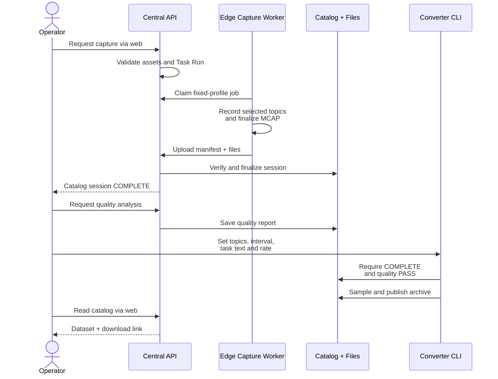
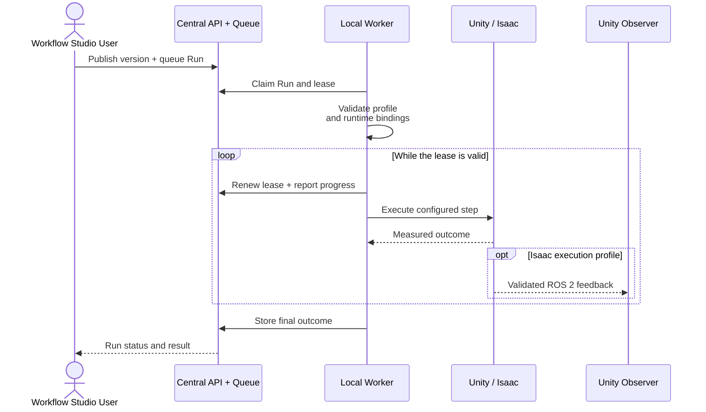

# SANG

**An operations platform connecting robot observation, task management, data collection, and digital twins.**

Manage SO-101, OMY, RB5, and cameras as workcells. Collect ROS 2 observations, preserve selected
recording intervals in MCAP, and inspect device status, recordings, and simulation results through
one web interface. OPC UA provides read-only information exchange; AAS connects asset documents.

[Watch the demo](#demo) ·
[System architecture](#system-architecture) ·
[Quick start](#quick-start) ·
[Installation & operations](docs/ROBOT_CAMERA_OPERATIONS_V1.md) ·
[Detailed usage (Korean)](docs/USAGE.md) ·
[Requirements](docs/requirements.md)

## Demo

**From a published Workflow to an observable virtual workcell.**

<video src="https://github.com/user-attachments/assets/32079579-3c66-48bb-a755-0d96c4eae799" controls="controls"></video>

**2:06 · 1080p · actual application footage.** SANG queues Scenario 1, coordinates the
carrier, OMY and RB5 in NVIDIA Isaac Sim, completes all five stages, acknowledges Reset,
and replays the linked recording in Data Catalog. White: RB5. Black: OMY. Blue: carrier.
Accelerated sections are labeled 4x; the original capture includes navigation and idle time.

**Simulation only:** physical outputs are disconnected. This demonstrates configured
trajectories and virtual transfer fixtures, not welding physics, physical grasp qualification
or certified safety. The footage is from the local development runtime; this media update
does not publish its pending source changes.

[Open video](https://github.com/user-attachments/assets/32079579-3c66-48bb-a755-0d96c4eae799) ·
[Demo notes, poster and integrity](docs/media/README.md)

## System Architecture


The system has three distinct flows: **live observation**, **recording and data export**, and
**isolated simulation execution**. The diagram shows logical responsibilities; boxes do not require
one dedicated computer each. [Open the full-size diagram](docs/assets/sang-architecture-detailed-en.svg).

[Deployment roles](#deployment-roles) · [Data flows](#data-flows) ·
[Components](#component-responsibilities) · [Recording and datasets](#recording-and-dataset-flow) ·
[Simulation](#simulation-flow) · [Storage](#storage) · [Key terms](#key-terms)

### Deployment Roles

An **Edge / Processing PC** sits near the devices and handles ROS 2 observations and capture.
**Central** owns the operational registry, access rules, catalogs and queues. A **Manager PC** is a
browser client of Central; it is not another name for the server. Several logical services can run on
one host. Remote observation uses configured authenticated links; the documented simulation worker
uses a dedicated local runtime, not an automatically provisioned remote execution cluster.

The arrows summarize information flow. In particular, the Edge OPC UA gateway serves its own
industrial clients. Central OPC UA builds a separate projection from Central's registry and catalog;
it does not need to relay the Edge OPC UA server.

### Data Flows

| Path | Trigger | Processing | Result |
|---|---|---|---|
| **Live observation** | An adapter publishes a declared ROS 2 topic. | Robot Agent checks topic presence, type, freshness and rate; sends bounded heartbeats. | Fleet health and latest operational state. A selected camera can be previewed separately. |
| **Retained recording** | An authorized user requests a capture for an active Task Run. | A fixed-profile Edge worker records an interval, finalizes it and uploads verified artifacts. | A cataloged MCAP session, indexed camera playback, a quality report and optional derived data. |
| **Simulation execution** | A user queues a published Workflow against a configured simulation profile. | A separate local worker claims the Run, checks its profile and maintains execution authority. | Step progress and a Run outcome, including failure or interruption. |

Observation alone does not retain every frame. A heartbeat reports health and bounded metadata;
camera preview relays an explicitly selected stream; recording preserves a selected interval.
These paths share asset and Task Run identities, but carry different payloads.

### Component Responsibilities

| Component | Input | Responsibility and output | Implementation |
|---|---|---|---|
| Device adapters | Robot data channels, serial reads or camera streams | Publish joint and camera observations under a device-specific manifest. | [SO-101 adapter](src/so101_readonly_adapter/), [RB5 adapter](src/rb5_readonly_adapter/) |
| Robot Agent | Manifest and ROS 2 observations | Monitor stream health and send versioned heartbeats; expose bounded local status. | [Agent node](src/robot_agent/robot_agent/node.py), [manifests](manifests/) |
| Recording worker | Capture Job and fixed capture profile | Claim and validate a job, start the recorder, report progress, finalize and upload its artifacts. | [Worker](src/fleet_control_plane/fleet_control_plane/recording_worker.py), [capture jobs](src/fleet_control_plane/fleet_control_plane/capture_jobs.py) |
| MCAP Recorder | Allowlisted ROS 2 topics | Retain messages and timestamps; preserve compressed JPEG payloads without re-encoding. | [Recorder](src/sang_mcap_recorder/sang_mcap_recorder/recorder.py) |
| Central API and stores | Authenticated user requests, Agent metadata and uploads | Manage assets, assignments, Runs, access, audit, capture jobs and artifact catalogs. | [API](src/fleet_control_plane/fleet_control_plane/app.py), [recording storage](src/fleet_control_plane/fleet_control_plane/recording_storage.py) |
| Browser interfaces | Central API, selected preview and catalog frames | Inspect fleet state, manage permitted task operations and review recordings. | [React application](frontend/admin/) |
| OPC UA projections | Validated local values or Central catalog state | Present read-only industrial information. Edge and Central have different scopes. | [Edge gateway](src/sang_opcua_gateway/), [Central projection](src/fleet_control_plane/fleet_control_plane/central_opcua.py) |
| AAS asset projection | Imported asset packages linked to registry assets | Validate and preserve asset documents and their identifiers; retain package bytes separately from registry metadata. | [AAS projection](src/fleet_control_plane/fleet_control_plane/aas_projection.py) |
| Dataset converter | Quality-passed MCAP, selected topics and interval | Align observations and publish a reproducible LeRobot v3 derivative. | [Converter](src/fleet_control_plane/fleet_control_plane/lerobot_derivation.py), [data contract](docs/LEROBOT_DERIVATION_CONTRACT.md) |
| Simulation worker | Queued Run, immutable Workflow and adapter profile | Execute the configured simulation backend, renew its lease and report progress and outcome. | [Worker](src/fleet_control_plane/fleet_control_plane/workflow_simulation_worker.py) |

### Recording and Dataset Flow

Suppose a Task Run has one robot and three cameras assigned. The capture profile determines the
allowed topics and duration bounds. The following is a successful recording and export sequence.
Quality analysis is available through the authenticated API. Dataset generation is a separate
administrative CLI operation after capture; the current web catalog lists and downloads its results.



The recording worker cannot declare success merely because its local recorder stopped. Central
verifies the uploaded session before marking capture complete. **Upload integrity and observation
quality are separate checks**: correct file hashes do not prove that cameras and joint samples were
fresh or sufficiently aligned.

For playback, the browser requests indexed JPEG frames from verified MCAP objects. Up to four selected
cameras share a record-time timeline, with each frame's actual time difference displayed. This does
not download the entire MCAP or imply support for every raw depth or image encoding.

For derivation, one selected interval becomes one episode. The converter requires one JointState
topic and supported JPEG camera topics, samples their common source-time range, and rejects samples
whose selected observations are more than 50 ms from the target timestamp. It uses nearest samples,
not interpolation. The result contains `observation.state`, `observation.images.<topic_key>` and task
labels. It has **no `action` feature**: measured joint positions are not silently relabeled as motor
commands. See the [derivation contract](docs/LEROBOT_DERIVATION_CONTRACT.md) for frozen versions and limits.

### Simulation Flow

Workflow Studio edits a draft and publishes an immutable version. Queueing a Run pins that publication
and its configured adapter profile. Central HTTP manages the request and durable state; a separate
worker performs simulation execution.



There are two simulation topologies. In a **Unity execution profile**, the Unity adapter executes
virtual actions. In an **Isaac execution profile**, Isaac is the motion executor and a separately built
Unity observer displays measured feedback. The latter is not two simulators independently commanding
the same motion. The [Isaac Scenario 1 runtime](sim/isaac_scenario1/) contains a concrete configured
example; it does not establish support for arbitrary workflows or physical process dynamics.

Lease expiry ends a worker's execution authority; recovery must follow the stored Run and reconciliation
state rather than blindly starting the same motion again. The diagram summarizes a successful run;
failures and aborts remain durable outcomes. Existing runtime assets and configured
builds must be supplied as described in the [source publication policy](docs/GITHUB_SOURCE_POLICY.md).

### Storage

| Store or transport | Contents | Why it exists |
|---|---|---|
| **ROS 2 topics** | Live joint states and camera messages | Local observation transport. Persistence is handled by a recorder. |
| **Manifests and contracts** | Stable identifiers, topic types, units, expected rates, allowed profiles and schemas | Versioned configuration shared by producers, validators and consumers. |
| **SQLite** | Assets, assignments, users, permissions, Task Runs, versions, events, queues and catalog references | Queryable operational metadata and transactional state changes. |
| **MCAP** | Selected observation messages with topics and timestamps | The authoritative retained sensor record for an interval. |
| **Filesystem Object Store** | Verified MCAP files, AAS artifacts, quality reports and dataset archives | Immutable bulk bytes referenced by metadata and verified by size and hash. It is not an automatically deployed cloud bucket. |
| **LeRobot derivative** | Sampled measured state, camera videos, task labels and provenance | A reproducible data product derived from a source recording; it does not replace MCAP. |

ROS 2 handles device-side observations; OPC UA exposes industrial information; the web API handles
authorized operations and catalogs. AAS links durable asset meaning and documents. They have different
responsibilities rather than being interchangeable transports for all data.

### Key Terms

| Term | Meaning | Example |
|---|---|---|
| **Asset** | A stable identity for a robot, camera, tool or virtual device | A robot remains the same asset when its network address changes. |
| **Workcell** | A grouping of related devices and their processing context | One robot and its observation cameras. |
| **Manifest** | A versioned description of a device's observable interface | Joint names, units, topic types and expected rates. |
| **Action** | A versioned robot-type operation with declared inputs and implementation references | A published simulation action selected in Workflow Studio. |
| **Task / Workflow** | A reusable definition of required roles and ordered actions or dependencies | A defined sequence using robot and camera roles. |
| **Run** | One instance tied to a specific definition and runtime binding | The result of one queued simulation attempt. |
| **Capture Job** | A bounded recording request attached to a Task Run and worker | Capture the assigned profile for a selected duration. |
| **Recording Session** | The finalized source observation record and its manifest | MCAP artifacts, topic metadata and quality information. |
| **Derivation** | One reproducible transformation of a source interval | A LeRobot episode at a selected output rate. |

### Implementation Scope

The public operational path observes and records physical devices. Its isolated simulation worker
executes configured virtual profiles. A successful simulation or dataset export does not add physical
actuation to that path. The repository also includes separate commissioning and vendor-driver tools;
their presence should not be confused with a web-to-robot command feature.

OPC UA application projections are read-only, and no OPC UA conformance certification is claimed.
Software timestamp checks do not imply hardware-synchronized exposure. Observation-only LeRobot
exports do not constitute action-labeled VLA training datasets. These distinctions define what the
current diagrams represent; authoritative interfaces remain in [requirements](docs/requirements.md),
[OPC UA contracts](contracts/opcua/README.md) and
[orchestration contracts](contracts/orchestration/README.md).

## Features

| Area | Capabilities |
|---|---|
| **Fleet & Task** | Register assets, Processing PCs, and workcells; assign tasks; track Agent health and events. |
| **Camera & Recording** | Preview selected cameras, record Task Run intervals, verify uploads, and replay multiple views. |
| **OPC UA & AAS** | Read-only Edge and Central projections, pinned NodeSets and mapping contracts, and asset document links. |
| **Workflow & Simulation** | Versioned Actions and Workflows, with isolated Unity and Isaac simulation execution. |
| **Data Export** | Derive LeRobot v3 datasets containing joint states and camera observations from quality-checked MCAP sessions. |

**Current scope:** The physical path supports observation and recording. Derived LeRobot datasets
contain no `action` feature. VLA training, policy execution, and actuation of physical robots or
welding equipment are outside this repository's supported functionality.
No OPC UA conformance certification is claimed.

## Quick Start

Clone the repository and build the web interface. You will need Git, Docker, and a Node.js/npm
version supported by the project's dependencies.

```bash
git clone https://github.com/acdonge/sang-robot-operations.git
cd sang-robot-operations

mkdir -p ui-admin ui-operator
cd frontend/admin
npm ci
npm run build
cd ../..
```

Open the ROS 2 Jazzy development container:

```bash
docker/run.sh
```

Inside the container, build and source the workspace:

```bash
source /opt/ros/jazzy/setup.bash
colcon build --symlink-install
source install/setup.bash
```

Next, follow [first-time installation and administrator setup](docs/ROBOT_CAMERA_OPERATIONS_V1.md#first-local-installation)
to start Central. Device connections, simulator execution, and remote deployment require configuration
for your environment. Unity and Isaac runtimes, external models, and scenes must be supplied separately;
see the [reproduction requirements](docs/GITHUB_SOURCE_POLICY.md#reproduction-requirements).

## Repository Layout

```text
src/
├── fleet_control_plane/    # Central API, assets/tasks, data, simulation workers
├── robot_agent/            # ROS 2 topic health and heartbeats
├── so101_readonly_adapter/ # SO-101 observation
├── rb5_readonly_adapter/   # RB5 observation
├── sang_mcap_recorder/     # MCAP recording of allowlisted topics
├── sang_opcua_gateway/     # Read-only OPC UA
├── sang_security/          # Certificates, TLS, and security
└── xr_*/                   # XR input and target preview
frontend/admin/            # React + TypeScript + Ant Design
contracts/                 # Versioned schemas, mappings, and execution contracts
manifests/ · config/        # Device, topic, and camera profiles
sim/ · unity/              # Isolated simulation and observation interfaces
docker/ · deploy/          # Development environment and deployment configuration
scripts/                   # Launch, validation, and operations tools
docs/                      # Public guides and architecture diagrams
```

## Documentation

| Purpose | Guide |
|---|---|
| Follow component responsibilities and end-to-end sequences | [System architecture](#system-architecture) |
| Understand the platform and data flow | [Platform overview (Korean)](docs/SANG_PLATFORM_OVERVIEW_KO.md) |
| Install, deploy remotely, back up, and upgrade | [Operations guide](docs/ROBOT_CAMERA_OPERATIONS_V1.md) |
| Find device observation, recording, and simulation commands | [Detailed usage (Korean)](docs/USAGE.md) |
| Review functionality, permissions, and security boundaries | [Requirements](docs/requirements.md) |
| Configure OPC UA mappings and security | [OPC UA contracts](contracts/opcua/README.md) |
| Review Action and Workflow interfaces | [Orchestration contracts](contracts/orchestration/README.md) |
| Understand the derived LeRobot dataset format | [Data contract](docs/LEROBOT_DERIVATION_CONTRACT.md) |
| Check included source and external dependencies | [Source publication policy](docs/GITHUB_SOURCE_POLICY.md) |

This repository contains public source code and usage documentation. Internal plans and working notes
are maintained in a separate private repository.
