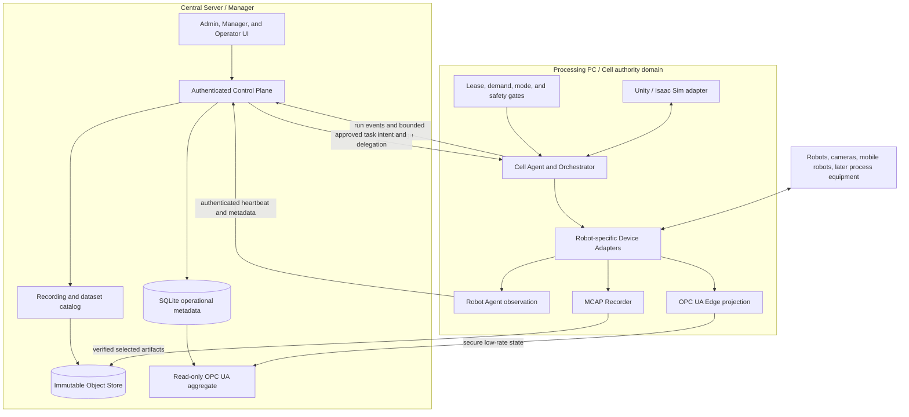

# SANG Master Implementation Plan

- Date: 2026-09-10
- Status: **Canonical current roadmap**
- Scope: Central Manager, Processing PCs, robot/camera observation, recording, simulation,
  orchestration, OPC UA, learning data, XR, and future AAS/process equipment
- First robot families: dual SO-101, ROBOTIS OMY, Rainbow Robotics RB5-850E

## 1. Document authority

This is the only document that decides **current implementation status, next priority, and deferred
scope**. Detailed contracts and dated evidence remain in their original files; they are not copied
here as competing roadmaps. The complete classification is in
[`docs/DOCUMENT_AUTHORITY_INDEX.md`](docs/DOCUMENT_AUTHORITY_INDEX.md).

Precedence is responsibility-specific:

1. Machine-readable schemas, signed manifests, database constraints, and passing tests define exact
   wire and persistence behavior.
2. [`docs/requirements.md`](docs/requirements.md) defines mandatory product and safety boundaries.
3. This plan defines current status, implementation order, and completion gates.
4. Subsystem design documents define implementation detail within that scope.
5. Runbooks define operations for a specific release.
6. Dated evidence proves only the named build, topology, and test interval.
7. Root `PLAN_*.md` files other than this one are completed or superseded execution records.

The Korean product overview [`docs/SANG_PLATFORM_OVERVIEW_KO.md`](docs/SANG_PLATFORM_OVERVIEW_KO.md)
explains the shared intent and terminology. It is an onboarding snapshot, not a second roadmap.

No later summary may turn simulation success into physical commissioning, an internal contract into
standards conformance, or a dated lab result into a guarantee for a different topology.

## 2. Product outcome

SANG is a distributed lab robot operations and data platform, not a single robot dashboard. It must:

- register heterogeneous robots, cameras, mobile robots, tools, and later process equipment as stable
  assets without hard-coding each type into Central;
- let a Manager compose versioned Tasks and Workflows from approved assets and Actions;
- run sequencing and recovery locally on the relevant Processing PC while Central retains intent,
  authorization, audit, and fleet-wide visibility;
- support sequential, parallel, conditional, compensating, and human-in-the-loop collaboration;
- collect synchronized robot, camera, EEF, process, decision, and provenance evidence for replay,
  LeRobot/VLA training, and digital twins;
- validate Tasks in output-disconnected Unity or Isaac Sim before any separate physical release; and
- expose low-rate industrial state through OPC UA and later durable asset semantics through AAS without
  replacing ROS 2, MCAP, the Object Store, or independent machine safety.

Example target workflows include OMY placing a plate for RB5 welding, dual SO-101 manipulation, and a
mobile carrier delivering material between robot steps. The core must remain robot- and scenario-neutral.

## 3. Non-negotiable boundaries

1. ROS 2 or a vendor SDK remains the local real-time observation and motion plane.
2. A Device Agent on a Processing PC is the only software component that may eventually own a vendor
   command handle. Central, browsers, OPC UA aggregation, AAS, and storage never own one.
3. Central sends approved task intent and bounded delegation, not raw joint, Cartesian servo, digital
   output, analog output, or welding targets.
4. Physical E-stop, protective stop, guard/interlock, and safety-rated control remain independent of
   ordinary ROS 2, HTTP, Wi-Fi, Unity, XR, OPC UA, and this application.
5. In the gated orchestration contract, `UNSAFE` or `UNKNOWN` blocks new software steps and places
   a Run in `HELD`; the deployed command-free Unity Shadow reporter only records evidence and must
   not be described as an automatic physical stop. A software hold is not a physical E-stop.
6. High-rate samples and media use ROS 2 at runtime and MCAP/Object Store for retention. OPC UA and
   SQLite carry bounded current state, metadata, references, and audit, not raw video or servo streams.
7. Simulation and physical assets always have different runtime identities. A twin relationship never
   grants command authority.
8. Published Tasks, Workflows, Skills, Actions, manifests, packages, and qualification records are
   immutable. A change creates a new version.
9. Existing read-only adapters remain read-only. Physical output stays disabled until the attended G7
   gate; welding and feeder outputs stay disabled until the separate G9 gate.

## 4. Target deployment architecture

The target OPC UA Edge boundary is one logical endpoint per **Cell Agent/control-authority domain**,
not automatically one endpoint per PC or one endpoint per robot. A Processing PC may host several
isolated Cell Agents. Separate the domains when controller ownership, safety, maintenance, or required
availability differs.

## 5. Identity and source-of-truth model

Keep these identities distinct:

- `processing_node_id`: physical or virtual compute host;
- `cell_agent_id`: local control-authority and failure-isolation domain;
- `agent_id`: deployed observation/runtime process identity;
- `asset_id`: stable Central identity for a physical or simulated asset;
- `motion_device_system_id`: future OPC UA Robotics system identity;
- `task_id@version`, `workflow_id@version`, `action_id@version`: immutable approved intent;
- `task_run_id`, `simulation_run_id`, `capture_job_id`, `recording_session_id`: runtime/evidence identity.

| Information | Authoritative location | Derived or projected form |
|---|---|---|
| Topic, unit, expected rate, source and adapter contract | Versioned manifest/config | Agent health and OPC UA mapping |
| Stable asset identity, assignment, relationship and approved capability | Central SQLite registry | UI, Task binding, OPC UA, future AAS |
| Users, service identities, reservations, Runs and audit | Central SQLite | Authenticated API/event stream |
| Current bounded health/observation | Local Agent, reconciled snapshot | Central latest state and OPC UA |
| Selected high-rate observations | Immutable MCAP | Web playback and derived datasets |
| Unity/URDF/model/calibration/build artifacts | Immutable Object Store | Asset package and qualification references |
| LeRobot datasets, thumbnails, video, embeddings | Immutable derived objects plus SQL provenance | Training/catalog/search views |
| Long-lived standardized asset semantics | Immutable imported AAS documents and Central asset links | Read-only IDTA JSON/AASX-JSON projection; writable Repository remains future work |

SQLite is not a high-rate historian. The Object Store is not a searchable registry. A vector database,
if added, stores derived embeddings and object references only. AAS does not duplicate live telemetry.

## 6. Verified implementation baseline

The status terms are strict:

- **ACCEPTED**: dated implementation and runtime/site evidence exists for the stated boundary.
- **SOFTWARE COMPLETE**: code and automated/disconnected tests pass, but site or physical evidence is
  still required.
- **IMPLEMENTED WITH DEBT**: usable implementation exists with listed correctness or deployment debt.
- **CONTRACT ONLY**: schemas/design exist without the corresponding runtime.
- **NOT IMPLEMENTED**: no completion claim is allowed.

| Area | Current status | What is actually available | Remaining boundary |
|---|---|---|---|
| Registry, Workcells, Tasks, Runs, RBAC and audit | ACCEPTED for Robot/Camera v1 | Revisioned assets/configuration, Task Run lifecycle, reservations, authenticated Admin/Operator access | Continue migrations and access review as features expand |
| Robot/camera observation | ACCEPTED for frozen RB5/D405/D455/OTOS site topology; other profiles are deployment-specific | SO-101, OMY, RB5 and Isaac-oriented manifests/adapters; freshness/rate/host health; fault isolation | Do not infer that every currently attached device is healthy or commissioned |
| Camera preview | ACCEPTED | Authenticated on-demand single-stream relay; no all-camera background fan-out | Scale testing for more simultaneous Managers remains demand-driven |
| MCAP capture and Central upload | ACCEPTED | Task Run-linked capture jobs, restart recovery, idempotency, SHA-256 upload, immutable catalog/Object Store | Hardware-triggered exposure synchronization is not proven |
| Web recording playback | ACCEPTED | Up to four selected compressed-image topics on one MCAP timeline with nearest-frame skew | Only supported indexed compressed-image profiles are playable |
| Time and synchronization | ACCEPTED for software clocks in the named RB5 run | Chrony lock, rate/gap/regression/skew probes and two-hour observation evidence | PTP/hardware exposure/controller synchronization remains unverified |
| LeRobot derivation | ACCEPTED, observation-only | Immutable LeRobot v3 derivative from quality-passed MCAP; state and cameras only | No action feature, training service, policy release, or inference path |
| SANG OPC UA Edge and Robotics projection | IMPLEMENTED WITH DEBT | Frozen custom v1 tree plus pinned Core/DI/IA/Robotics 1.02 read-only dual projection for validated profiles | SO-101, OMY and RB5 remain truthful `partial` profiles; no CTT/conformance claim or qualified physical profile |
| Central OPC UA aggregate | SOFTWARE COMPLETE | Deterministic read-only fleet/task/recording summary with removal reconciliation, unknown quality, explicit access levels and recurring audit | It remains a SANG fleet aggregate rather than an official Robotics fleet model |
| Generic orchestration G1-G6b workflow | SOFTWARE COMPLETE | G1-G6a runtime plus append-only, digest-bound G6b evidence submission, independent review and report workflow | No physical G6b evidence has been supplied; production build attestation and G7 physical commissioning remain absent |
| Workflow Studio | ACCEPTED for fixed output-disconnected Unity and Isaac profiles | Draft/version/clone/publish, immutable Workflow, explicit adapter selection, queue and lifecycle progress | No arbitrary remote runtime or physical execution binding |
| Action Library | IMPLEMENTED WITH DEBT; authoring fixture accepted | One C#/Python source per Action, static Source Gate, definition/step-based Simulation Gate, immutable publish | Historical Run profile digest is not compared in this publication gate; registered definitions are not installed-build attestation (ACT-C01) |
| Unity Scenario 1 | ACCEPTED as simulation evidence | All five steps run from SANG UI/Worker; Hold/Resume/Abort/Reset; standalone output-disconnected Player | Not safety-rated and not physical commissioning |
| Isaac execution / Unity observation | ACCEPTED for the fixed RB5 pilot and five-stage Scenario 1 fixture | Isaac is sole virtual device authority; isolated ROS feedback and passive Unity build; two same-session Web Runs and Reset PASS | One-host trial, kinematic carrier/grasp, OMY base visual defect, extended-cycle drift, signed reuse and MCAP integration remain open |
| Dynamic Unity/AAS asset package | IMPLEMENTED WITH DEBT | Actual Scenario 1 nine-asset inventory, compiled Player, pinned package/Action dispatch, and IDTA 3.1.2 JSON/AASX-JSON read-only validation/projection | Repeat-motion qualification, signed/Object-Store release registration, second-scene reuse, A4 recording parity, XML-only AASX and optional AAS Repository remain open |
| XR | DEVELOPMENT PROTOTYPE | Galaxy XR parsing, preview, retargeting, freshness/deadman/focus/network latches | No commissioned physical actuator path; no safety credit |
| SANG-managed physical orchestration | NOT IMPLEMENTED/NOT AUTHORIZED | Disconnected mock/HIL only; a separate attended manufacturer-tool launcher exists under deploy/rb5_official_control | Manufacturer-tool operation is not SANG G7 commissioning; requires G6b and attended G7 per robot/capability |
| Welding and wire feeder control | NOT IMPLEMENTED/NOT AUTHORIZED | Hardware intent is documented only | Requires independent G9 electrical, I/O, fail-off and site acceptance |

Primary evidence is linked from [`docs/DOCUMENT_AUTHORITY_INDEX.md`](docs/DOCUMENT_AUTHORITY_INDEX.md).

## 7. Corrections incorporated by this plan

The following earlier statements are retired:

1. Central OPC UA is no longer "Client only". A custom read-only aggregate server exists, and its
   stale-node, unknown-quality and explicit-access correctness defects are closed.
2. G1-G6a and the non-authorizing G6b evidence workflow are implemented. Actual G6b lab evidence,
   G7, G8 physical coordination, and G9 process output remain open.
3. SANG OPC UA v1 is not an OPC UA Robotics 1.02 implementation. Similar joint names and read-only
   values do not satisfy the mandatory MotionDeviceSystem, controller, axis, power-train, safety,
   identification, type, unit, and range model.
4. OPC UA Robotics 1.02 does define `SystemOperation` and optional `TaskControl` operations. SANG keeps
   zero Methods now by product/safety decision, not because the standard lacks them.
5. D405, D455, OTOS and raw MJPEG sources are cameras, not complete OPC UA Machine Vision systems.
   Machine Vision applies only after SANG has a qualified processing system with modes, jobs/recipes,
   results, events, and lifecycle.
6. A0 remains the internal asset contract, while Central now validates pinned IDTA 3.1.2 JSON and
   JSON-bearing AASX as a one-way read-only projection. This is not a writable AAS Repository, does
   not execute AAS Operations, and does not yet accept XML-only AASX packages.
7. Simulation approval creates evidence or a non-actuating commissioning candidate only. It never
   authorizes physical motion.

## 8. Known defects and hardening debt

| ID | Priority | Issue | Required correction |
|---|---|---|---|
| OPC-C01 | CLOSED | Central aggregate previously retained removed entities | Full desired-state reconciliation and removal tests now pass |
| OPC-C02 | CLOSED | Missing values previously risked appearing as Good/false | Unknown/null values now carry non-Good quality and are tested |
| OPC-C03 | CLOSED | Read-only audit previously ran only at startup | Recurring post-refresh audit and atomic report now pass |
| OPC-C04 | CLOSED | Read-only behavior previously relied partly on defaults | Application Variables now receive and retain explicit read-only access levels |
| OPC-S01 | P1 | Numeric mapping `valid_range` is validation metadata only | In the official projection, use the required data types, EngineeringUnits and `EURange` where defined |
| OPC-S02 | CLOSED | Host/runtime/robot identities were overloaded | Versioned Processing Node, Cell Agent, Agent, Asset and MotionDeviceSystem identities are distinct |
| OPC-S03 | CLOSED | Official NodeSets and a machine-readable Robotics matrix were absent | Robotics 1.02 release NodeSets, dependency lock and per-profile support/evidence matrix are pinned |
| DEP-C01 | P1 | Concurrent Central processes can race while applying schema migrations | Serialize migration ownership before unattended multi-service startup |
| SIM-C01 | P1 | Unity Supervisor is not boot-persistent | Install a scoped service with restart/reconciliation and output-isolation checks |
| BUILD-C01 | P1 | New Action source cannot yet move through a trusted automatic build/install/attestation pipeline | Build a Build Owner pipeline outside Central; preserve exact source/build hashes and signed role artifacts |
| ACT-C01 | P1 | Action Library publication checks registered definitions and completed steps but does not compare the historical Run profile digest with the current adapter profile | Bind publication evidence to exact current source/build/profile attestation; do not market the current gate as verified installed-build proof |
| SAFE-C01 | BLOCKING G7 | Stop time/distance, hardwired safety-chain behavior, cell calibration and named approvals are unverified | Complete attended G6b evidence; software tests cannot waive it |
| DATA-C01 | DEFERRED | Software timestamp alignment does not prove hardware exposure synchronization | Add trigger/PTP-capable hardware and calibration only when the task requires that guarantee |

OPC-C01 through OPC-C04, identity/profile v2, the official read-only Robotics projection, AAS import,
Unity inventory, and the G6b evidence workflow are now implemented. The next standards task is a
truthful physical robot profile and OPC UA conformance evidence, not adding command Methods.

## 9. Ordered implementation roadmap

### Wave 0 - Documentation authority and correction

Status: **COMPLETE.**

- Publish this master plan and the document authority index.
- Mark mixed-era plans as historical and repair contradictory status headers.
- Keep dated evidence immutable.
- Verify local links, headings, and conflict phrases.

Exit gate: there is one roadmap authority; no core document claims that Central is Client-only, that
G1-G6a are wholly unimplemented, that raw cameras are Machine Vision systems, or that A0 is actual AAS.

### Wave 1 - Current OPC UA correctness

Status: **SOFTWARE COMPLETE.**

- Fix OPC-C01 through OPC-C04 with focused lifecycle, null-quality, access-level, and post-refresh
  conformance tests.
- Preserve zero writable application Variables and zero application Methods.
- Prove stopping/restarting the aggregate does not affect Central HTTP, Agents, adapters, or capture.
- Add a bounded report that distinguishes source timestamp, Central receive time, and quality.

Exit gate: stale nodes cannot survive reconciliation, unknown is never represented as Good/false, every
application Variable is explicitly read-only, and the full existing regression remains green.

### Wave 2 - Identity and manifest contract v2

Status: **SOFTWARE COMPLETE.**

- Separate Processing Node, Cell Agent, runtime Agent, Asset, and MotionDeviceSystem identity.
- Freeze one logical Edge endpoint per Cell Agent/control-authority domain and document split criteria.
- Add `robotics_profile = unsupported|partial|base_candidate|validated` with evidence references.
- Add a machine-readable mapping matrix: mandatory/optional node, source selector, type, unit, range,
  quality, rate, profile support, and provenance.
- Freeze stable SANG v1-to-v2 identity mapping and migration tests.
- Keep cameras as related assets rather than forcing them into a robot axis hierarchy.

Exit gate: SO-101, OMY and RB5 fixtures validate without placeholder mandatory data, identity collisions,
or real/simulation ambiguity. No profile marked `partial` is advertised as conformant.

### Wave 3 - Official OPC UA Robotics dual projection

Status: **IMPLEMENTED WITH DEBT for the reference fixture; physical robot profiles remain partial.**
The typed read-only fixture exists, but per-axis EngineeringUnits/EURange population and two
independent-client evidence are not complete. The following bullets include open exit criteria;
the full conformance gate is not closed. Core is pinned for provenance and provided by asyncua's
built-in address space; DI, IA and Robotics are the explicit runtime imports.

- Pin and package OPC UA Core, DI, IA and Robotics NodeSets with deterministic import order.
- Keep `urn:sang:fleet:model:1` and its NodeIds unchanged as the compatibility tree.
- Add official `DeviceSet -> MotionDeviceSystem -> MotionDevices/Controllers/SafetyStates` instances
  only for profiles with truthful mandatory values.
- Add `MotionDevice -> Axes/PowerTrains`, typed `ActualPosition`, units and `EURange` as required.
- Drive the SANG and official trees from one validated sample/quality decision.
- Add a typed Central Fleet Operations model and preserve full Edge provenance for shadows.
- Validate with at least two independent OPC UA clients. Use OPC Foundation CTT only when claiming an
  actual supported conformance profile.

Exit gate: one selected robot reaches the declared profile with no copied official NodeIds, no fake
mandatory data, no v1 client regression, and no added control Method.

### Wave 4 - Dynamic Unity asset integration and build provenance

Status: **A0 and AAS read-only foundation complete; bounded A1/A2 runtime implemented;
A3/A4 and release qualification remain open.** Dated scope and runtime evidence:
[`docs/UNITY_DYNAMIC_BINDING_A1_A2_2026-09-09.md`](docs/UNITY_DYNAMIC_BINDING_A1_A2_2026-09-09.md).

- A1: inventory the existing Scenario 1 scene/Player and add stable bindings without behavior change.
- A2: resolve Task-selected packages, roles and published Actions through a dynamic simulation adapter.
- A3: extract reusable OMY, RB5, carrier and camera packages and compose them into a second scene.
- A4: publish ROS 2 joint/TF/camera/diagnostic/action evidence and record qualified MCAP parity.
- Automate the trusted Build Owner source install, role-specific build, artifact scan, signature and
  registration path. Central continues to store intent and evidence but never compiles untrusted code.
- Make the Unity Supervisor boot-persistent and serialize Central migration ownership.

The current A2 implementation binds one trusted, prebuilt scene and accepts linear,
exclusive-role workflows. Ambiguous assets, unsupported parallel workflows and mismatched
source/package/scene hashes are rejected. It does not load arbitrary uploaded code or a
second scene. Actual Reset inventory is stable; repeated OMY motion after Reset has an
independent IK-limit regression that must be resolved without weakening its guard.

Exit gate: the same immutable Workflow runs in two qualified scenes from package/binding contracts,
with exact hashes and `physical_output_connected=false`, without scenario-specific Central code.

2026-09-09 isolated pilot: a separate Isaac RB5 executor now runs a fixed two-step
Task from Workflow Studio; ROS 2 measured joints and one RGB camera feed a separate
Unity observer. Isaac is the only physics/motion authority. This is not the A3
same-Workflow/two-scene gate or full A4 recording parity. Evidence and launch/reset
limits: [`docs/ISAAC_UNITY_TWIN_PILOT_2026-09-09.md`](docs/ISAAC_UNITY_TWIN_PILOT_2026-09-09.md).

The subsequent fixed Scenario 1 adapter extends this topology to OMY, RB5,
carrier and plate. Original world targets/recordings are bounded and retargeted
to the composed vendor models; measured TCP/joints and object ownership gate the
five stages. Carrier and grasp are explicit kinematic fixtures, with finger/table
proxy contacts excluded. It does not close physical grasp/collision qualification
or the legacy Unity IK repeatability defect. See
[`docs/ISAAC_SCENARIO1_EXECUTION_2026-09-09.md`](docs/ISAAC_SCENARIO1_EXECUTION_2026-09-09.md).

### Wave 5 - Physical readiness and one-asset commissioning

Status: **Evidence workflow software complete; BLOCKED on lab-owned G6b evidence and never automatic.**

- Measure stop time and distance per robot, payload, tool, speed and pose envelope.
- Witness cancellation, lease expiry, network loss, controller restart, protective stop and independent
  E-stop behavior.
- Approve cell frame, calibration method, tolerance, workspace and revalidation interval.
- Name Edge Operator, Manager and Safety Officer accounts and custody of release/signing keys.
- Commission one low-energy, bounded capability on one robot with no process output.
- Only the attended G7 release may create the first manifest with `command_sink_present=true`.

Exit gate: dated, signed G6b/G7 evidence and rollback procedure exist. Simulation evidence alone is
insufficient.

### Wave 6 - Coordinated physical workflows and process equipment

Status: **FUTURE.**

- G8: commission OMY/RB5/SO-101 or mobile-robot collaboration with transitive reservations, barriers,
  shared-zone rules, cancellation propagation and synchronized recording.
- Verify sequential and parallel workflows, local autonomy during bounded Central loss, and fail-closed
  recovery without duplicate action.
- G9: add CK WF-5 and Miller Dynasty 400 only after a separate electrical/I/O map, safety review,
  fail-off proof, interlock design and site acceptance. RB5 control-box I/O is not enabled by asset
  registration alone.

Exit gate: physical multi-robot tests are attended and measured; process-output tests have independent
authorization and cannot reuse G7 robot-motion approval.

### Wave 7 - Learning and policy lifecycle

Status: **OBSERVATION DERIVATION EXISTS; training/control is future.**

- Preserve MCAP as the immutable source and add deterministic action/EEF/process alignment only from
  authoritative sources.
- Version dataset recipes, calibration, schema, task labels, train/validation splits and provenance.
- Add training job/catalog integration, model evaluation, policy registry and signed release stages.
- Evaluate policies in replay/simulation first, then disconnected HIL, and only then through the same
  commissioned local lease/safety/Device Agent path as programmed Actions.
- Never give a VLA policy a separate actuator bypass.

Exit gate: every model result is reproducible from immutable source references, and policy execution
cannot bypass the ordinary authority and safety gates.

### Wave 8 - Industrial semantic extensions

Status: **READ-ONLY AAS FOUNDATION COMPLETE; remaining extensions are demand-driven.**

- AAS: IDTA 3.1.2 JSON is pinned and accepted as a one-way immutable projection linked to SQL Assets
  and Object Store artifacts. Add supplied Submodel templates, XML-only AASX, generated shells, or an
  AAS Repository only when their actual files and consumers are known.
- Machine Vision: implement only for a complete ZED/Vision AI processing system with jobs, recipes,
  results, events and lifecycle. Raw camera streams remain outside OPC UA.
- OPC UA Methods: only after G7 and an external PLC/MES requirement, expose selected official high-level
  operations at the logical commissioned Edge through the same local arbiter. Central remains Method-free.
- Native RB5 OPC UA: require the vendor NodeSet, NodeId/security/update-rate/licensing contract before use.
- XR: commission intervention only through freshness, focus, tracking, network, deadman, lease and local
  operator gates. XR never receives safety credit by itself.

Exit gate: each extension has a real consumer, pinned standard/version, ownership rule, threat model,
and independent conformance/commissioning evidence.

## 10. Parallelism and dependency rules

- Wave 1 must finish before any official OPC UA expansion.
- Wave 2 identity must finish before v2 OPC UA NodeIds or Dynamic Unity package identities are published.
- Wave 3 OPC UA and Wave 4 Unity work may proceed in parallel after Wave 2.
- Wave 5 cannot be parallelized away with simulation; its evidence is physical and attended.
- Wave 7 dataset tooling may advance without actuation, but policy execution waits for Wave 5.
- The Wave 8 read-only AAS projection foundation is complete; writable AAS, OPC UA Methods, Machine
  Vision and process equipment each need separate demand and approval.

## 11. Legacy phase crosswalk

Old phase names remain valid only inside their subsystem records:

| Legacy label | Consolidated meaning |
|---|---|
| Robot/Camera M1-M7 | Accepted observation, capture, storage, UI, backup and site-soak release |
| OPC UA Phase 0-5 | Custom SANG model/Edge/shadow/security/multi-edge/aggregate history; not official Robotics conformance |
| G0 | Generic orchestration contract freeze |
| G1-G6a | Software/disconnected orchestration runtime complete |
| G6b/G7/G8/G9 | Lab safety evidence, first robot, coordinated robots, and process output respectively |
| Workflow/Simulation v1 | Output-disconnected authoring, execution, lifecycle and promotion evidence |
| A0-A6 | Internal contract, scene binding, dynamic adapter, reusable packages, ROS parity, AAS, then separate physical release |

Do not infer ordering between unrelated labels merely because both use the word `Phase` or the same
number.

## 12. Decisions still required from the lab

No new user decision is required to implement Wave 1. Later gates require:

1. Cell Agent/control-authority boundaries when multiple robots share one Processing PC.
2. Complete manufacturer/integrator nameplate, controller, safety and power-train data for each OPC UA
   Robotics candidate.
3. G6b measured stop behavior, calibrated cell frame/workspace, named users and safety approval.
4. Exact Unity source repository/build-owner/signing-key custody for production attestations.
5. The first physical robot/capability and its low-energy envelope for G7.
6. The first complete vision-processing workload that warrants Machine Vision.
7. Exact IDTA release and required Submodel Templates before AAS A5.
8. RB5 vendor OPC UA documentation if native endpoint integration is desired.
9. Separate electrical and safety design before CK WF-5 or Miller Dynasty 400 integration.

## 13. Definition of done

A roadmap item is complete only when:

- exact scope and explicit non-goals are documented;
- machine-readable contracts and migrations are versioned and backward compatibility is tested;
- focused tests and the relevant full regression pass;
- distributed, restart, stale-data, idempotency and negative authorization paths are exercised;
- physical/simulation identity and output-isolation evidence are explicit;
- security, timestamp, provenance and artifact integrity are preserved;
- a dated evidence record names the build, topology, inputs, duration and limitations; and
- documentation status is updated here without rewriting historical evidence.

For physical motion or process I/O, automated tests are necessary but never sufficient. The attended
gate and named approvals are part of the feature, not post-release paperwork.

## 14. Immediate next sprint

The current user priority is Isaac as a virtual physical device, with Unity as its
digital-twin observer. The bounded RB5 loop and fixed Scenario 1 fixture are
implemented. Continue in this order, preserving earlier debts:

1. Repair Scenario 1 vendor visual correspondence (OMY base and RB5 TCP reference)
   and qualify extended-cycle fixture drift, then replace kinematic grasp/carrier fixtures and proxy collision geometry
   with measured, qualified dynamics before claiming virtual-physical equivalence.
   Keep source frames, one authority, isolated sessions and explicit Reset rebind.
2. Treat legacy Unity OMY repeated-motion IK as a separate regression: the Isaac
   recorded-path executor avoids it but does not repair that original solver.
3. Register trusted source/build artifacts and signatures through the existing package/Object Store
   path; automate Supervisor startup and pin the same adapter digest across all services.
4. Complete A3 second-scene package reuse and A4 ROS 2 observation/MCAP provenance
   parity. The pilot's JPEG snapshot and joint mirroring do not complete recording/catalog integration.
5. Separately repair the SO-101 read-only deployment after an approved endpoint/PKI migration.
   The old address is absent and CRLs are expired; do not bypass certificate validation.

Waves 1-3 software and G6b evidence tooling are not replaced by a new stack. AAS user content,
physical commissioning and process I/O remain independent gates, not automatic follow-ons.
