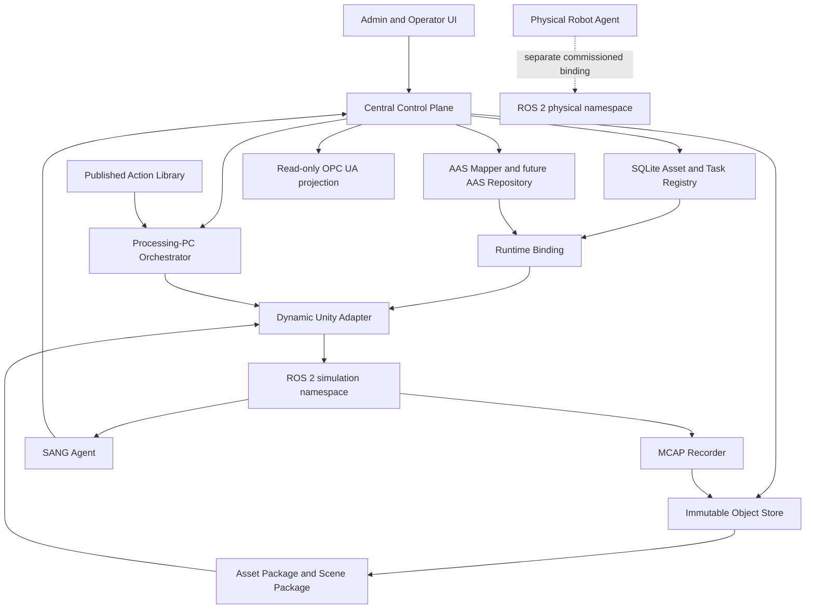

# SANG AAS Asset Package and Dynamic Unity Adapter Design

Status: A0/read-only AAS foundation and bounded A1/A2 runtime implemented; reusable release,
repeat-motion qualification, second-scene composition and A4 parity remain open

Roadmap authority: current status and implementation order are maintained in
[`../SANG_MASTER_IMPLEMENTATION_PLAN.md`](../SANG_MASTER_IMPLEMENTATION_PLAN.md). This document is the
detailed target design for representing robots, cameras, end effectors, and other
lab equipment as durable assets, attaching Unity and URDF artifacts to those assets, and loading the
result through a dynamic Unity adapter. It consolidates the asset, database, object storage, ROS 2,
OPC UA, workflow, simulation, and Action Library decisions already recorded in this repository.

The first implementation targets disconnected Unity simulation. Physical command enablement remains
a separate commissioning and safety release.

Implementation checkpoint: the command-free asset models and deterministic JSON Schemas are under
`src/fleet_control_plane/fleet_control_plane/asset_models.py` and `contracts/assets/`. The
`Sang.Observer` package emits stable scene inventory, while Central validates pinned IDTA 3.1.2 JSON
or JSON-bearing AASX and stores a one-way read-only projection through `aas_projection.py`. It does
not deploy a writable AAS Repository, execute AAS Operations, load a Unity scene dynamically, or add
a physical command path.

Standards boundary: A0 remains internal AAS-ready metadata. The additive import path pins the official
IDTA 3.1.2 JSON Schema and accepts only a complete JSON Environment, including JSON-bearing AASX. It
is not an AAS API or conformant Repository, does not yet accept XML-only AASX, and never turns an AAS
`Operation` into an execution route. Legacy OPC UA/AAS mapping remains reference material rather than
the canonical basis.

## 한국어 기준 요약

이 설계에서 AAS는 로봇을 직접 움직이거나 실시간 데이터를 저장하는 DB가 아니다. AAS는 로봇,
카메라, 툴을 일관된 자산으로 식별하고 자산의 기능, 관계, 문서와 모델 파일을 표준 의미로 연결하는
계층이다. 기존 SQLite Asset Registry가 운영 identity와 배정의 원장으로 남고, Unity/URDF와 같은 큰
파일은 Object Store에 불변 객체로 저장한다. AAS는 이 원장과 파일을 표준 형태로 연결하거나 향후 AAS
Repository에 투영한다.

Unity에서는 Scene Binding Manifest가 AAS/SANG 자산 ID를 실제 GameObject, ArticulationBody, 관절,
Controller, 좌표계, 카메라, 충돌체, Reset과 성공/실패 신호에 연결한다. Dynamic Unity Adapter는 Task에
선택된 자산과 동작의 정확한 버전 및 SHA-256을 검증하고 Scene에 bind하거나 prefab을 생성한 뒤,
등록되고 시뮬레이션 검증을 통과한 동작만 실행한다.

실시간 통신은 기존 설계대로 ROS 2가 담당한다. 관절값, TF, 영상, CameraInfo, 진단, 동작 feedback과
simulation clock은 ROS 2로 전달하고, 필요한 구간만 MCAP으로 기록해 Object Store에 보존한다. OPC UA는
관리 계층에서 제한된 상태와 산업 의미를 제공하고, AAS는 자산 의미와 관계를 제공한다. 두 계층 모두
고주파 로봇 제어나 원본 영상 전달을 대신하지 않는다.

실물 자산과 시뮬레이션 자산은 항상 서로 다른 identity와 ConnectionProfile을 가지며 twin 관계로만
연결한다. 따라서 Unity 검증 통과가 실물 명령을 자동 승인하지 않으며, 실물 적용은 별도의 commissioning,
lease/deadman, 취소/정지, 안전 및 현장 검증 Gate를 반드시 거친다.

## 1. Decision Summary

The target architecture is:

1. AAS gives each asset a stable semantic identity and describes what the asset is, what it can do,
   and which technical documents and runtime contracts belong to it.
2. Unity scenes, Unity prefabs, URDF/Xacro, meshes, materials, calibration files, and controller
   binaries are immutable artifacts in the Central Object Store. Large files are not embedded in
   SQLite or in an AAS Submodel.
3. SQLite stores searchable identity, revision, relationship, artifact-reference, qualification,
   and runtime-binding metadata. It is not a high-rate historian and does not store video payloads.
4. A Scene Binding Manifest maps an AAS/SANG asset identity to a Unity object, articulation root,
   controller, frames, sensors, reset behavior, and completion signals.
5. The Dynamic Unity Adapter resolves a Task's role bindings, verifies exact artifact versions and
   hashes, loads or binds the assets, exposes the registered actions, and reports deterministic
   execution evidence.
6. ROS 2 remains the local high-rate observation and execution plane. AAS does not replace ROS 2.
7. OPC UA remains a bounded northbound industrial status and semantic projection. It does not carry
   raw camera frames or become the robot servo bus.
8. A simulation asset and its physical twin always have different runtime identities. Their
   relationship is explicit; a simulation endpoint can never silently fall back to a physical one.

This design supports the user's intended flow: create consistent AAS assets, attach versioned
Unity/URDF representations to each asset, compose those assets into a Task, and execute registered
actions through a dynamic Unity adapter using the same ROS 2 observation contract used by the rest
of SANG.

## 2. Important Terminology: "AAS DB"

The phrase "AAS DB" is useful informally, but it must not imply a second copy of all runtime data.
The SANG design separates four responsibilities:

| Responsibility | System of record | Examples |
|---|---|---|
| Operational identity and assignment | Central SQLite Asset Registry | `asset_id`, serial, type, Workcell, Task assignment, ConnectionProfile |
| Standard semantic model | AAS projection or future AAS Repository | global asset identity, nameplate, capabilities, document links, relationships |
| Immutable binary artifacts | Central Object Store | Unity package, prefab, scene, URDF, mesh, calibration, AASX export, controller build |
| High-rate observations and evidence | ROS 2 at runtime, MCAP/Object Store for selected recordings | joint states, TF, images, diagnostics, action feedback |

For the first AAS phase, SQLite remains authoritative and an AAS mapper produces a read-oriented AAS
projection. A future standards-compatible AAS Repository can persist and serve AAS shells and
Submodels, but it must not become an uncontrolled second source of truth.

If the AAS Repository later becomes writable, each Submodel must have one declared owner. For
example, Identity may remain Registry-owned while Maintenance may become AAS-owned. Bidirectional
field-level synchronization is forbidden unless conflict resolution, revisioning, and audit rules
are explicitly designed.

## 3. Current, Target, and Deferred Boundaries

### 3.1 CURRENT

- Stable robot/camera/agent identities, Workcells, Tasks, runs, assignments, reservations, health,
  recording catalog metadata, and audit records are held in Central SQLite.
- Robot and camera interface contracts are held in versioned manifests and adapter configuration.
- Selected high-rate observations are recorded to immutable MCAP and uploaded to Object Store.
- Unity Scenario 1 uses a fixed, output-disconnected scenario and registered fixed actions.
- Published workflows and actions are immutable. A change creates a new version.
- Action source is content-addressed outside SQLite. Central validates metadata but does not execute
  uploaded C# or Python source.
- ROS 2 and OPC UA already have distinct responsibilities: local high-rate exchange versus bounded
  northbound status projection.

### 3.2 TARGET

- Introduce a stable global AAS identity linked to each SANG `asset_id`.
- Register immutable Asset Packages containing or referencing Unity and URDF representations.
- Add Scene Binding Manifests so an adapter can discover robot roots, joints, controllers, cameras,
  collision geometry, workspaces, reset behavior, and outcome signals without scenario-specific
  hard-coding.
- Load Task-selected assets and actions through a Dynamic Unity Adapter on a Processing PC.
- Publish simulation joint state, TF, camera, diagnostics, and action evidence through ROS 2 using
  the existing SANG timing and provenance contracts.
- Qualify exact combinations of scene, package, action digest, adapter build, and workflow before
  they can be published as simulation-approved evidence.

### 3.3 DEFERRED

- Final AAS Submodel content supplied by the lab and vendors.
- Choice and deployment of a standards-compatible AAS Repository product.
- Automatic arbitrary URDF-to-production-Unity conversion in Central.
- Physical robot command release, welding equipment control, and safety-rated stop behavior.
- Writable OPC UA Methods or use of AAS as a control channel.
- Certified collision/safety validation based only on Unity metadata.

## 4. Layered Architecture



The Central Control Plane selects intent and immutable versions. The Processing PC owns local
execution, timing, adapter health, and ROS 2 communication. The Central process never imports a Unity
package, runs an uploaded script, writes a raw joint topic, or opens a vendor robot handle.

## 5. Stable Identity and Twin Relationships

### 5.1 Identity levels

The following identifiers have different meanings and must not be collapsed:

| Identifier | Meaning | Mutability |
|---|---|---|
| `global_asset_id` | Globally stable AAS asset identity | Stable for asset life |
| `aas_id` | Identifier of the Asset Administration Shell | Stable; versioned references |
| `asset_id` | Stable SANG operational identity | Stable for asset life |
| `manifest_id@version` | Immutable technical interface contract | New version on change |
| `asset_package_id@version` | Immutable collection of model artifacts | New version on change |
| `scene_id@version` | Immutable Unity scene composition | New version on change |
| `connection_profile_id@revision` | Site/runtime endpoint binding | Mutable through audited revision |
| `runtime_binding_id` | Exact selection frozen for one Run | Immutable per Run |

An IP address, ROS domain ID, namespace, USB path, Unity hierarchy path, and Processing PC hostname
are not asset identity. They belong to revisioned connection or scene bindings.

### 5.2 Physical and simulation assets

A physical OMY and a simulated OMY are separate assets, for example:

```text
asset_id: omy_01
global_asset_id: urn:sang:asset:physical:omy:lab-serial

asset_id: omy_sim_01
global_asset_id: urn:sang:asset:simulation:omy:scenario1
relationship: isDigitalTwinOf -> urn:sang:asset:physical:omy:lab-serial
```

They may share a model profile and logical capabilities, but never share a live ConnectionProfile,
control lease, command sink, or runtime namespace. Real-to-sim and sim-to-real are explicit data and
qualification operations, not identity aliasing.

## 6. AAS Semantic Model

AAS describes durable meaning and links. It does not hold every live sample. The initial model keeps
Submodel slots stable while allowing detailed content to be supplied later.

### 6.1 Proposed Submodels

| Submodel | Purpose | Typical references |
|---|---|---|
| Identification and Nameplate | Manufacturer, model, serial, asset owner, lifecycle state | SANG Asset Registry identity |
| Technical Data | Axes, payload, reach, camera sensor type, supported units | Device Manifest and vendor documents |
| Capabilities and Skills | What the asset can observe or execute | `capability@version`, Action Library publications |
| Simulation Model | Unity, URDF/Xacro, USD, meshes, controller compatibility | Asset Package artifact references |
| Frames and Kinematics | Base/tool/camera frames, units, joint naming, kinematic chain | frame contract, URDF, calibration |
| Safety and Workspace | Informational limits, collision model, zones, stop profile references | approved policy and geometry artifacts |
| Calibration and Maintenance | Calibration versions, dates, equipment, maintenance records | immutable calibration artifacts and audit |
| Runtime Interfaces | ROS 2 semantic channels and supported execution modes | Device Manifest, not raw endpoint secrets |
| Data and Model Provenance | Dataset, policy, scene, action, and validation lineage | MCAP/object IDs, hashes, reports |
| Relationships | Twin, composed-of, mounted-on, observed-by, located-in | other global asset IDs |

Final standardized Submodel Templates and semantic IDs are intentionally deferred. The first schema
must not invent vendor facts that the lab has not supplied.

### 6.2 AAS data rules

- Store stable facts, capabilities, relationships, version references, and document links.
- Store live state only as a bounded status projection or endpoint reference.
- Do not store continuous joint arrays, images, video bytes, point clouds, or high-rate diagnostics.
- Do not store passwords, private keys, tokens, or vendor credentials.
- Every external artifact reference includes media type, size, SHA-256, version, and provenance.
- Changes to immutable technical meaning create a new referenced version; they do not rewrite old
  Run evidence.

## 7. Asset Package

An Asset Package is the immutable, executable model representation for one robot, camera, tool, or
other simulated asset. It is not the same as an AAS shell. The AAS shell points to the package.

### 7.1 Package contents

A package manifest should contain:

```yaml
schema_version: 1
asset_package_id: rb5-850e-unity
version: 1
compatible_asset_profile: rb5-850e
runtime: UNITY_6000_5_6F1
artifacts:
  - role: unity_prefab
    object_id: sha256:<digest>
    media_type: application/vnd.unity.prefab
    sha256: <64-hex-digest>
  - role: urdf
    object_id: sha256:<digest>
    media_type: application/xml
    sha256: <64-hex-digest>
  - role: collision_meshes
    object_id: sha256:<digest>
    media_type: application/vnd.sang.asset-bundle+tar
    sha256: <64-hex-digest>
dependencies:
  unity_editor: 6000.5.6f1
  ros_distribution: jazzy
  controller_contract: sang-unity-robot-controller@1
frames_contract_ref: rb5-850e-frames@1
device_manifest_ref: rb5-850e-sim-manifest@1
build_attestation_ref: build-attestation:<id>
```

This is an architectural example, not a committed JSON/YAML schema.

### 7.2 Supported artifact roles

- Unity prefab or addressable package
- Unity scene package for transitional full-scene assets
- URDF/Xacro and optional SRDF
- USD for Isaac Sim or vendor provenance
- visual and collision meshes
- materials and textures
- controller assembly or allowlisted runtime component
- home/reset profile
- frame and unit contract
- camera intrinsics and nominal extrinsics
- workspace and collision-zone geometry
- calibration artifact
- vendor documentation and licenses
- build attestation and validation report

### 7.3 Object storage rules

- Artifacts are content-addressed and immutable.
- Upload occurs to a temporary object, exact length and SHA-256 are verified, then publication is
  atomic.
- A package references object IDs; it does not contain arbitrary host filesystem paths.
- The same object may be referenced by multiple package versions without duplication.
- Deleting a package publication does not delete an object still referenced by evidence or another
  package.
- A Run freezes every artifact digest required to replay or audit it.

### 7.4 Current full-scene transition

The current Scenario 1 Unity project contains multiple robots and environment objects in one edited
scene. It does not need to be dismantled before this architecture can start.

1. Register the existing scene build as one immutable Scene Package.
2. Create bindings from OMY, RB5, carrier, cameras, and environment assets to stable objects in that
   scene.
3. Keep the current fixed scenario adapter as a compatibility adapter.
4. Qualify the Dynamic Unity Adapter against the same scene and actions.
5. Extract reusable per-asset prefabs only when a robot must be reused in another scene.

This avoids blocking progress while still converging on reusable asset packages.

## 8. Scene Binding Manifest

A Unity file alone cannot tell SANG which object is the OMY, which component controls it, or how Task
completion is detected. The Scene Binding Manifest provides that missing contract.

### 8.1 Required scene-level fields

- `scene_id` and immutable version
- Unity scene/build artifact reference and SHA-256
- exact Unity editor/player compatibility
- world frame, length unit, angle unit, handedness, and axis convention
- simulation clock source and fixed timestep
- required package versions
- environment and workspace geometry references
- output-isolation declaration
- build attestation reference

### 8.2 Required asset binding fields

- SANG `asset_id`, `global_asset_id`, and AAS reference
- expected robot/camera/tool profile
- stable Unity binding ID
- GameObject or prefab identity used only inside the qualified build
- articulation root and ordered joints
- controller component and supported controller contract version
- base, flange, tool, camera, and sensor frame mappings
- collider group and allowed workspace/zone references
- home pose and deterministic Reset contract
- health, ready, busy, success, failure, and fault signal bindings
- camera render target, intrinsic profile, and ROS 2 semantic channel bindings

Hierarchy paths are fragile. The preferred implementation gives every bindable Unity object a stable
`SangAssetBinding` component with a unique binding ID. A hierarchy path may be retained for diagnostics
but is not the primary identity.

### 8.3 Example binding

```yaml
scene_id: iitp-scenario1
version: 2
world:
  frame_id: cell_world
  length_unit: m
  angle_unit: rad
  fixed_timestep_s: 0.01
bindings:
  - asset_id: omy_sim_01
    global_asset_id: urn:sang:asset:simulation:omy:scenario1
    package_ref: omy-f3m-unity@1
    unity_binding_id: scenario1.omy.material-handler
    articulation_root: omy_articulation
    controller_contract: sang-unity-robot-controller@1
    frames:
      base: omy_base
      tool: omy_tool0
    reset_profile_ref: omy-scenario1-home@1
    outcome_contract_ref: omy-pick-place-result@1
```

This is illustrative and does not authorize a physical command.

## 9. Dynamic Unity Adapter

### 9.1 Responsibility

The adapter converts a frozen Task/Workflow intent into deterministic operations against qualified
Unity assets. It is responsible for simulation execution, not workflow ownership or physical robot
control.

It may:

- resolve registered package and scene versions;
- verify hashes, signatures, compatibility, and build attestation;
- discover and validate scene bindings;
- instantiate approved prefabs or bind transitional scene objects;
- expose semantic actions supported by each bound asset;
- translate local ROS 2 simulation messages to controller calls and state observations;
- implement deterministic Reset and report evidence;
- reject missing, ambiguous, stale, or incompatible bindings.

It may not:

- download and execute an arbitrary script requested by a browser;
- modify the Unity project or vendor asset source at runtime;
- infer a physical robot endpoint from a simulation asset;
- bypass Workflow publication, simulation qualification, reservation, or output-isolation gates;
- claim safety certification from Unity collision checks;
- own a production vendor robot handle.

### 9.2 Load lifecycle

1. Central publishes a Run intent with immutable Workflow and role requirements.
2. The Processing orchestrator resolves each role to a simulation Asset.
3. It creates a `RuntimeBindingV1` that freezes Asset, Device Manifest, ConnectionProfile,
   calibration, Asset Package, Scene, Action, policy, and adapter build versions.
4. The adapter fetches only allowlisted object IDs into a confined cache.
5. It verifies exact size, SHA-256, signature, runtime compatibility, and dependency closure.
6. It loads the qualified Scene Package and either binds existing objects or instantiates prefabs.
7. It validates every joint, frame, controller, collider, sensor, reset signal, and outcome signal.
8. It starts a simulation-only ROS 2 namespace/domain and announces readiness.
9. The orchestrator dispatches published actions in Workflow order.
10. The adapter reports action feedback/results, timestamps, reset evidence, and artifact provenance.
11. Terminal evidence is recorded; resources are released only after Reset/reconciliation.

### 9.3 Fail-closed behavior

| Failure | Required behavior |
|---|---|
| Artifact missing or SHA mismatch | Do not load; mark package invalid |
| Unity/build version mismatch | Do not start the Run |
| Duplicate or absent binding ID | Reject scene qualification |
| Joint order or frame mismatch | Reject asset readiness |
| Controller contract unsupported | Reject action dispatch |
| ROS 2 heartbeat or clock stale | Hold new steps and mark runtime degraded |
| Action digest differs from qualified digest | Reject execution |
| Reset does not reach the declared home state | Keep Run blocked; require reconciliation |
| Adapter restart during a Run | Recover from durable journal; never duplicate accepted action |
| Simulation endpoint unavailable | Fail the simulation; never fall back to a physical endpoint |

## 10. ROS 2 Runtime Contract

ROS 2 remains the normalized communication layer between simulation/robot adapters, local Agents,
recorders, and orchestration components.

### 10.1 Semantic channels

The Device Manifest declares semantic channels. The ConnectionProfile maps them to site/runtime
namespaces and endpoints. Suggested standard mappings are:

| Semantic channel | Typical ROS 2 contract |
|---|---|
| Joint state | `sensor_msgs/msg/JointState` |
| Robot transforms | `/tf`, `/tf_static` |
| Camera image | `sensor_msgs/msg/Image` or `CompressedImage` |
| Camera calibration | `sensor_msgs/msg/CameraInfo` |
| Health | `diagnostic_msgs/msg/DiagnosticArray` plus Agent heartbeat |
| Bounded trajectory execution | local `FollowJointTrajectory` behind the Agent |
| SANG high-level execution | `sang_control_msgs/action/ExecuteSkill@1` |
| Simulation time | `/clock` with `use_sim_time=true` |

The Admin Task UI never edits raw ROS topic names, vendor addresses, shell commands, or joint arrays.
Those remain Agent-owned manifest and ConnectionProfile data.

### 10.2 Command ownership

- Central sends signed, bounded execution intent to the Processing orchestrator.
- The local Agent resolves the intent to a qualified capability and adapter.
- The Dynamic Unity Adapter executes only in `SIMULATION` mode for its first release.
- A future physical Agent uses a separately commissioned implementation of the same logical action.
- High-rate servo loops remain in Unity simulation, `ros2_control`, or the vendor controller. They do
  not run over Central HTTP, Wi-Fi orchestration, OPC UA, or AAS.

### 10.3 Time and recording

- Simulation state uses Unity simulation time published through `/clock`.
- Each observation keeps a valid ROS source timestamp; Central receive time never replaces it.
- Wall-clock correlation and clock quality are recorded in Run metadata.
- MCAP records joint, TF, image, camera info, diagnostics, action feedback/result, and orchestration
  markers using one time contract.
- Qualification reports include rate, gap, timestamp regression, and nearest image-to-joint skew.

## 11. Action Library Integration

The Action Library defines reusable, versioned robot behavior. One registered C# or Python source
artifact represents one implementation of one logical action.

Example logical action:

```text
logical_action_id: pick-and-place-material
capability: simulate-pick-place@1
implementation A: Unity C# for OMY simulation
implementation B: ROS 2 Agent Python for a future commissioned physical OMY
```

The implementations may share intent and input schema but have different immutable source/build
digests and separate qualification evidence.

Rules:

- Central stores source artifacts but never executes them inside the API process.
- A trusted build worker produces the Unity controller/package or Agent artifact.
- Published actions are immutable.
- Inputs cannot exceed the bounds of the registered Skill schema.
- The Dynamic Unity Adapter executes only an installed action digest present in the exact simulation
  qualification record.
- A physical action requires a different commissioning approval even if simulation passed.
- Task cloning creates a new draft referencing existing immutable actions; it does not duplicate or
  rewrite source artifacts.

## 12. Camera and Sensor Assets

Cameras are first-class AAS/SANG assets, not anonymous topics attached only to a robot.

Each camera asset should link:

- manufacturer/model/serial identity when available;
- camera type and supported stream profiles;
- immutable intrinsic calibration versions;
- mounting relationship to a robot, tool, fixture, or cell;
- extrinsic calibration from camera frame to the common cell frame;
- Unity sensor prefab or render-camera binding;
- ROS 2 image, camera-info, depth, point-cloud, and health semantic channels;
- recording and preview profiles;
- calibration and provenance artifacts.

Live images remain in ROS 2 and selected MCAP recordings. AAS stores the camera's meaning and artifact
links, not frame bytes. A Task Runtime Binding freezes the exact calibration version used for every
recording and simulation result.

## 13. OPC UA Relationship

OPC UA and AAS are complementary:

- AAS describes durable identity, capabilities, documents, lifecycle, and relationships.
- OPC UA exposes bounded current state, health, selected measurements, Task/Run status, and alarms to
  industrial clients.
- ROS 2 carries local high-rate observations and bounded local execution.
- MCAP/Object Store preserves selected high-rate evidence.

An OPC UA node may expose an AAS/global asset reference, and an AAS Runtime Interfaces Submodel may
link to the OPC UA model. Neither mapping changes the source-of-truth table in this document. Camera
bytes, continuous point clouds, raw servo commands, control leases, and safety-rated E-stop functions
remain outside general OPC UA and AAS paths.

## 14. Persistence Design

### 14.1 Existing authoritative stores

The existing storage split remains valid:

| Store | Authoritative content |
|---|---|
| Versioned manifests | local interfaces, topics, units, frames, health thresholds, execution modes |
| Central SQLite | identities, revisions, assignments, Tasks/Runs, audit, latest snapshots, catalog metadata |
| Local MCAP | high-rate selected observations and execution evidence before upload |
| Central Object Store | immutable MCAP, media, model, package, report, calibration, and derived artifacts |
| Vector database, future | derived embeddings and pointers only |
| AAS layer, target | durable standards-oriented semantic projection and links |

### 14.2 Proposed SQLite additions

These are logical tables for a future migration, not current implemented schema:

| Table | Purpose |
|---|---|
| `asset_global_identities` | Map SANG `asset_id` to `global_asset_id`, `aas_id`, lifecycle revision |
| `aas_projection_revisions` | Track generated shell/Submodel revision, hash, repository URI, sync state |
| `artifact_objects` | Object ID, SHA-256, size, media type, immutable storage URI |
| `asset_packages` | Immutable package identity, version, compatibility, attestation |
| `asset_package_artifacts` | Ordered role-to-object references for each package version |
| `scene_definitions` | Immutable scene/build identity, world convention, output isolation |
| `scene_asset_bindings` | Scene version to stable asset binding/controller/frame/reset mappings |
| `calibration_revisions` | Intrinsic/extrinsic/tool/world calibration artifact references |
| `runtime_bindings` | Exact asset/manifest/profile/calibration/package/scene/action selection per Run |
| `build_attestations` | Builder, source digest, output digest, dependency lock, signing information |
| `simulation_qualifications` | Exact combination tested, report object, verdict, timestamps |
| `asset_relationships` | Twin, mounted-on, composed-of, observes, located-in relationships |

Mutable operational placement remains in ConnectionProfile and Workcell assignment revisions.
Package, scene, calibration, action publication, build attestation, and qualification versions are
immutable once referenced by a Run.

### 14.3 AAS Repository options

The repository may be introduced in either of two modes:

1. Projection mode, recommended first: Central generates AAS JSON/AASX from authoritative Registry,
   manifest, package, and catalog data. Generated documents are versioned artifacts and optionally
   served by an AAS Repository API.
2. Governed authoring mode, later: selected AAS Submodels are edited in the repository. Every
   Submodel has a declared owner and one-way synchronization rule.

Projection mode avoids dual-write conflicts and is sufficient to expose consistent assets to an AAS
client while the lab determines final Submodel content.

### 14.4 No payload duplication

- SQLite stores object references and checksums, not Unity binaries, video, or MCAP payloads.
- AAS stores semantic references, not duplicate model binaries or high-rate samples.
- Object Store stores immutable bytes but is not the semantic source of truth.
- A vector database stores embeddings and IDs derived from cataloged objects, never the only copy.
- A search index can be rebuilt from SQLite metadata and immutable objects.

## 15. Runtime Binding and Provenance

Every Simulation Run must freeze at least:

- Task Definition and Workflow publication version;
- role-to-asset assignments;
- physical or simulation runtime class;
- Asset Identity and AAS/global identity revisions;
- Device Manifest version;
- ConnectionProfile revision;
- Asset Package and Scene versions;
- calibration versions;
- Action publication and installed digest;
- adapter and orchestrator build digests;
- safety policy and validation profile versions;
- ROS domain/namespace and time-source declaration;
- output-isolation evidence;
- resulting MCAP, report, preview, and derived artifact IDs.

This allows a later investigator to answer exactly which robot model, Unity object, controller,
calibration, action, scene, and software build produced a result.

## 16. Safety and Security Boundaries

- AAS workspace limits and Unity collision geometry are descriptive engineering inputs, not a
  certified safety function.
- Unity `SAFE`, `UNSAFE`, or `UNKNOWN` evaluation may hold workflow progress but must not claim to be
  a physical E-stop.
- Physical E-stop, safety relay/PLC, vendor controller limits, and local safety logic remain
  independent and authoritative.
- Simulation packages cannot contain a physical ConnectionProfile or vendor credential.
- Artifact signatures and SHA-256 checks are verified before load.
- Central accepts no arbitrary filesystem path, process command, ROS topic, endpoint, or raw joint
  command from the browser.
- Source upload, trusted build, simulation qualification, publication, and physical commissioning are
  separate authorization steps.
- Secrets are references to a protected secret store and never appear in AAS, package manifests,
  SQLite audit payloads, or Unity scenes.

## 17. New Asset Onboarding

The reusable onboarding flow for OMY, RB5, SO-101, cameras, and future robots is:

1. Register the physical or simulation Asset and stable SANG `asset_id`.
2. Assign a global AAS identity and create the initial read-oriented shell projection.
3. Register a versioned Device Manifest containing frames, units, observations, capabilities, limits,
   execution modes, and fail behavior.
4. Upload Unity/URDF/USD/mesh/calibration/controller artifacts to Object Store.
5. Publish an immutable Asset Package referencing exact artifact digests.
6. Register or build a Scene Package and Scene Binding Manifest.
7. Validate identity uniqueness, dependencies, joint order, frames, units, colliders, cameras,
   controller contract, reset, and outcome signals.
8. Register one or more Action Library implementations and trusted build outputs.
9. Run output-disconnected simulation and store exact qualification evidence.
10. Publish the qualified action/package/scene versions for Workflow use.
11. Compose a Task using roles and capabilities, not host paths or raw topics.
12. Run and record through ROS 2/MCAP.
13. If physical use is later required, create a separate physical Runtime Binding and complete
    commissioning, safety, lease, cancellation, and site acceptance gates.

## 18. Initial Robot and Camera Mapping

### 18.1 OMY F3M

- Keep `omy_01` and `omy_sim_01` separate.
- Use the existing ROBOTIS-derived model/profile as technical provenance.
- Bind base/tool frames, ordered articulation joints, gripper/tool state, D405/D455 camera mounts,
  deterministic home/reset, and Scenario 1 outcome signals.
- First dynamic-adapter proof uses the current Scenario 1 scene and existing pick/place action.

### 18.2 RB5-850E

- Keep `rb5_850e_01` and `rb5_850e_sim_01` separate.
- Preserve Rainbow vendor model/URDF and `rbpodo_ros2` joint naming provenance.
- Bind six arm joints, base/flange/tool frames, workspace, D405 wrist camera, deterministic reset,
  and registered WAAM-path simulation action.
- Welding power and wire feeder remain separate future assets, not implicit properties of RB5.

### 18.3 Dual SO-101

- Represent left/right leader/follower arms as distinct assets or clearly versioned composite members.
- A composite `bi_so101` asset may describe coordinated capability while preserving each arm's serial,
  calibration, port binding, joint state, and failure status.
- Each of the five cameras remains an independently identifiable camera asset with mounting and
  calibration relationships.
- A future Unity package may use URDF-derived prefabs, but physical LeRobot and simulation action
  implementations remain separate.

### 18.4 Cameras

- D405, D455, OTOS, and future ZED X devices each receive stable Asset identity.
- A physical camera and a Unity render camera are different assets linked through a twin or
  represents relationship.
- Intrinsic and extrinsic calibration revisions are frozen per Run.
- Stream resolution/FPS is a capture profile or runtime observation, not immutable identity.

## 19. Implementation Phases

### Phase A0 - Contract freeze

- Approve this architecture and terminology.
- Define JSON Schemas for global identity reference, Asset Package, Scene Binding, and qualification.
- Add schema validation and examples without introducing a runtime AAS server.

Acceptance: existing Registry/manifest/ROS2/OPC UA contracts remain valid and no duplicate source of
truth is introduced.

Implementation status: complete. Four generated schemas, five examples, and fail-closed validation
tests are documented in `contracts/assets/README.md` and
`docs/AAS_ASSET_PACKAGE_A0_EVIDENCE_2026-08-31.md`. Phase A1 must use these contracts rather than
silently extending the existing orchestration v1 payloads.

### Phase A1 - Existing Scenario 1 packaging

- Register the current Unity Player/scene as an immutable Scene Package.
- Add stable Unity binding components for OMY, RB5, carrier, cameras, and relevant environment objects.
- Generate a binding report without changing current fixed behavior.

Acceptance: every required object, joint, frame, controller, reset signal, and outcome signal resolves
uniquely and the existing Scenario 1 still passes.

2026-09-09 checkpoint: nine stable bindings compile and resolve in the actual Player, with
source-backed package documents and a local scene archive. Reset inventory rebinds all nine
objects. This is not yet a signed, Central Object-Store-registered Scene Package. See
`UNITY_DYNAMIC_BINDING_A1_A2_2026-09-09.md` for run evidence and the separate OMY repeated-motion
IK-limit regression; inventory success alone does not close that motion qualification.

### Phase A2 - Dynamic simulation adapter

- Load/bind the A1 scene through package and binding contracts.
- Resolve Task roles and published actions dynamically.
- Use simulation-only ROS 2 namespace/time and keep physical output disconnected.

Acceptance: the same published Workflow completes with no scenario-specific object lookup in Central
and no physical command sink.

2026-09-09 checkpoint: schema-2 bridge dispatch resolves arbitrary role/step correlation names
through exact installed Action, controller and asset bindings. The trusted prebuilt scene is
selected by the local Supervisor; this is not a runtime scene downloader. Current scope is a
linear chain with one exclusive, uniquely matching asset per role. Ambiguous matching, source
mismatch, stale inventory and unsupported structures fail closed. The scene reports Unity's
simulation clock; ROS 2 namespace/observation/recording parity is the A4 gate, not claimed here.

### Phase A3 - Reusable per-asset packages

- Extract reusable OMY and RB5 prefabs where needed.
- Add camera sensor packages and calibration bindings.
- Support composition into a second test scene.

Acceptance: one asset package can be reused in two qualified scenes without changing its identity or
artifact bytes.

### Phase A4 - ROS 2 observation and recording parity

- Publish joint state, TF, cameras, camera info, diagnostics, action feedback/result, and `/clock`.
- Record a synchronized MCAP with full runtime binding provenance.

Acceptance: rate/gap/timestamp/skew checks pass and every recorded source resolves to an Asset,
calibration, package, and scene binding.

### Phase A5 - AAS projection and repository

- Pin exact current IDTA metamodel, API, serialization, AASX/package and selected Submodel Template
  revisions before creating persisted AAS identifiers or payloads.
- Define one-way ownership and revision mapping from SQLite/Object Store to every generated Submodel;
  do not infer bidirectional synchronization.
- Generate AAS shells/Submodels from Registry, manifests, packages, relationships, and catalog.
- Deploy a standards-compatible read-oriented AAS Repository if required.
- Add AAS ID links to OPC UA and UI asset detail views.

Acceptance: AAS export/repository content is reproducible from authoritative revisions, large payloads
remain external, and no live control path is introduced.

### Phase A6 - Physical commissioning, separate project gate

- Map qualified logical actions to commissioned physical Agent implementations.
- Complete local control, lease/deadman, cancellation, stop behavior, safety, calibration, and site
  acceptance requirements for each robot.

Acceptance: simulation approval alone can never authorize physical motion.

## 20. Acceptance Criteria for the Complete Target

- A new robot type can be added without editing Central application code.
- Every Task-selected robot/camera resolves through stable asset identity and immutable versions.
- Unity can bind or instantiate all required assets from qualified packages and a Scene Manifest.
- Missing or mismatched joints, frames, units, controllers, calibration, hashes, or reset signals fail
  before action execution.
- Workflow actions are selected by capability and immutable publication, not by arbitrary script path.
- ROS 2 carries simulation observations with coherent source timestamps and records them to MCAP.
- AAS exposes durable asset semantics and artifact relationships without storing high-rate payloads.
- OPC UA exposes bounded state without becoming a motion-control or media path.
- Simulation and physical assets, namespaces, credentials, leases, and command sinks remain isolated.
- Exact Run provenance supports replay, audit, and later sim-to-real comparison.

## 21. Decisions Still Required Later

The following do not block the architecture or A0-A2 work:

- exact standardized AAS Submodel Templates and semantic IDs;
- final AAS Repository implementation and deployment topology;
- vendor-supplied nameplate, maintenance, payload, tool, and safety content;
- package signing authority and production key custody;
- acceptable Unity/URDF conversion pipeline and supported Unity versions beyond 6000.5.6f1;
- frame/calibration tolerances and revalidation periods for physical commissioning;
- whether an asset is modeled as one composite shell or multiple member shells for dual-arm systems;
- retention, archival, and legal ownership rules for vendor model artifacts.

## 22. Traceability to Existing Design

This document preserves and specializes the following repository decisions:

- `ADMIN_MVP.md`: AAS is a later interoperability layer for robot, camera, EEF, calibration,
  capability, maintenance, dataset, and policy metadata, not a replacement runtime path.
- `PLAN_TASK_SCOPED_OPERATIONS.md`: stable Asset identity, mutable ConnectionProfile, source-of-truth
  split, AAS compatibility, ROS 2/OPC UA boundary.
- `PLAN_ROBOT_CAMERA_V1_COMPLETION.md` and `docs/requirements.md`: versioned manifest, SQLite,
  immutable MCAP/Object Store, vector-index, and future AAS authority split.
- `docs/ROBOT_CAMERA_OPERATIONS_V1.md`: SQLite/Object Store/MCAP/vector DB/AAS storage roles.
- `docs/MULTI_ROBOT_ORCHESTRATOR_IMPLEMENTATION_DESIGN.md`: AssetIdentity, DeviceManifest,
  ConnectionProfile, RuntimeBinding, Unity adapter ownership, time/provenance, safety gates.
- `PLAN_MULTI_ROBOT_ORCHESTRATOR_DESIGN.md`: heterogeneous robot coordination and Agent ownership.
- `PLAN_ISAAC_VENDOR_SIM.md`: immutable vendor model provenance, runtime overlay, isolated simulation
  domain, and disabled physical command bridge.
- `PLAN_UNITY_IITP_SCENARIO1_INTEGRATION.md`: separate simulation assets and output-disconnected Unity
  integration.
- `PLAN_SIMULATION_OPERATIONS_V1.md`: restart-safe simulation lifecycle and Reset evidence.
- `PLAN_SIMULATION_VALIDATION_AND_PROMOTION_V1.md`: immutable qualification profile/report and
  non-actuating promotion.
- `PLAN_SIMPLE_ROBOT_ACTION_LIBRARY_V1.md`: robot/action/script metadata and Central authoring boundary.
- `PLAN_ACTION_LIBRARY_AUTHORING_V1.md`: content-addressed source, trusted execution boundary, exact
  action-digest qualification, and immutable publication.
- `docs/WORKFLOW_STUDIO_V1_DESIGN.md` and `docs/PARAMETERIZED_SKILL_EDITOR_V1_DESIGN.md`: versioned
  Workflow/Skill composition and bounded parameter authoring.
- `contracts/orchestration/README.md`: current G0 schema boundary and immutable-per-Run binding rules.
- `contracts/orchestration/device-manifest-v1.schema.json`: current immutable technical contract. AAS
  and package fields must be introduced additively in a new schema version rather than silently
  changing v1 semantics.

If another document conflicts with this specialization, the original document remains authoritative
for its existing implemented release, while this document is authoritative for the future AAS Asset
Package and Dynamic Unity Adapter work.
