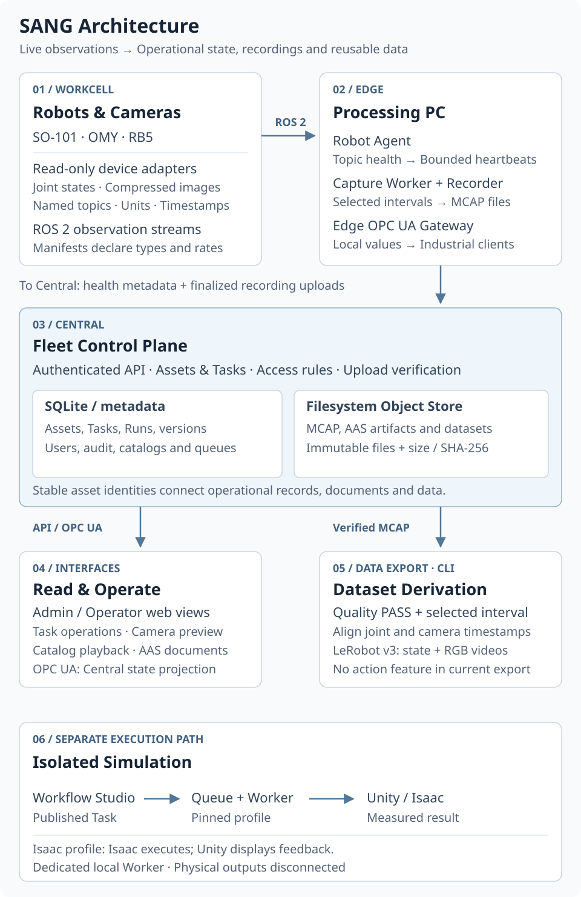
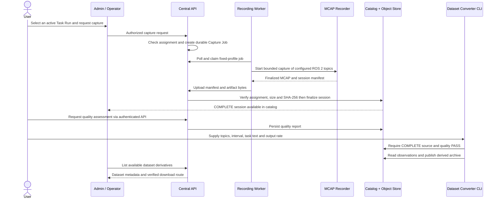
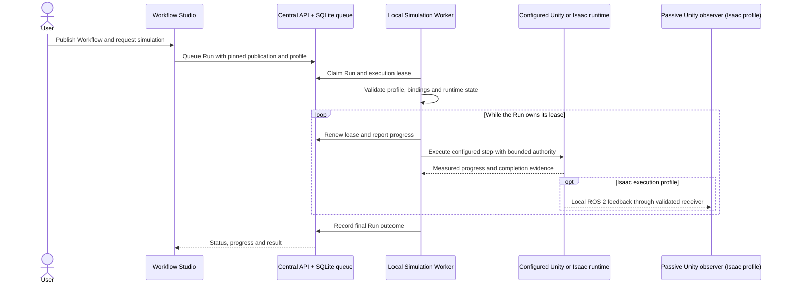

# SANG Architecture

SANG connects device observation, operational tasks, selected recording, data export and digital-twin
simulation. This guide explains how the implemented parts fit together. It describes the public
repository, not a particular live installation or a future deployment plan.

[Repository overview](../README.md) · [Installation and operations](ROBOT_CAMERA_OPERATIONS_V1.md) ·
[Requirements](requirements.md) · [Detailed commands (Korean)](USAGE.md)

## 1. Read the architecture by responsibility

An **Edge / Processing PC** sits near the devices and handles ROS 2 observations and capture.
**Central** owns the operational registry, access rules, catalogs and queues. A **Manager PC** is a
browser client of Central; it is not another name for the server. Several logical services can run on
one host. Remote observation uses configured authenticated links; the documented simulation worker
uses a dedicated local runtime, not an automatically provisioned remote execution cluster.

The arrows summarize information flow. In particular, the Edge OPC UA gateway serves its own
industrial clients. Central OPC UA builds a separate projection from Central's registry and catalog;
it does not need to relay the Edge OPC UA server.

## 2. Three paths through the system

| Path | Trigger | Processing | Result |
|---|---|---|---|
| **Live observation** | An adapter publishes a declared ROS 2 topic. | Robot Agent checks topic presence, type, freshness and rate; sends bounded heartbeats. | Fleet health and latest operational state. A selected camera can be previewed separately. |
| **Retained recording** | An authorized user requests a capture for an active Task Run. | A fixed-profile Edge worker records an interval, finalizes it and uploads verified artifacts. | A cataloged MCAP session, indexed camera playback, a quality report and optional derived data. |
| **Simulation execution** | A user queues a published Workflow against a configured simulation profile. | A separate local worker claims the Run, checks its profile and maintains execution authority. | Step progress and a Run outcome, including failure or interruption. |

Observation alone does not retain every frame. A heartbeat reports health and bounded metadata;
camera preview relays an explicitly selected stream; recording preserves a selected interval.
These paths share asset and Task Run identities, but carry different payloads.

## 3. Component responsibilities

| Component | Input | Responsibility and output | Implementation |
|---|---|---|---|
| Device adapters | Robot data channels, serial reads or camera streams | Publish joint and camera observations under a device-specific manifest. | [SO-101 adapter](../src/so101_readonly_adapter/), [RB5 adapter](../src/rb5_readonly_adapter/) |
| Robot Agent | Manifest and ROS 2 observations | Monitor stream health and send versioned heartbeats; expose bounded local status. | [Agent node](../src/robot_agent/robot_agent/node.py), [manifests](../manifests/) |
| Recording worker | Capture Job and fixed capture profile | Claim and validate a job, start the recorder, report progress, finalize and upload its artifacts. | [Worker](../src/fleet_control_plane/fleet_control_plane/recording_worker.py), [capture jobs](../src/fleet_control_plane/fleet_control_plane/capture_jobs.py) |
| MCAP Recorder | Allowlisted ROS 2 topics | Retain messages and timestamps; preserve compressed JPEG payloads without re-encoding. | [Recorder](../src/sang_mcap_recorder/sang_mcap_recorder/recorder.py) |
| Central API and stores | Authenticated user requests, Agent metadata and uploads | Manage assets, assignments, Runs, access, audit, capture jobs and artifact catalogs. | [API](../src/fleet_control_plane/fleet_control_plane/app.py), [recording storage](../src/fleet_control_plane/fleet_control_plane/recording_storage.py) |
| Browser interfaces | Central API, selected preview and catalog frames | Inspect fleet state, manage permitted task operations and review recordings. | [React application](../frontend/admin/) |
| OPC UA projections | Validated local values or Central catalog state | Present read-only industrial information. Edge and Central have different scopes. | [Edge gateway](../src/sang_opcua_gateway/), [Central projection](../src/fleet_control_plane/fleet_control_plane/central_opcua.py) |
| AAS asset projection | Imported asset packages linked to registry assets | Validate and preserve asset documents and their identifiers; retain package bytes separately from registry metadata. | [AAS projection](../src/fleet_control_plane/fleet_control_plane/aas_projection.py) |
| Dataset converter | Quality-passed MCAP, selected topics and interval | Align observations and publish a reproducible LeRobot v3 derivative. | [Converter](../src/fleet_control_plane/fleet_control_plane/lerobot_derivation.py), [data contract](LEROBOT_DERIVATION_CONTRACT.md) |
| Simulation worker | Queued Run, immutable Workflow and adapter profile | Execute the configured simulation backend, renew its lease and report progress and outcome. | [Worker](../src/fleet_control_plane/fleet_control_plane/workflow_simulation_worker.py) |

## 4. Example: from a capture request to a dataset

Suppose a Task Run has one robot and three cameras assigned. The capture profile determines the
allowed topics and duration bounds. The following is a successful recording and export sequence.
Quality analysis is available through the authenticated API. Dataset generation is a separate
administrative CLI operation after capture; the current web catalog lists and downloads its results.

The recording worker cannot declare success merely because its local recorder stopped. Central
verifies the uploaded session before marking capture complete. **Upload integrity and observation
quality are separate checks**: correct file hashes do not prove that cameras and joint samples were
fresh or sufficiently aligned.

For playback, the browser requests indexed JPEG frames from verified MCAP objects. Up to four selected
cameras share a record-time timeline, with each frame's actual time difference displayed. This does
not download the entire MCAP or imply support for every raw depth or image encoding.

For derivation, one selected interval becomes one episode. The converter requires one JointState
topic and supported JPEG camera topics, samples their common source-time range, and rejects samples
whose selected observations are more than 50 ms from the target timestamp. It uses nearest samples,
not interpolation. The result contains `observation.state`, `observation.images.<topic_key>` and task
labels. It has **no `action` feature**: measured joint positions are not silently relabeled as motor
commands. See the [derivation contract](LEROBOT_DERIVATION_CONTRACT.md) for frozen versions and limits.

## 5. Example: from a Workflow to an isolated simulation

Workflow Studio edits a draft and publishes an immutable version. Queueing a Run pins that publication
and its configured adapter profile. Central HTTP manages the request and durable state; a separate
worker performs simulation execution.

There are two simulation topologies. In a **Unity execution profile**, the Unity adapter executes
virtual actions. In an **Isaac execution profile**, Isaac is the motion executor and a separately built
Unity observer displays measured feedback. The latter is not two simulators independently commanding
the same motion. The [Isaac Scenario 1 runtime](../sim/isaac_scenario1/) contains a concrete configured
example; it does not establish support for arbitrary workflows or physical process dynamics.

Lease expiry ends a worker's execution authority; recovery must follow the stored Run and reconciliation
state rather than blindly starting the same motion again. The diagram summarizes a successful run;
failures and aborts remain durable outcomes. Existing runtime assets and configured
builds must be supplied as described in the [source publication policy](GITHUB_SOURCE_POLICY.md).

## 6. What is stored where?

| Store or transport | Contents | Why it exists |
|---|---|---|
| **ROS 2 topics** | Live joint states and camera messages | Local observation transport. Persistence is handled by a recorder. |
| **Manifests and contracts** | Stable identifiers, topic types, units, expected rates, allowed profiles and schemas | Versioned configuration shared by producers, validators and consumers. |
| **SQLite** | Assets, assignments, users, permissions, Task Runs, versions, events, queues and catalog references | Queryable operational metadata and transactional state changes. |
| **MCAP** | Selected observation messages with topics and timestamps | The authoritative retained sensor record for an interval. |
| **Filesystem Object Store** | Verified MCAP files, AAS artifacts, quality reports and dataset archives | Immutable bulk bytes referenced by metadata and verified by size and hash. It is not an automatically deployed cloud bucket. |
| **LeRobot derivative** | Sampled measured state, camera videos, task labels and provenance | A reproducible data product derived from a source recording; it does not replace MCAP. |

ROS 2 handles device-side observations; OPC UA exposes industrial information; the web API handles
authorized operations and catalogs. AAS links durable asset meaning and documents. They have different
responsibilities rather than being interchangeable transports for all data.

## 7. Terms used in the UI and code

| Term | Meaning | Example |
|---|---|---|
| **Asset** | A stable identity for a robot, camera, tool or virtual device | A robot remains the same asset when its network address changes. |
| **Workcell** | A grouping of related devices and their processing context | One robot and its observation cameras. |
| **Manifest** | A versioned description of a device's observable interface | Joint names, units, topic types and expected rates. |
| **Action** | A versioned robot-type operation with declared inputs and implementation references | A published simulation action selected in Workflow Studio. |
| **Task / Workflow** | A reusable definition of required roles and ordered actions or dependencies | A defined sequence using robot and camera roles. |
| **Run** | One instance tied to a specific definition and runtime binding | The result of one queued simulation attempt. |
| **Capture Job** | A bounded recording request attached to a Task Run and worker | Capture the assigned profile for a selected duration. |
| **Recording Session** | The finalized source observation record and its manifest | MCAP artifacts, topic metadata and quality information. |
| **Derivation** | One reproducible transformation of a source interval | A LeRobot episode at a selected output rate. |

## 8. Current implementation boundaries

The public operational path observes and records physical devices. Its isolated simulation worker
executes configured virtual profiles. A successful simulation or dataset export does not add physical
actuation to that path. The repository also includes separate commissioning and vendor-driver tools;
their presence should not be confused with a web-to-robot command feature.

OPC UA application projections are read-only, and no OPC UA conformance certification is claimed.
Software timestamp checks do not imply hardware-synchronized exposure. Observation-only LeRobot
exports do not constitute action-labeled VLA training datasets. These distinctions define what the
current diagrams represent; authoritative interfaces remain in [requirements](requirements.md),
[OPC UA contracts](../contracts/opcua/README.md) and
[orchestration contracts](../contracts/orchestration/README.md).
