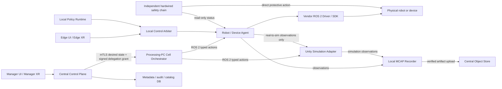

# SANG Multi-Robot Orchestrator Implementation Design

Status: **Normative implementation contract; G1-G6a software/disconnected-HIL implemented; G6b/G7+
physical release not implemented**

Version: 1.2

Date: 2026-08-28

Roadmap authority: current status and implementation order are maintained in
[`../SANG_MASTER_IMPLEMENTATION_PLAN.md`](../SANG_MASTER_IMPLEMENTATION_PLAN.md). This document remains
the detailed control/safety contract.

Scope: heterogeneous robots, cameras, mobile robots, simulators, XR, and future process equipment

Review record: the first independent Claude Opus architecture review identified current code defects;
the adversarial v1.0 review returned FAIL on lease, recovery, teleop, retry, camera scaling, VLA, and
Unity isolation ambiguity. Version 1.1 incorporated those findings. A final read-only Opus gate
returned **PASS with no documentation blockers for starting G0**. This is not approval for physical
motion; physical readiness remains gated by G6/G7 and the lab decisions in Section 19. Version 1.2
reconciles the implemented G0 wire schemas with the normative examples and makes HIL output-isolation
evidence, fan-out ordinals, and independent workflow-state observation explicit. The G0 code review
then moved from FAIL to PASS after closing the Scenario fixture access, HIL, Safety v2, fan-out,
deployment-neutrality, wire-drift, envelope, and Group binding findings.

## 1. Purpose

This document defines the control architecture that SANG should implement after its observation,
recording, and management foundation. It is deliberately not a Scenario 1 or Scenario 2 design.
Those scenarios are only the first conformance fixtures for a platform that must later support new
robots, new simulators, new workflows, VLA policies, and program-authored motion without changing the
Orchestrator core.

The product target is:

- compose sequential, parallel, conditional, compensating, and human-in-the-loop work across many
  heterogeneous assets;
- bind the same workflow role to either an approved physical asset or a compatible simulator asset;
- collect synchronized robot, camera, EEF, process, decision, and provenance data for replay and
  learning;
- let a Manager supervise many Processing PCs while each Processing PC can complete work already
  permitted by an unexpired delegated grant, and otherwise holds without dispatching new work during
  a Central-network interruption;
- support Manager XR and Edge XR without treating XR, Unity, ROS 2, Wi-Fi, or Central as a
  safety-rated control;
- introduce physical commands only after explicit implementation and commissioning gates.

> **Safety boundary:** Nothing in the current SANG repository is a certified safety function. The
> future software described here is operational control and defense in depth. Emergency stop,
> protective stop, power isolation, and credited human protection remain in an independently
> designed hardwired/vendor-rated chain.

## 2. Current Baseline and Release Blockers

### 2.1 What should be preserved

The current system already has useful platform foundations:

- versioned robot/camera manifests and observation contracts;
- mTLS Agent ingress, scoped identities, Admin authentication, and audit records;
- durable Task Run, capture-job, recording, MCAP, object-store, and SHA-256 provenance paths;
- read-only OPC UA aggregation and observation-only ROS 2 adapters;
- Isaac Sim observation profiles and a command-free Unity Safety Shadow;
- Galaxy XR parsing, preview, retargeting, freshness, deadman, and workspace-gate prototypes with no
  hardware publisher.

These remain independent of the future actuator path. Existing read-only Agents must not acquire a
command sink merely because the Orchestrator is added.

### 2.2 Implemented software boundary and remaining release boundary

The original gap described by this section was closed for G1-G6a. Central now persists immutable
workflow/capability/runtime contracts and compatible reservations; the Processing runtime includes a
generic DAG Orchestrator, signed grant/sublease and lease checks, a durable Agent ledger, execution
journal, expiry and crash reconciliation. Output-disconnected Unity/Isaac adapters, safety evidence,
Demand Arbiter, XR latches and the disconnected Device Agent skeleton have focused regression evidence
in [`G1_G6_IMPLEMENTATION_STATUS_2026-08-28.md`](G1_G6_IMPLEMENTATION_STATUS_2026-08-28.md).

This is **not** a commissioned production motion path. Real vendor command handles, physical manifests
with `command_sink_present=true`, measured G6b evidence, attended G7 motion, G8 multi-robot physical
coordination and G9 process output remain unimplemented or unauthorized. Unity C# no longer owns the
accepted Scenario 1 production ordering, but legacy/specialized bridges are still not a substitute for
a commissioned Device Agent.

### 2.3 Historical critical defects that G1-G6a was required to close

The table below is retained as the design trace. Current completion status is governed by Section 17,
the G1-G6 status evidence, and the master plan rather than by the original future-tense wording.

| ID | Current defect | Required disposition |
|---|---|---|
| C-01 | Safety `source_kind` is accepted from the producer, and non-`live` values bypass live-run and Agent-binding checks. | Derive provenance from authenticated identity, registered source, run mode, and binding. Reject a producer-supplied provenance class. |
| C-02 | `register_task_bundle()` validates `workflow` and `safety_policy` locally but does not register them in Central. | Add immutable Workflow Definition and approved Policy registries; make bundle registration atomic. |
| C-03 | `WorkflowStepV1` requires Unity scene names and cannot express dependencies, conditions, parallel work, human gates, timeout, or compensation. | Replace it with a simulator-independent typed DAG. Scene mapping belongs only in a Unity adapter profile. |
| C-04 | A Task Run has no execution mode, while an asset `runtime_kind` can be changed in place. | Make runtime class immutable per asset identity; put immutable execution mode on each Run; validate every binding before READY and ACTIVE. |
| C-05a | The existing reservation index correctly prevents two READY/non-terminal Runs from reserving one asset, but ignores `access_mode`; a `shared_read` camera is therefore locked as if exclusive. | Preserve the existing exclusive protection while allowing compatible concurrent `shared_read` reservations. |
| C-05b | There is no reservation for zones, coordinated-group members, or process resources. | Add transactional asset, transitive-member, zone, and process-resource reservations. |
| C-06 | Current run states have no HELD, ABORTING, or RECONCILING path. | Add explicit run and step state machines plus recovery rules. |
| C-07 | Scenario 2 labels `auto_stop_waam_process`, but its implementation pauses a Unity `VideoPlayer` and rewinds a scene step. | Rename it to `safety_observation` with `task_pause_candidate`. Never present it as a physical stop. |
| C-08 | Unity derives expected and observed step from the same source, so sequence mismatch cannot be detected. | Expected state comes from the Orchestrator; comparison evidence comes from a separately bound observer or controller-feedback capability that is independent of the workflow executor. |
| C-09 | Missing signal confidence currently defaults to `1.0`; clock quality is producer-declared; wall-clock ordering can wedge ingest. | Missing required confidence yields UNKNOWN/0.0; use measured clock status and `(producer_boot_id, sequence)` ordering. |
| C-10 | Sim-to-real clients and Shadow Reporter can exist in one Unity build and are separated mainly by environment flags. | Build and sign separate observer, simulation-executor, and fixture artifacts with compile-time exclusion. |
| C-11 | Role eligibility uses a closed `asset_type`, and the shipped `RuntimeKind` lacks `replay`. | Migrate role matching to registered capabilities and widen the runtime-class contract in G1. |
| C-12 | A role binds exactly one asset, so workflows cannot select `1..n` cameras or similar resource sets. | Add role cardinality, capability selectors, and generic fan-out/fan-in. |

The supporting local evidence is in
[`task_bundle.py`](../src/fleet_control_plane/fleet_control_plane/task_bundle.py),
[`safety_shadow.py`](../src/fleet_control_plane/fleet_control_plane/safety_shadow.py),
[`operations_models.py`](../src/fleet_control_plane/fleet_control_plane/operations_models.py), and the
Unity project under `unity_IITP/unity_IITP/100.Whole_integration/Scenario1_app`.

## 3. Non-Negotiable Invariants

1. Central never streams joint, Cartesian, motor, vendor, weld, or feeder setpoints.
2. Only a local Device Agent may hold a vendor command handle.
3. The Processing-PC Orchestrator sequences typed, high-level skills; it does not compute vendor
   motion or open a vendor socket.
4. Every physical effect requires an immutable Run mode, compatible binding, exclusive reservation,
   valid authorization, current lease epoch, idempotent command ID, bounded deadline, and local gate.
   The effect terminates or reaches its manifest-declared safe state no later than the remaining
   monotonic lease TTL.
5. Message delivery is at least once. Effects are made idempotent; the design never claims
   distributed exactly-once execution.
6. A physical command with an unknown result is never automatically retried.
7. Simulation and physical assets have different asset and binding identities. An object is never
   flipped from simulation to physical in place.
8. Real-to-sim is an observation path. Sim-to-real is an approved artifact-promotion path, not an
   unrestricted live mirror.
9. UNKNOWN and stale inputs inhibit new physical work. UNKNOWN stays visibly distinct from UNSAFE.
10. Software hold, controlled cancel, vendor protective stop, and hardwired E-stop are separate
    concepts in API names, UI labels, logs, and tests.
11. No network resume is automatic after a safety-related hold or participant restart.
12. XR is an authenticated human interface, never the only human detector, E-stop, safety PLC, or
    direct actuator client.
13. Adding a robot type requires a manifest, capability implementation, and binding, not Orchestrator
    source changes.
14. Scenario, vendor, model, IP address, ROS topic, and Unity scene names never appear in generic
    Orchestrator code.
15. The Agent's command ledger and highest accepted lease epoch are durable across restart and power
    loss. An Agent that cannot load either starts command-inhibited and reports prior command state as
    UNKNOWN.

## 4. Runtime Architecture



Central-to-Processing communication is Edge-initiated mTLS HTTPS streaming or bounded long polling
over a durable outbox. ROS 2/DDS remains local to a workcell network/domain. This avoids making
Central, Wi-Fi, or cross-site DDS discovery part of a motion deadline.

### 4.1 Exact ownership

| Component | Owns | Must not own |
|---|---|---|
| Central Control Plane | identity/RBAC; immutable registries; workflow versions; Task Run intent; reservations; authorizations; bounded delegation-grant issuance/revocation; durable lifecycle; audit; evidence catalog | servo deadlines; IK; trajectory generation; vendor handles; protective stop |
| Cell Orchestrator | DAG scheduling; local step journal; precondition checks; typed dispatch; barriers; timeout/cancel; reconciliation; short sub-lease minting strictly within an unexpired Central grant | vendor SDK; raw motor commands; safety certification; extending a sub-lease past its parent grant |
| Device Agent | capability implementation; local planning/vendor API; device limits; local command ledger; TTL/deadman; observations | global workflow decisions; another Agent's motion; self-issued lease |
| Control Arbiter | sole local demand gate for teleop and closed-loop policy output; lease, mode, freshness, deadman where applicable, workspace, tracking, rate, and interlock checks | plan authoring; lease minting; safety rating; workflow authority |
| Policy Runtime | local VLA/deterministic inference; bounded demand production under one approved policy/envelope and policy session | vendor handle; lease minting; command journal; bypass of Control Arbiter |
| Unity Adapter | simulation execution, twin observation, or deterministic fixture replay according to its build attestation | production workflow ownership; physical vendor handle; self-declared provenance |
| Safety Evaluator | evidence-to-assessment transformation with versioned policy | actuator output or credited protective action |
| Hardwired/vendor safety chain | actual credited stop and energy-isolation functions | dependence on Central, ROS 2, Unity, XR, HTTP, or Wi-Fi |
| Recorder | source messages, command/event evidence, timestamps, and immutable artifacts | state-machine authority |

One Processing PC may host multiple Runs only when Central has proven that their exclusive assets,
zones, process resources, and safety domains do not overlap. The conservative default is one active
motion Run per safety cell.

### 4.2 Tight multi-robot coordination

Ordinary cooperation uses DAG steps, barriers, and observed completion. This is appropriate for a
carrier delivering a part, OMY positioning it, and RB5 processing it in sequence.

Two independently networked Agents must not pretend to provide hard real-time lockstep. When two
robots must move synchronously while sharing a workpiece, register a `coordinated-motion-group`
asset. Its local Group Agent owns both controller interfaces, validates a common plan, and exposes one
composite `execute-coordinated-plan` capability. It either arms all participants for a measured,
time-tagged start or rejects the goal. Central and the Cell Orchestrator still see one high-level
step. Reserving the group transitively and atomically reserves every member asset and shared zone; a
member cannot be reserved by another Run, and cancellation at the Group Agent boundary is
all-or-nothing. This preserves the same contract without moving synchronization onto Wi-Fi.

## 5. Registries and Versioned Contracts

### 5.1 Separate identity, manifest, and connection data

Do not store changing deployment secrets inside durable asset identity.

- `AssetIdentityV1`: durable business identity, manufacturer/model/serial, AAS reference, ownership,
  lifecycle, and tags.
- `DeviceManifestV1`: immutable versioned technical contract: profile, units, frames, limits,
  observations, capabilities, local safe-state behavior, supported modes, software compatibility.
- `ConnectionProfileV1`: revisioned site binding: Processing node, Agent identity, ROS namespace,
  vendor endpoint reference, secret reference, network domain, and deployment state.
- `RuntimeBindingV1`: immutable-per-Run selection of one asset/manifest/connection/calibration set for
  a workflow role.

Passwords, tokens, private keys, and vendor credentials remain secret references, never manifest
fields or audit payloads.

### 5.2 Capability profile

```json
{
  "schema_version": 1,
  "profile_id": "articulated-arm",
  "version": 1,
  "kind_tags": ["actuated", "motion", "manipulator"],
  "capabilities": [
    {
      "capability_id": "execute-registered-joint-plan",
      "version": 1,
      "effect": "actuation",
      "parameter_schema_ref": "contracts://capabilities/joint-plan.v1",
      "required_frames": ["base", "tool"],
      "required_units": ["joint-position"],
      "required_limits": ["joint-position", "joint-velocity", "joint-acceleration"],
      "control_envelope_schema_ref": "contracts://envelopes/joint-plan.v1",
      "completion_contract_ref": "contracts://completion/joint-converged.v1",
      "cancellation_contract_ref": "contracts://cancellation/joint-plan.v1",
      "recovery_contract_ref": "contracts://recovery/joint-plan.v1",
      "evidence_contract_ref": "contracts://evidence/joint-plan.v1",
      "allowed_execution_modes": ["SIMULATION", "HIL", "PHYSICAL_AUTO"],
      "max_clock_uncertainty_ms": 0,
      "max_demand_age_ms": 0,
      "on_lease_expiry": "safe_state",
      "on_agent_restart_with_motion_in_flight": "vendor_state_reconcile"
    },
    {
      "capability_id": "observe-joint-state",
      "version": 1,
      "effect": "observation",
      "parameter_schema_ref": "contracts://capabilities/observe.v1",
      "allowed_execution_modes": ["SIMULATION", "REPLAY", "SHADOW", "HIL", "PHYSICAL_AUTO"]
    }
  ]
}
```

Capabilities are semantic contracts, not free-form labels. A physical-effect capability version must
define parameters, units, frames, limits, completion, cancellation, recovery, evidence, supported
modes, maximum measured clock uncertainty, maximum accepted demand age, lease-expiry behavior, and
Agent-restart behavior. Zero timing values in the example mean **not commissioned** and are rejected
for `PHYSICAL_*`; they never mean infinite. Vendor names belong in Device manifests and Agent
plugins, not in a workflow.

`on_lease_expiry` is a closed enum: `controlled_hold`, `controlled_cancel`, or `safe_state`. Each
value resolves through the manifest's exact vendor behavior and measured time-to-state; none means
E-stop or a credited protective stop.

### 5.3 Device manifest

```json
{
  "schema_version": 1,
  "manifest_id": "example-arm-manifest",
  "version": 4,
  "profile_ref": {"profile_id": "articulated-arm", "version": 1},
  "vendor": {"make": "example", "model": "example-6dof"},
  "capability_refs": ["execute-registered-joint-plan@1", "observe-joint-state@1"],
  "frames": {
    "mappings": {"base": "arm_base", "tool": "arm_tcp"},
    "world_calibration_required": true
  },
  "units": {"mappings": {"joint-position": "rad", "length": "m", "angle": "rad"}},
  "limits_ref": {
    "object_id": "example-arm-limits",
    "version": 2,
    "sha256": "aaaaaaaaaaaaaaaaaaaaaaaaaaaaaaaaaaaaaaaaaaaaaaaaaaaaaaaaaaaaaaaa"
  },
  "observation_contract": [
    {"key": "joint-state", "message_type": "sensor_msgs/msg/JointState", "min_rate_hz": 20.0}
  ],
  "execution_contract": {
    "agent_api": "sang_control_msgs/action/ExecuteSkill@1",
    "supported_modes": ["SHADOW"],
    "command_sink_present": false
  },
  "local_fail_behavior_ref": "contracts://fail-behavior/example-arm.v1"
}
```

The currently deployed physical manifests continue to declare `command_sink_present: false` until
their independent command-capable Agent and commissioning gate are complete. The referenced local
fail-behavior contract is mandatory and includes lease-expiry behavior, communication-loss behavior,
restart-with-motion-in-flight behavior, controller-state query behavior, controlled-cancel semantics,
and measured worst-case time to the declared safe state. Only G7 may sign and publish a new manifest
version with `command_sink_present: true`, after the named safety officer, device owner, and attended
commissioning approver accept G6 evidence. G9 separately enables process-output sinks.

### 5.4 Zones, calibrations, plans, policies, and models

Central needs immutable versioned registries for:

- `ZoneV1`: frame, geometry, classification, workcell, approval, expiry;
- `CalibrationV1`: source/target frames, transform, method, residual, sample count, approver, expiry;
- `PlanArtifactV1`: motion/process plan object hash, authoring source, compatibility, validation
  report, approval state;
- `PolicyArtifactV1`: VLA or deterministic policy hash, runtime, input/output contract, training data
  lineage, evaluation report, approved envelope;
- `SafetyPolicyV2`: evidence rules, basis, approver, effective period, and mode scope.

Every Run binding pins exact versions and normalized SHA-256 digests. Editing creates a new version;
it never mutates evidence from a past Run.

## 6. Execution and Twin Modes

Runtime class, execution authority, and twin data flow are separate fields. Combining them into one
`real_to_sim/sim_to_real` string makes unsafe transitions too easy.

### 6.1 Runtime class

- `PHYSICAL`: an identity tied to real hardware.
- `SIMULATION`: an identity tied to a simulator instance/scene binding.
- `REPLAY`: an immutable recording-backed identity.

Each has a distinct `asset_id`. Compatibility permits explicit substitution at Run binding time; it
does not make them the same asset.

G1 migrates the shipped `RuntimeKind = Literal["physical", "simulation"]` and SQLite CHECK constraint
to include `replay`. It also retires closed `asset_type` matching for role eligibility. Legacy type is
retained only as a display/migration field; capability contracts decide whether an asset can fill a
role.

### 6.2 Run execution mode

| Mode | Physical effects | Use |
|---|---|---|
| `OBSERVE_ONLY` | forbidden | fleet health, recording, OPC UA/AAS projection |
| `SIMULATION` | forbidden | Orchestrator drives simulation Agents |
| `REPLAY` | forbidden | deterministic CI and incident replay |
| `SHADOW` | forbidden | observe a real or simulated task and produce recommendations only |
| `HIL` | motion/process outputs physically disconnected | controller/software-in-loop verification |
| `PHYSICAL_AUTO` | explicitly permitted by authorization and local lease | approved autonomous/program/VLA skill execution |
| `PHYSICAL_TELEOP` | explicitly permitted by local intervention lease | Edge-operated jog/teleoperation |
| `MAINTENANCE` | site-policy limited | calibration/commissioning; never a production Task Run |

Mode is set when the Run is created and is immutable after READY. Moving to a different mode creates
a new Run and new authorization.

An effectful `HIL` binding against a physical controller requires a pinned, immutable
`output_isolation_evidence_ref` in the Run binding, delegation grant, and sub-lease. The evidence
records the verified physical disconnection of motion/process outputs. A producer-supplied boolean is
not sufficient, and HIL is rejected if the three references do not match.

### 6.3 Real-to-sim

`MIRROR_REAL_TO_SIM` is a twin-link mode, not command authority. Physical observations are copied to
the simulator with original source timestamps, boot/sequence identity, frame/calibration references,
and measured clock uncertainty. The twin may derive visualization or comparison facts. There is no
return command route in the observer build, and twin output cannot satisfy a physical safety
precondition.

### 6.4 Sim-to-real

Sim-to-real is artifact promotion:

1. simulation produces a candidate plan, policy, pose set, or skill parameter artifact;
2. offline checks validate units, frames, limits, collisions, timestamps, and compatible manifest;
3. Central stores the immutable object and SHA-256 plus evaluation evidence;
4. authorized reviewers approve a bounded asset/mode/envelope and expiry;
5. a new `PHYSICAL_AUTO` Run binds that approved version;
6. the local Agent independently verifies the digest and executes through its vendor controller.

Unity never streams a live physical trajectory. An online VLA policy is deployed as a registered
local `execute-policy-session` capability with two local interfaces:

1. `ExecuteSkill` opens/closes the policy session and binds its policy digest, envelope, Run,
   authorization, and lease;
2. the Policy Runtime publishes `PolicyDemand` messages to the Control Arbiter on the local ROS 2
   domain. Each demand carries session/command ID, monotonic sequence, source timestamp, policy
   digest, lease ID/epoch, frame, units, and a bounded joint/task-space demand schema.

The Arbiter is the only process allowed to forward validated demand to the Device Agent. It enforces
`max_demand_age_ms`, maximum rate, delta, workspace, mode, current sub-lease, and controller state.
Missing or late demand reaches the capability's declared safe state within its bounded TTL. The
Policy Runtime computes inference demand but never vendor packets, never holds a vendor handle, and
never mints a lease. Central records the policy digest and decisions but does not carry this loop.

## 7. Generic Workflow Definition

### 7.1 Workflow schema

```json
{
  "schema_version": 2,
  "workflow_id": "generic-transfer-and-process",
  "version": 1,
  "roles": [
    {"role": "carrier", "cardinality": "1", "selector": {"requires": ["navigate-to-pose@1"]}, "access": "exclusive"},
    {"role": "handler", "cardinality": "1", "selector": {"requires": ["execute-registered-joint-plan@1"]}, "access": "exclusive"},
    {"role": "processor", "cardinality": "1", "selector": {"requires": ["execute-registered-process-path@1"]}, "access": "exclusive"},
    {"role": "cell-view", "cardinality": "1..n", "selector": {"requires": ["record-compressed-video@1"], "zone_id": "process-cell"}, "access": "shared_read"}
  ],
  "steps": [
    {
      "step_id": "deliver",
      "kind": "action",
      "role": "carrier",
      "capability": "navigate-to-pose@1",
      "parameters": {"pose_ref": "workcell://stations/load"},
      "depends_on": [],
      "timeout_s": 120,
      "retry": {"max_total_attempts": 1}
    },
    {
      "step_id": "position",
      "kind": "action",
      "role": "handler",
      "capability": "execute-registered-joint-plan@1",
      "parameters": {"plan_ref": "artifact://plans/position@3"},
      "depends_on": ["deliver"],
      "timeout_s": 90,
      "on_hold": "controlled_cancel",
      "compensation_step": "position-recover"
    },
    {
      "step_id": "process-approval",
      "kind": "human_approval",
      "authority": "manager",
      "depends_on": ["position"],
      "timeout_s": 600,
      "on_timeout": "HOLD"
    },
    {
      "step_id": "process",
      "kind": "action",
      "role": "processor",
      "capability": "execute-registered-process-path@1",
      "parameters": {"plan_ref": "artifact://plans/process@2"},
      "depends_on": ["process-approval"],
      "timeout_s": 900,
      "on_hold": "capability_default",
      "compensation_step": "process-safe-state"
    },
    {
      "step_id": "capture",
      "kind": "action",
      "role": "cell-view",
      "capability": "record-compressed-video@1",
      "fan_out": "all_bound_assets",
      "join": "all",
      "depends_on": ["process-approval"],
      "timeout_s": 900,
      "lifetime": {"start_on": "process-approval:SUCCEEDED", "stop_on": "process:TERMINAL", "on_unreachable": "cancel"}
    },
    {
      "step_id": "quality-route",
      "kind": "conditional",
      "depends_on": ["process", "capture"],
      "join": "all",
      "cases": [
        {"when": {"path": "steps.process.result.quality", "op": "eq", "value": "PASS"}, "next": "release"},
        {"when": {"op": "default"}, "next": "edge-inspection"}
      ]
    },
    {
      "step_id": "position-recover",
      "kind": "compensation",
      "role": "handler",
      "capability": "execute-registered-joint-plan@1",
      "parameters": {"plan_ref": "artifact://plans/position-recover@1"},
      "timeout_s": 90
    },
    {
      "step_id": "process-safe-state",
      "kind": "compensation",
      "role": "processor",
      "capability": "execute-registered-process-path@1",
      "parameters": {"plan_ref": "artifact://plans/process-safe-state@1"},
      "timeout_s": 90
    },
    {
      "step_id": "release",
      "kind": "action",
      "role": "handler",
      "capability": "execute-registered-joint-plan@1",
      "parameters": {"plan_ref": "artifact://plans/release@1"},
      "timeout_s": 90
    },
    {
      "step_id": "edge-inspection",
      "kind": "human_task",
      "authority": "edge-operator",
      "instruction": "Inspect the process result and record the disposition.",
      "timeout_s": 600
    }
  ]
}
```

Minimum step kinds are `action`, `wait_for_observation`, `barrier`, `conditional`,
`human_approval`, `human_task`, and `compensation`. Recording and observation are ordinary
capabilities executed by an `action`; they are not Orchestrator-special camera branches. Generic
`lifetime.start_on/stop_on` edges can bound any long-lived action and are validated as DAG references.
Parallelism is represented by multiple eligible nodes; convergence uses `join: all|any`.

`on_hold` is one of `controlled_hold`, `controlled_cancel`, `finish_if_bounded`, or
`capability_default`; the latter resolves to an immutable capability-version rule. `fan_out` is one
of `all_bound_assets`, `first_n`, or `explicit_binding_set`. `first_n` uses `fan_out_count`;
`explicit_binding_set` uses zero-based `binding_ordinals` into the role's immutable Run binding.
Both are validated against role cardinality and actual bound count. Asset IDs never enter a Workflow.

Role cardinality and selectors bind one asset or a capability-compatible set. `fan_out` applies the
same step to that set and collects per-asset results with an explicitly required `join: all|any`;
there is no implicit default. READY fails if the binding count is below the role's cardinality
minimum or above its finite maximum. `selector.requires` is logical AND. A mixed-modality cell uses
separate capability-based roles (for example compressed video versus triggered line scan), never an
Orchestrator special case. Adding compatible cameras changes the Run binding, not the Workflow.
Eligibility is decided only by registered
capability versions, units, frames, mode, and access. The Orchestrator never matches `asset_type`,
`profile_id`, or `kind_tags`; the current `asset_type` role check is removed during G1.

Conditional predicates use a closed, versioned grammar of declared result paths, typed constants,
`eq/ne/lt/lte/gt/gte/in`, composition nodes `all`, `any`, and `not`, and `default`. Function calls,
arbitrary code, I/O, time reads, and undeclared fields are forbidden, making replay deterministic. The validator rejects
cycles, missing/lifetime references, incompatible capabilities, unapproved artifacts, expired
calibrations, impossible compensation, and overlapping exclusive resources.

A lifetime-bearing step must have a finite `timeout_s`. G0 validates both event references and always
requires deterministic `on_unreachable: cancel|complete`; it does not claim whole-path reachability
proof. G3 may add that stronger static proof without weakening this mandatory fallback. Timeout, Run
termination, and lease expiry remain independent terminal guards.

Workflow definitions may contain domain concepts such as a registered process capability. They may
not contain vendor APIs, IPs, ROS topics, simulator names, Unity scenes, or robot models. Those live
in binding/adapter configuration.

### 7.2 Run lifecycle

```text
DRAFT -> READY -> ACTIVE -> COMPLETE
                   |  |
                   |  +-> HELD -> ACTIVE
                   |  +-> ABORTING -> ABORTED
                   |  +-> RECONCILING -> HELD | ABORTING
                   +----> FAILED
```

`READY` means validation and reservations succeeded; it does not mean motors are enabled. `ACTIVE`
allows the Orchestrator to evaluate eligible steps. A physical step still needs its own current
authorization and lease.

### 7.3 Step lifecycle

```text
PENDING -> ELIGIBLE -> DISPATCHED -> RUNNING -> SUCCEEDED
              |             |          |  |-> FAILED
              |             |          |  +-> CANCELLING -> CANCELLED
              |             |          +----> TIMED_OUT
              +-> BLOCKED
any non-terminal -> HELD
SUCCEEDED -> COMPENSATING -> COMPENSATED | COMPENSATION_FAILED
```

Step state is durable on the Processing PC and mirrored to Central as events. `COMPENSATION_FAILED`
requires human adjudication and never auto-retries.

`max_total_attempts` includes the first attempt; `1` means no retry. Retry is allowed automatically
only when the Run mode has no physical effects, or when a physical
Agent has produced a durable terminal proof that the effect never started. `reason_code` comes from a
closed registered enum but remains advisory; an Agent-supplied code alone never authorizes a physical
retry. UNKNOWN physical results always enter reconciliation.

## 8. ExecuteSkill Contract

ROS 2 Actions fit bounded, long-running local goals because they provide goal acceptance, progress
feedback, final result, and cancellation. The local interface is
`sang_control_msgs/action/ExecuteSkill`.

```text
# Goal
string schema_version
string command_id
string run_id
string step_instance_id
uint32 attempt
string asset_id
string capability_id
uint32 capability_version
string parameters_json
string artifact_id
string artifact_sha256
string control_envelope_id
string control_envelope_sha256
string authorization_id
string parent_grant_id
string lease_id
uint64 lease_epoch
string orchestrator_boot_id
string execution_mode
string manifest_sha256
string calibration_refs_json
builtin_interfaces/Time not_valid_after
---
# Result
string outcome
string reason_code
string final_observation_json
string evidence_refs_json
builtin_interfaces/Time completed_at
---
# Feedback
float32 progress
string phase
string observed_state_json
uint64 sequence
builtin_interfaces/Time observed_at
```

Companion interfaces:

- `QueryExecution(command_id)` returns `UNKNOWN | ACCEPTED | RUNNING | TERMINAL` and the stored
  result, enabling restart reconciliation;
- `RenewLease(command_id, signed_sublease)` replaces the current sub-lease only when command, parent
  grant, epoch, Orchestrator identity/incarnation, mode, and authorization are unchanged and the new
  expiry remains within `renewable_until`;
- `CancelExecution(command_id, reason, lease_id, lease_epoch, orchestrator_boot_id)` is idempotent,
  returns acceptance and a queryable cancellation state, and requires either the current holder or a
  valid superseding epoch. An evicted holder may not extend or cancel a successor's command;
- `ExecutionEvent` is an append-only status stream keyed by Agent `boot_id` and monotonic sequence.

`not_valid_after` is the final time at which the Goal may be accepted. The signed sub-lease
`expires_at` bounds the continuing physical effect. Renewal must arrive before
`expires_at - declared_time_to_safe_state`; otherwise the Agent begins its manifest-declared
lease-expiry behavior early enough to reach that state no later than expiry. A long action therefore
uses repeated short sub-leases while the parent delegation grant remains valid; it never silently
runs beyond expiry.

An Agent stores the canonical goal hash, acceptance, feedback sequence, cancellation, and terminal
result in durable local storage under `command_id`. It also durably stores the per-asset epoch
high-water mark before acknowledging a lease. An identical replay returns the existing status/result;
a different payload under the same ID is rejected. `QueryExecution` reads this durable ledger. A
transport timeout therefore does not imply that the effect failed or that a retry is safe.

### 8.1 Command categories

The same envelope supports these capability implementations without changing the Orchestrator:

- pre-approved deterministic trajectory/program;
- Agent-local planning from a bounded pose or task goal;
- Processing-PC VLA policy execution with local command arbitration;
- composite multi-robot plan executed by a Group Agent;
- simulation skill executed by Unity or Isaac Sim;
- Edge teleop session entered through a separate `PHYSICAL_TELEOP` lease.

## 9. Reservations, Authorizations, and Leases

### 9.1 Reservation

A Central reservation is durable planning authority, not a real-time permit. All Run assets and zones
are acquired atomically in deterministic ID order. A partial acquisition is rolled back. Any number
of compatible `shared_read` reservations may coexist; an `exclusive` reservation conflicts with both
exclusive and shared holders. Reserving a Group Agent transitively locks every member. Zone and
process-resource reservations follow the same compatibility matrix. G1 migrates the current unique
index, which already prevents duplicate reservation but incorrectly locks `shared_read` cameras.

### 9.2 Authorization

`MotionAuthorizationV1`, `ProcessAuthorizationV1`, and `TeleopAuthorizationV1` are immutable approval
objects. They scope exact assets, Run, mode, capabilities, artifact digests, envelope, approvers,
evidence, issue/expiry time, and revocation. Admin identity management does not imply safety-officer
approval.

### 9.3 Central delegation grant

Central is the single issuer of `DelegationGrantV1`. A grant is not sent to a robot as a command. It
binds one Run, authorization, asset, execution mode, Orchestrator identity and `orchestrator_boot_id`,
lease epoch, capability set, delegated public key, maximum sub-lease TTL, and absolute
`renewable_until`. It also pins the approved control-envelope artifact ID and SHA-256 containing the
numeric rate, delta, workspace, clock, and demand-age limits. The Orchestrator cannot extend any
field or expiry beyond that signed envelope.
`orchestrator_boot_id` is a fresh random UUID for every process incarnation and is never loaded from
a previous process journal as the current identity.

Central loss therefore does not interrupt every short renewal: an Orchestrator may mint sub-leases
until the parent grant expires. It cannot start a different Run, mode, asset, capability, human
session, or post-grant action. When the grant can no longer cover the declared safe-state time, the
Orchestrator stops dispatch/renewal and the Agent follows its expiry behavior. A restarted
Orchestrator has a new boot ID and cannot use the old grant; Central must reconcile and issue a higher
epoch before physical execution resumes.

### 9.4 Control sub-lease

```jsonc
{
  "lease_id": "lease-uuid",
  "lease_kind": "auto",
  "parent_grant_id": "grant-uuid",
  "run_id": "run-id",
  "orchestrator_id": "processing-node/orchestrator",
  "orchestrator_boot_id": "uuid",
  "command_id": "command-uuid",
  "subject": {"kind": "service", "principal_id": "cell-orchestrator"},
  "xr_session_id": null,
  "asset_id": "asset-id",
  "capabilities": ["execute-registered-joint-plan@1"],
  "execution_mode": "PHYSICAL_AUTO",
  "authorization_id": "authorization-id",
  "control_envelope_id": "envelope-id",
  "control_envelope_sha256": "sha256",
  "epoch": 7,
  "issued_at": "RFC3339",
  "expires_at": "RFC3339",
  "renewable_until": "RFC3339",
  "issuer_key_id": "delegated-orchestrator-key-1",
  "signature": "detached-signature"
}
```

`lease_kind` is `auto` or `teleop`. A teleop lease additionally binds an authenticated human subject,
presence attestation reference, and XR session. Epoch is monotonic per asset. Revocation increments
it. The Agent verifies the Central grant signature, delegated sub-lease signature, binding, manifest
digest, mode, authorization, Orchestrator boot ID, subject/session, epoch, and expiry independently.
Receipt starts a local monotonic countdown so a wall-clock correction cannot extend a lease.

The parent grant's `max_sublease_ttl_ms` must be a positive commissioned value; null or zero is
invalid for physical modes. The sub-lease's signed `expires_at`, checked against that maximum, is the
operative fence. The renewal guard is at least the manifest's measured worst-case time to safe state. The Agent starts its
declared expiry behavior when remaining TTL reaches that guard, so it is at the declared safe state by
`expires_at`. The approved fencing budget bounds sub-lease TTL plus detection/processing uncertainty.

An `auto` to `teleop` transition, or the reverse, is never an epoch race. The existing goal is held or
cancelled by its current authorized holder, terminal/controller state is confirmed, reservations are
reconciled, and only then may Central issue the new Run/mode grant with a higher epoch. A teleop
request against a busy asset is rejected until this drain completes. The Control Arbiter cannot mint
a lease.

The Control Arbiter loads the immutable envelope through the authenticated local registry cache,
verifies its digest against the Central grant and current sub-lease, and refuses all demand if the
artifact is absent, stale, or mismatched. Numeric limits never come from the Policy Runtime or XR
payload.

### 9.5 Three different stop verbs

| Verb | Meaning |
|---|---|
| `hold_run` | stop dispatching new steps; apply each running step's declared hold/cancel policy |
| `cancel_execution` | ask one Agent to perform a controller-defined controlled cancel and report completion |
| `request_safe_state` | initiated locally by the Device Agent gate or Control Arbiter on gate loss, and optionally requested by the current Orchestrator; fail off demand and surrender the software lease |
| lease expiry | Agent begins the manifest-declared controlled hold/safe-state behavior before the renewal guard; the Orchestrator records HELD/RECONCILING |

None is named or presented as `emergency_stop`. The actual E-stop remains hardwired and independent.

## 10. Durability and Recovery

### 10.1 Required local journal

Each Cell Orchestrator uses local SQLite WAL storage for:

- accepted Run revision and normalized workflow digest;
- bindings, reservations, authorizations, and lease epochs;
- step instances, attempts, canonical command hashes, feedback summaries, and terminal results;
- approval decisions and user identities;
- expected versus observed state and reconciliation decisions;
- outbox events awaiting Central acknowledgement.

Central stores the authoritative definition, intent, audit, reservation, and replicated step-event
history. High-rate messages and video stay in local MCAP until selected immutable upload.

Each command-capable Device Agent independently uses durable transactional storage for canonical
goal hashes, command states/results, cancellation state, vendor goal/reference IDs, Agent boot
history, and the per-asset highest accepted `(epoch, orchestrator_boot_id)`. Lease acceptance is
acknowledged only after the epoch high-water mark and command acceptance are committed. If the ledger
cannot be opened, verified, or recovered, the Agent remains command-inhibited and reports UNKNOWN.

### 10.2 Restart behavior

- **Orchestrator restart:** replay journal, enter RECONCILING, query every DISPATCHED/RUNNING command.
  Adopt a proven terminal result. If the Agent has no record, mark UNKNOWN and require a person for
  any physical-effect step. Observation steps may retry according to policy.
- **Agent restart:** enter INACTIVE/RECOVERING, publish a new `boot_id`, query vendor state, and accept
  no command. Central increments the lease epoch. Motion may still exist in a vendor controller, so
  “process restarted” never means “robot stopped.” The Agent executes the manifest's declared
  restart-with-motion-in-flight procedure: query the durable vendor goal/controller state, request
  the declared controlled behavior if communication is available, observe the independent safety
  chain, and remain RECONCILING until terminal physical state is proven by an approved observer.
- **Central loss:** an already accepted local step follows its declared Agent policy; the
  Orchestrator dispatches no next step and cannot renew beyond the signed limit. Central recovery
  reconciles before new work.
- **Network partition/split brain:** the Agent durably accepts only the highest valid per-asset epoch.
  A lower epoch remains rejected after Agent restart. Equal epoch with a different
  `orchestrator_boot_id` is rejected. A higher epoch fences every older holder, while a new physical
  goal still waits for prior controller-state reconciliation.
- **Power restoration:** no automatic Run resume, motor enable, process enable, or XR session resume.

ROS 2 lifecycle nodes should keep command-capable Agents `INACTIVE` until configuration, manifest,
calibration, security enclave, vendor state, and gate checks have succeeded.

## 11. Unity, Isaac Sim, and Digital Twin Integration

### 11.1 Adapter boundary

A new local `unity_task_adapter` implements the same `ExecuteSkill` Action server as a Device Agent.
It communicates over loopback authenticated WebSocket or gRPC with a small C# interface:

```csharp
public interface IUnitySkillExecutor
{
    SkillAcceptance Accept(SkillGoal goal);
    SkillStatus Query(string commandId);
    CancelAcceptance Cancel(string commandId, string reason);
}
```

Scene-specific C# maps a registered capability to existing motion primitives. The Workflow never
names the scene or C# class. Unity reports observed progress and completion; it does not choose the
next workflow step.

### 11.2 Separate build artifacts

| Build | Allowed role | Included role assembly | Forbidden assembly/type |
|---|---|---|---|
| `unity-twin-observer` | visualization, real-to-sim mirror, snapshot production | observer only | simulation executor and every socket-sending command type |
| `unity-sim-executor` | SIMULATION/HIL `ExecuteSkill` implementation | simulator executor only | observer authority and every physical command type |
| `unity-fixture` | deterministic replay/conformance test | fixture only | network command sender and production executor |

Implement one Unity `.asmdef` per role with `defineConstraints`; source for each Player target is
selected at compile time. Specifically,
`Assets/Scripts/Rb5SimToRealUdpClient.cs` and
`Assets/Scripts/OmySimToRealUdpSender.cs` move out of the shared `Assets/Scripts` assembly into a
legacy research assembly excluded from all three production targets. Environment variables such as
`IITP_RB5_SIM_TO_REAL` are not a build boundary. CI scans the built Player assembly dependency graph
and IL/type list for these senders and socket-command references, rather than checking source flags.

Every Player ships a signed `UnityBuildAttestationV1` containing build role, source commit, Unity
version, scene-profile digest, assembly name/hash list, build timestamp, signer key, and signature.
Central registers the attestation; the Cell Orchestrator refuses a simulation/twin binding whose
attested role does not match the Run mode. Any later physical adapter remains a Python/ROS 2 Device
Agent, not a Unity assembly. Useful validation logic from the current Python bridges may be migrated
into Agents, but production launch files must not reference those bridges.

The current Unity source is a separate workspace sibling at
`../unity_IITP/unity_IITP/100.Whole_integration/Scenario1_app`, not part of `v2_ws`. G0 records its
source repository URI (or creates one), pinned commit, Unity build-owner role, and release-signing
service identity. Local unversioned source may be used for fixture exploration but cannot satisfy G1.
The SANG CI checks out the pinned Unity source as an explicit external build input; G1 establishes the
observer assembly exclusion and immediate no-sender check, while G4 owns all three Player builds,
built-assembly IL/dependency scans, signing, and attestation registration.

### 11.3 Scenario fixtures

Scenario 1 becomes a generic coordination conformance test:

1. carrier delivery;
2. handler pre-process placement;
3. process step while camera capture runs in parallel;
4. handler post-process transfer;
5. carrier return.

Its expected trace is compared with the Orchestrator's trace. The C# phase enum is an oracle, not the
runtime authority.

Scenario 2 becomes a safety-evidence and human-intervention conformance test:

1. simulator emits measured observation with source age/confidence/calibration;
2. evaluator produces SAFE/WARNING/UNSAFE/UNKNOWN evidence;
3. Orchestrator may enter HELD based on an approved operational policy;
4. no vendor command is emitted by the evaluator;
5. resume requires cleared dwell, local Edge acknowledgement, Manager authorization where policy
   requires it, and observed reset of the independent safety chain.

The current phrase `auto_stop_waam_process` must be replaced with `safety_observation` and
`task_pause_candidate` before it is reused outside a fixture.

## 12. Safety Architecture

### 12.1 Layers

| Layer | Safety rated? | Role |
|---|---|---|
| hardwired relay/E-stop/interlocks/protective devices | only as designed and validated by qualified safety engineering | credited protective function and energy isolation |
| vendor controller safety functions | only to the vendor-declared level | safe-limited functions/protective behavior where applicable |
| Agent Local Execution Gate | no | rejects stale lease, wrong mode, invalid artifact, absent interlock status, or stale demand |
| evaluator and Orchestrator | no | evidence, operational policy, sequencing, and hold recommendation |
| Central/UI/ROS 2/Unity/XR/network | no | management, visualization, transport, and interaction |

Risk assessment, integration, protective devices, stopping time/distance, and collaborative operation
must be handled against the applicable robot/cell standards and the actual installation. This design
does not set safety distances or claim compliance.

### 12.2 Safety evidence contract v2

Each source carries:

- authenticated producer identity, separate observer/evaluator/sender identities;
- `producer_boot_id` and monotonic `sequence`;
- source `sampled_at`, receive time, latency, measured clock offset/uncertainty;
- per-human/per-asset separation or per-zone occupancy, not one global scalar;
- signal confidence and validity;
- exact zone, calibration, policy, manifest, and Run references;
- command-free assessment and evidence references.

Missing required confidence, stale source, unknown calibration, unapproved policy, clock uncertainty,
or sequence regression yields UNKNOWN. A SAFE assessment can never default to maximum confidence
when the producer supplied no confidence.

For `PHYSICAL_*`, evidence required by the approved cell strategy is not a Run-time policy toggle. A
proximity strategy cannot set `require_human_distance: false`; a guarded-cell strategy instead
requires fresh, approved guard/interlock evidence. `clock_quality` and offset are measured by the
Processing-PC/Agent NTP/PTP monitor against a registered source. Producer-declared quality is rejected,
and measured uncertainty above the policy/capability's numeric `max_clock_uncertainty_ms` yields
UNKNOWN.

Expected workflow state is authored by the Orchestrator. Observed completion/safety state used for
comparison must come from a separately bound observer or controller-feedback capability, not merely
the same executor's self-report. `WorkflowStateEvidenceV2` therefore carries the Orchestrator,
observer producer, and executor identities separately; the snapshot producer must equal the observer
identity and must differ from both Orchestrator and executor. Executor feedback remains useful but is
not independent evidence.

### 12.3 Resume rules

No safety-related hold clears from a single remote button. At minimum:

1. the relevant condition is fresh and clear for an approved dwell;
2. the independent safety chain is reset by its own mechanism and observed healthy;
3. an authorized Edge operator confirms local conditions;
4. a Manager provides a second authorization for policy-defined physical Runs;
5. a `safety_officer` approves when the applicable policy, zone, calibration, or incident class
   requires that role; Manager and safety officer are separate authorization scopes even if one
   qualified person holds both credentials in a small lab;
6. the Orchestrator writes the resume record before obtaining a new grant/sub-lease;
7. the Agent rechecks mode, manifest, calibration, controller, and local interlocks.

XR head position is not an adequate sole detector for an untracked person. Any credited human
protection needs appropriate independent protective equipment selected through the cell risk
assessment.

## 13. Manager and Edge XR

### 13.1 Manager XR

Manager XR can observe many Runs, open a digital twin, inspect live/recorded cameras and provenance,
approve a declared human gate, request `hold_run`, and participate in a two-person resume workflow.
It cannot jog, teleoperate, edit a plan, set safety thresholds, reset the hardwired chain, or act as
an E-stop. A network loss removes its session but does not change local robot state.

### 13.2 Edge XR

Edge XR can inspect the local Task, acknowledge a human task, request a hold, and later enter a
separately authorized local teleop session. Motion requires:

- authenticated user and operational presence attestation;
- one asset-scoped XR session lease and one control lease;
- explicit two-stage entry into `PHYSICAL_TELEOP`;
- approved spatial calibration and visible coordinate frame;
- hold-to-enable/deadman, tracked poses, bounded workspace/orientation, and input age within the
  approved limit;
- a separate `control_arbiter` process as the only Agent-facing requester.

Tracking loss, app focus loss, network loss, stale input, lease loss, or deadman release sends zero
demand/controlled hold through the local arbiter and latches inhibition. Re-entry requires explicit
authorization; it does not resume from the last pose.

Operational presence attestation means a fresh local challenge completed through a Processing-PC
bound credential and a separately configured local-presence factor such as a cell console, local
hardware token, or site-approved proximity mechanism. It is not safety-rated and may never derive
from XR head pose alone. Failure or expiry inhibits teleop. The XR session lease is strictly nested
inside the control sub-lease, expires first, cannot outlive the parent grant, and its loss latches the
Arbiter inhibited even if the control lease remains valid.

### 13.3 XR RBAC

Replace the current broad `viewer/operator/admin` distinction with at least:

- `viewer`;
- `edge_operator`;
- `manager`;
- `safety_officer`;
- `maintenance_operator`;
- `admin`;
- scoped service identities.

`admin` manages identities and configuration but does not automatically inherit safety-policy,
calibration, zone, or physical-motion approval.

## 14. Time, Data, and Learning Provenance

### 14.1 Time model

- PTP is preferred inside a cell where hardware supports it; monitored NTP is the minimum for
  ordinary observation.
- Wall time is for cross-system correlation and audit. Monotonic time plus boot/sequence is used for
  ordering, TTL, and watchdog behavior.
- Every sample records source time, receipt time, clock source, measured offset, and uncertainty.
- Measured clock uncertainty may qualify recording correlation and evidence ordering. It never
  authorizes motion lockstep across independent Agents; synchronized physical motion requires the
  single Group Agent contract in Section 4.2.

### 14.2 Storage split

- SQLite: assets, versions, bindings, Task Runs, workflow/step state, reservations, leases,
  approvals, audit, catalog, quality summaries, and references;
- local MCAP: high-rate ROS 2 robot/camera/EEF/process observations plus command, feedback, safety,
  and step-transition evidence on one timeline;
- object storage: selected immutable MCAP, video-derived artifacts, models, plans, reports, and
  SHA-256-addressed blobs;
- vector database, if added later: derived embeddings and object references only, never authoritative
  robot state, safety state, or raw-video ownership;
- AAS: durable semantic projection of asset identity, capabilities, lifecycle, and document links;
- OPC UA: bounded current/status projection initially. Writable Methods remain disabled until a
  separately reviewed control mapping exists.

### 14.3 Required provenance

Every Run/step/artifact ties together `run_id`, workflow version/digest, step instance and attempt,
command ID, asset and runtime binding, execution mode, Agent boot ID/version, manifest digest,
calibration refs, zone/policy refs, plan/policy/model digest, `authorization_id`, parent grant ID,
`lease_id`, `lease_epoch`, `orchestrator_boot_id`, user approvals, wall/monotonic timing, clock
uncertainty, and evidence object hashes.

This lets the same dataset support incident replay, behavior comparison, LeRobot derivation, vision
training, VLA evaluation, and sim/real gap analysis without losing which exact system produced it.

## 15. Central and Local Persistence

Central should add these logical tables or equivalent append-only projections:

- `capability_profiles`, `device_manifests`, `connection_profiles`;
- `zones`, `calibrations`, `artifacts`, `artifact_approvals`;
- `workflow_definitions`, `workflow_roles`, `workflow_steps`;
- `task_runs.execution_mode`, `runtime_bindings`;
- `resource_reservations`, `control_authorizations`, `control_leases`;
- `run_steps`, `step_attempts`, `execution_events`;
- `human_decisions`, `reconciliation_cases`;
- `command_outbox`, `edge_acknowledgements`.

The local Orchestrator has a smaller journal keyed by Central Run revision and command ID. Replication
is event-based and idempotent. Central never overwrites a local terminal result merely because an
HTTP request was retried.

The current deployment contract is one active Central writer backed by SQLite. This is a management
availability limitation, not hidden distributed consensus. If Central is unavailable, no new Run,
authorization, parent grant, reservation, or mode transition is created; already delegated local work
continues only within its signed envelope. A future active/standby Central requires a consensus-backed
leader epoch and fenced signing key before it may issue grants. Merely placing two SQLite-backed
servers behind a load balancer is forbidden.

## 16. Proposed Repository Layout

```text
contracts/
  capabilities/
  devices/
  workflows/
  execution/
  safety/
  xr/
src/
  sang_control_msgs/        # ROS 2 actions/services/events
  cell_orchestrator/        # DAG scheduler, journal, reconciliation
  device_agent_core/        # lease verification, idempotency, lifecycle, ledger
  control_arbiter/          # local teleop/intervention gate
  unity_task_adapter/       # loopback Unity boundary
  fleet_control_plane/      # registries, reservations, authorizations, outbox
external build input (separate repository):
  unity_iitp/               # pinned commit; role-specific Player builds and attestations
```

Vendor packages depend on `device_agent_core`; the core never depends on a vendor. Examples later may
include OMY, RB5, SO-101, mobile robot, camera recorder, and process-equipment plugins, but none is
imported by `cell_orchestrator`.

Trust-boundary imports are one-way and checked in CI: `fleet_control_plane` must not import
`cell_orchestrator`, `device_agent_core`, `control_arbiter`, policy runtime, or any vendor package.
Central shares only versioned contract packages with Edge components.

## 17. Implementation Gates

Implementation status as of 2026-08-28 is recorded in
`docs/G1_G6_IMPLEMENTATION_STATUS_2026-08-28.md`. G1-G6a software exists and its ROS 2 interfaces
generate under Jazzy, while production Unity Player attestation, ROS process round-trip testing,
and all G6b lab evidence remain
open. This status note does not weaken any exit criterion below.

No physical motion is introduced before G7, and welding/process output stays disconnected until G9.

| Gate | Deliverable | Exit criteria |
|---|---|---|
| G0 Contract freeze | capability, manifest, binding, workflow, mode, zone, calibration, Safety Snapshot v2, Group Agent, policy-demand, delegation/sub-lease, role cardinality/selector, structured predicate, and Unity build-attestation schemas | schemas versioned; Scenario 1/2 expressible; actuated fixture roles migrated to `exclusive`; 1..n cameras bind without workflow edits; no runtime command |
| G1 Central integrity and immediate mode cleanup | workflow persistence, immutable run mode/runtime identity, capability role matching, `replay` migration, compatible shared-read/exclusive reservations, zone/group/process locks, derived provenance, extended Run states; create the observer asmdef and remove the two sim-to-real senders from its/shared assembly | C-01 through C-06 and C-10 through C-12 closed with API/DB/source-and-observer-build tests; existing read-only behavior unchanged; current observer build contains no command sender |
| G2 Safety evidence v2 | boot/sequence ordering, measured clock, per-pair separation, confidence rules, approved policies | every evaluator branch reachable in replay; C-07 through C-09 closed; still command-free |
| G3 Sim-only Orchestrator and lease semantics | `sang_control_msgs`, Cell Orchestrator, fake Agents, durable Agent ledger, dev-signed grant/sub-lease verification, renewal, expiry, idempotency, reconciliation | generic DAG passes; kill/restart enters RECONCILING; epoch/incarnation and long-action expiry tests pass; no physical sink |
| G4 Unity/Isaac adapters | separate observer/executor/fixture builds, full built-Player IL/dependency CI scans, signed build attestations, and simulation capability adapters | all three builds exclude physical senders; Scenario 1 runs from Orchestrator; C# no longer owns production order; Scenario 2 remains evidence-only |
| G5 Production leases, Arbiter, policy stream, XR roles | production signing/key rotation, mTLS local input, separate Arbiter, bounded `PolicyDemand`, XR session nesting, RBAC | split-brain, expiry, policy staleness, restart, mode drain, and unauthorized-XR tests pass; still no physical motion |
| G6 Motion readiness, outputs disconnected | command-capable Agent skeleton, approved fail behavior, measured timing, controller mock/HIL, hardwired-chain design evidence; manifest still says `command_sink_present: false` | independent review; output-disconnected fault injection; no unreviewed defaults |
| G7 Attended one-asset commissioning | named approvers sign the first manifest version with `command_sink_present: true`; one low-energy capability, bounded envelope, local operator, no process output | dated acceptance report; stop/cancel/restart/network tests; explicit lab and safety approval |
| G8 Multi-robot commissioning | transitive reservations, barriers, Group Agent composite capability, synchronized recording | attended coordinated test and measured skew; no process output |
| G9 Process commissioning | welder/feeder or other process plugin and authorization | separate electrical/safety review, I/O proof, fail-off test, and site acceptance |

Scenario 1 and Scenario 2 remain regression fixtures at every gate, not branches in production code.

Gate re-entry is mandatory: contract/schema changes return to G0; registry/mode/reservation changes to
G1; evidence/evaluator/source changes to G2; dispatch/ledger/lease changes to G3; Unity/Isaac build or
adapter changes to G4; key/Arbiter/policy/XR changes to G5; and any physical manifest, firmware,
controller, tool, payload, calibration, zone, network timing, or protective-device change to at least
G6. A failed acceptance test blocks the current and every higher gate.

## 18. Acceptance Test Matrix

### 18.1 Contract and registry

- reject cyclic/missing workflow edges and incompatible capability bindings;
- register the same bundle twice without duplicates, including workflow and policy;
- reject an asset runtime-class mutation and a mode mutation after READY;
- allow two Runs to share one compatible `shared_read` camera while rejecting an overlapping
  exclusive asset, transitive Group member, zone, or process resource;
- reject unapproved/expired plan, model, zone, calibration, policy, or authorization references;
- prove Orchestrator source contains no vendor, model, IP, topic, or simulator identifiers.

### 18.2 Delivery and recovery

- duplicate identical `command_id` returns one stored execution; different payload returns conflict;
- lost HTTP/ROS response followed by query discovers the original result;
- Orchestrator crash during a physical-effect mock enters RECONCILING and never re-dispatches;
- lease expiry during a long mock action follows the manifest behavior and reaches the declared state
  by expiry; renewal cannot exceed the parent grant;
- Agent restart preserves command ledger and epoch high-water mark; corrupt/missing storage inhibits
  all command acceptance;
- Agent boot-ID change invalidates the lease and blocks commands;
- two holders with equal epoch but different `orchestrator_boot_id` cannot both execute;
- competing epochs demonstrate that only the highest valid holder can execute;
- a teleop lease request against a busy auto asset is rejected until controlled cancellation and
  terminal controller state are confirmed;
- a physical retry occurs only after durable proof that the prior effect never started;
- Central/network loss permits no next step and no automatic resume.

### 18.3 Safety and XR

- missing confidence, stale sample, missing calibration, clock degradation, and sequence regression
  all produce UNKNOWN and inhibit a new physical mock goal;
- expected/observed step mismatch is generated from independent sources;
- `source_kind` in an ingress payload is rejected;
- observer and simulation Unity builds contain no physical-socket sender;
- XR requester cannot reach a Device Agent except through the arbiter;
- tracking/focus/network/deadman/lease loss latches intervention off;
- a `PolicyDemand` stream stops forwarding within `max_demand_age_ms` after policy/runtime failure;
- software hold is never labeled E-stop or protective stop in API/UI.

### 18.4 Generic extensibility

- add a fake seventh-axis robot and a fake conveyor by manifest/plugin only;
- bind the same `cardinality: 1..n` camera role first to 3 and then 12 compatible cameras without a
  Workflow or Orchestrator source edit;
- run the same workflow with compatible simulation bindings and then a separately authorized
  physical mock binding without workflow changes;
- run two disjoint tasks concurrently and prove overlapping zones/resources are rejected;
- reserve a Group Agent and prove all member assets are atomically unavailable to another Run;
- scan built Unity Player assemblies and fail if either sim-to-real sender or a socket-command type is
  reachable from observer, simulation-executor, or fixture builds;
- record camera, joint, decision, feedback, and step events on one playback timeline with provenance.

## 19. Decisions the Lab Must Supply

These values must not be invented in code or generated by a language model:

1. credited protective devices and complete cell risk assessment;
2. fixed guarded-zone versus speed/separation strategy;
3. measured stopping time/distance for each physical configuration, payload, and tool;
4. hardwired safety relay/PLC architecture, reset behavior, monitored contacts, and interrupted
   circuits;
5. canonical cell frame, calibration method, residual limits, and revalidation interval;
6. per-capability cancellation, communication-loss, and controller-restart behavior;
7. lease/input TTLs and timing uncertainty permitted for physical modes;
8. Edge/Manager/safety-officer identities and two-person resume policy;
9. which robot skills, plans, policies, and work envelopes may be physically commissioned first;
10. XR hardware, tracked-space calibration, local presence proof, and authorized intervention scope;
11. whether concurrent Runs share any physical safety zone or process resource;
12. process-equipment I/O schedule and confirmation that outputs remain disconnected until G9.
13. per-capability sub-lease TTL, renewal guard, measured worst-case time to safe state, and total
    approved fencing budget, including clock and processing uncertainty.
14. Unity source repository ownership, build-owner role, release-signing service identity, and key
    custody before the G1 observer build is accepted.

Until these are approved, the implementation may progress through simulation, replay, Shadow, and
output-disconnected HIL only.

## 20. Decision Summary

- Keep the existing SANG platform; add a distinct local Cell Orchestrator rather than rebuilding the
  observation, recording, security, and catalog stack.
- Treat ROS 2 as the local robot integration bus and ROS 2 Actions as the typed long-running skill
  contract. Do not stretch ROS 2 discovery or servo traffic across the Manager network.
- Make workflows capability-based and simulator/vendor-independent.
- Keep physical/simulation identity and execution authority explicit and immutable.
- Use Unity and Isaac Sim through adapters; they do not own production workflow or physical command
  authority.
- Promote sim output as reviewed immutable artifacts; do not enable direct Unity-to-robot mirroring.
- Keep Manager XR supervisory and Edge XR local/leased/arbitrated.
- Build safety evidence and operational holds, but leave credited protective action to the
  independent safety chain.

## 21. References

### Local

- [`docs/requirements.md`](requirements.md)
- [`docs/UNITY_SAFETY_SHADOW_PHASE0.md`](UNITY_SAFETY_SHADOW_PHASE0.md)
- [`docs/UNITY_IITP_SCENARIO1_PHASE1_2026-08-27.md`](UNITY_IITP_SCENARIO1_PHASE1_2026-08-27.md)
- [`docs/RB5_WELD_CELL_HARDWARE_CONTRACT.md`](RB5_WELD_CELL_HARDWARE_CONTRACT.md)
- [`contracts/tasks/iitp-scenario1-shadow.v1.json`](../contracts/tasks/iitp-scenario1-shadow.v1.json)

### External primary sources

- [ROS 2 Actions design](https://design.ros2.org/articles/actions.html)
- [ROS 2 managed node lifecycle](https://design.ros2.org/articles/node_lifecycle.html)
- [ROS 2 Jazzy security keystore and enclaves](https://docs.ros.org/en/ros2_documentation/jazzy/Tutorials/Advanced/Security/The-Keystore.html)
- [ISO 10218-1:2025, industrial robot safety requirements](https://www.iso.org/standard/73933.html)
- [ISO/TS 15066:2016, collaborative robot systems](https://www.iso.org/standard/62996.html)

These references guide architecture and terminology. Determining applicable requirements and
conformity for the installed cell requires qualified engineering and the complete standards, not
this document alone.
