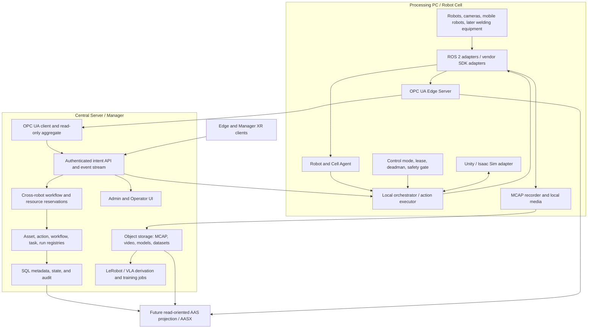

# SANG OPC UA Robotics / AAS Architecture Audit

- Date: 2026-09-01
- Status: Architecture decision record; no runtime change
- Scope: Robot/camera observation, distributed orchestration, recording, simulation, OPC UA, and future AAS
- Primary target: SO-101 dual arm, OMY, and RB5 first; heterogeneous robots, cameras, mobile robots, welding equipment, Unity/Isaac Sim, VLA, and XR later

Roadmap authority: the accepted findings and ordered implementation work are consolidated in
[`../SANG_MASTER_IMPLEMENTATION_PLAN.md`](../SANG_MASTER_IMPLEMENTATION_PLAN.md). This file remains the
detailed architecture decision and standards evidence record.

Status clarification added 2026-09-10: the baseline verdict below predates the restricted
IDTA 3.1.2 JSON/AASX-JSON importer and official-NodeSet reference projection now in the working
tree. Its "not yet an AAS implementation" sentence is historical, not current status. See the
master plan and `OPCUA_ROBOTICS_AAS_G6_M1_M5_EVIDENCE_2026-09-01.md` for the later restricted
implementation. A writable AAS Repository, XML-only AASX and OPC UA certification remain absent.

## 1. Executive verdict

The intended product direction is valid, and the repository does not need a full rewrite.

The system implemented today is best described as:

> a ROS 2 and vendor-SDK based distributed robot operations platform with SQL-backed fleet/task state,
> MCAP/object-storage evidence, simulation adapters, and a custom read-only OPC UA observation projection.

It is **not yet** an OPC UA Robotics-conformant server and it is **not yet** an AAS implementation. The
repository already states this correctly. The next standards step is therefore not to remove the SANG
model or replace ROS 2. It is to add a backward-compatible official-NodeSet-backed projection beside the
frozen SANG v1 tree, then validate it one robot profile at a time.

The recommended product boundaries are:

1. ROS 2 or a vendor SDK remains the real-time device and motion plane.
2. The Processing PC owns local execution, command authority, safety gating, acquisition, and recording.
3. Central owns identities, approved intent, cross-robot workflow, audit, catalog, and fleet views.
4. OPC UA exposes typed operational state and, only after physical commissioning, high-level operations.
5. MCAP and object storage carry high-rate evidence and media; OPC UA does not.
6. AAS later provides durable asset semantics, documents, relationships, and runtime interface references.
7. Physical E-stop and certified protective functions remain independent of ordinary ROS 2, Unity, XR,
   HTTP, and OPC UA traffic.

## 2. Evidence baseline

### 2.1 Normative and primary references

| Reference | How it is used here |
|---|---|
| [OPC UA for Robotics 1.02, OPC 40010-1](https://reference.opcfoundation.org/specs/OPC-40010-1) | Normative robot, controller, axis, power-train, safety-state, and operation model. |
| [Official Robotics NodeSet](https://github.com/OPCFoundation/UA-Nodeset/tree/latest/Robotics) | Runtime type and NodeId source; never copied or renamed into the SANG namespace. |
| [OPC UA for Machine Vision 1.0](https://reference.opcfoundation.org/specs/OPC-40100-1) | Used only for a complete vision system with state, recipe/configuration, and result handling. |
| [umati Robotics Reference Implementation](https://github.com/umati/OPC-UA-for-Robotics-Reference-Implementation) | Interoperability, certificate, gateway, multi-robot client, and browser-boundary reference. |
| [OPC Foundation MinimalRobotServer](https://github.com/OPCFoundation/UA-.NETStandard/tree/master/samples/Robotics/MinimalRobotServer) | Small official structural oracle; not a reason to rewrite the Python stack. |
| [umati asyncio sample server](https://github.com/umati/Sample-Server-asyncio) | Companion-NodeSet loading and instance-model examples; not a production platform. |
| [opcua-asyncio / asyncua](https://github.com/FreeOpcUa/opcua-asyncio) | Current Python implementation option for the bounded Edge and Central servers. |
| [open62541](https://github.com/open62541/open62541) | Future hardened native implementation candidate after measured need, not an immediate migration. |
| [IDTA AAS specifications](https://industrialdigitaltwin.org/en/content-hub/aasspecifications) | Future normative AAS metamodel, API, security, and AASX baseline. |
| [OPC Foundation AAS/OPC UA PoC](https://github.com/OPCFoundation/PoC-Unifying-AAS-and-OPC-UA) | Feasibility and UI/gateway ideas only; it explicitly is not a complete conformant product. |
| [Magician ROS 2 / OPC UA demonstrator](https://github.com/magician-project/magician-demonstrator) | Narrow bridge and BehaviorTree integration patterns, not the SANG fleet architecture. |
| [Rainbow Robotics RB5-850 product page](https://rainbow-robotics.com/en/products/rb5-850/) | Confirms that the control box advertises OPC-UA, but does not provide a public NodeSet or NodeId contract. |

### 2.2 Important corrections to avoid overclaiming

- OPC UA Robotics describes a **complete motion device system**. A Robotics Base Server Facet requires
  the `Rob MotionDeviceSystem Base` conformance unit, not merely joint variables with similar names.
- `MotionDeviceSystemType` is an entry under the DI `DeviceSet` and requires `MotionDevices`,
  `Controllers`, and `SafetyStates` containers. A `MotionDeviceType` has mandatory identification,
  `Axes`, and `PowerTrains`; each motion device has at least one axis and one power train.
- `AxisType/ParameterSet/ActualPosition` is a mandatory `Double` `AnalogUnitType`. Physical limits require
  `EURange`. The current custom `Float` value plus a text unit is semantically useful but is not that type.
- Robotics 1.02 includes `SystemOperation` and optional `TaskControl` operations. Their existence in the
  standard does not make them safe to expose before lease, deadman, authority, local interlock, and
  commissioning gates are complete.
- OPC UA Machine Vision models a vision **system**, including modes, state, jobs, recipes/configuration,
  results, and events. A D405/D455/MJPEG preview source is not automatically such a system.
- The umati repositories are references and prototypes, not certification tools.
- An RB5 marketing feature list is insufficient to use the control-box native OPC UA endpoint. The
  vendor information model, endpoint/security rules, NodeIds, update rates, and licensing still have to
  be obtained and tested.
- The A0 Pydantic contracts are AAS-ready internal contracts. They are not the IDTA metamodel, an AAS
  repository, an AAS API, or an AASX package implementation.

## 3. Final product understood from the project history

The target is not one robot dashboard. It is a lab-scale distributed robot operations and data platform
that can grow into a multi-cell system.



### 3.1 Required behavioral properties

- Different robot types use the same manifest, adapter, identity, health, time, action, and recording
  contracts while retaining vendor-specific local control.
- One task can coordinate A -> B -> C sequential steps and safe parallel steps through versioned actions,
  dependencies, barriers, resource reservations, and local acceptance/rejection.
- Central sends intent; a Processing PC decides whether and how an approved local action may execute.
- SO-101 may use a centrally hosted process initially, but it is still represented as a logical Cell
  Agent so that later migration to a dedicated PC does not change task contracts.
- Real and simulated assets share semantic identities and action contracts, but never share an
  unqualified physical command endpoint.
- Camera, joint, tool, object-pose, and process observations share source timestamps and calibration
  provenance for recording and VLA derivation.
- XR can request, observe, acknowledge, hold, and resume according to role. XR loss cannot be the only
  physical stop mechanism.

## 4. What the repository actually implements

### 4.1 OPC UA Edge

Implemented and useful:

- `contracts/opcua/model-contract.yaml:1-154` freezes the read-only v1 namespace, deterministic escaped
  NodeIds, source/server timestamps, StatusCode rules, sampling, queue size one, and performance gates.
- `contracts/opcua/README.md:42-54` explicitly declares Robotics alignment without conformance and defers
  Machine Vision for raw cameras.
- `contracts/opcua/SANG.NodeSet2.xml:44-406` defines reusable SANG robot, source health, joint feature,
  camera source, and clock types.
- `src/sang_opcua_gateway/sang_opcua_gateway/server.py:104-318` builds one custom robot observation tree
  per Agent from a manifest and mapping.
- `src/sang_opcua_gateway/sang_opcua_gateway/server.py:617` imports only the custom SANG NodeSet at runtime.
- `src/sang_opcua_gateway/sang_opcua_gateway/validate.py:170-214` audits Method count and writable Variables;
  the later checks enforce zero of each.
- Mapping v2 covers SO-101, OMY, RB5, and real/sim variants with per-feature provenance.
- SignAndEncrypt, certificate trust, authorization, reconnect handling, and deterministic deployment
  profiles are already present around this path.

Not implemented:

- Runtime import and instantiation of DI, IA, and Robotics NodeSets.
- `DeviceSet/MotionDeviceSystemType`, `ControllerType`, `MotionDeviceType`, `AxisType`, `PowerTrainType`,
  or `SafetyStateType` instances.
- A Robotics profile/conformance claim or CTT evidence.
- OPC UA control Methods.

Hardening gaps independent of Robotics conformance:

- Dynamic instance Variables currently rely on asyncua's read-only creation default. The server audits
  the result, but should also set AccessLevel/UserAccessLevel explicitly when each instance is created.
- Mapping `valid_range` is enforced for data-quality decisions but is not exposed to clients as an
  engineering range. The standard v2 projection should publish the applicable `EURange`; v1 must not
  change its existing Value DataType.

Conclusion: this is a strong custom read-only observation contract, not a defective Robotics server.
Its main weakness is that an off-the-shelf Robotics client cannot discover standard robot structures.

### 4.2 Central OPC UA

`src/fleet_control_plane/fleet_control_plane/central_opcua.py` implements a second read-only server with a
custom `urn:sang:fleet:central:operations:1` namespace. It projects summary, Agents, observed robots,
assets, task runs, and recording sessions from the Central snapshot.

Strengths:

- It is a projection, not a second writer to the SQL source of truth.
- Application Methods and writable Variables remain zero.
- It gives northbound clients one stable endpoint while the browser continues to use HTTP/WebSocket.

Gaps:

- Objects and Variables are created dynamically from `BaseObjectType`; there is no published Central
  NodeSet with reusable fleet types.
- Timestamps such as `GeneratedAt`, `ReceivedAt`, `StartedAt`, and `FinishedAt` are strings instead of
  OPC UA `DateTime` values.
- Assignment lists are JSON encoded into a String rather than typed arrays or references.
- `project()` creates and updates present entities but does not reconcile deleted entities out of the
  address space, so removed records can survive until server restart.
- Central writes plain values without a corresponding source StatusCode. For example, an unobserved
  asset becomes `Fresh=false` with Good quality, which cannot be distinguished from a valid observed
  stale result.
- The read-only audit runs once before `server.start()`. Entities introduced by later projection cycles
  are not included in that startup audit.
- Observed robots are flattened SANG summaries, not Robotics instances or links to the corresponding
  standard Edge object.
- The local “conformance report” proves read-only shape, not OPC UA Robotics conformance.

### 4.3 Registry, tasks, orchestration, recording, and UI

The source-of-truth split in `PLAN_TASK_SCOPED_OPERATIONS.md:417-438` is sound:

| Concern | Current authority | Correct long-term role |
|---|---|---|
| Local interfaces, topics, units, health | Versioned manifest/adapter contract | Keep authoritative locally; project to OPC UA. |
| Stable asset identity and approved configuration | Central SQL Asset Registry | Keep authoritative; later project to AAS and OPC UA. |
| Workflows, actions, tasks, runs, reservations, audit | Central SQL and versioned contracts | Keep; Central sends intent, not servo commands. |
| Latest health and host state | Agent runtime -> heartbeat -> SQL snapshot | Keep; OPC UA and UI are projections. |
| High-rate source data | ROS 2 runtime and selected MCAP | Keep out of relational hot paths and OPC UA history by default. |
| Recorded binary artifacts | Immutable local artifact -> object storage | Keep with checksums and provenance. |
| Playback/derived video and LeRobot datasets | Versioned derived artifacts | Keep in object storage, reproducible from source evidence. |
| Search time series/vector index | Derived and rebuildable | Add only for a demonstrated query workload. |

The current two user experiences should remain two views over one platform:

- Admin: assets, Processing PCs, workcells, assignments, workflows, policy, audit, recordings, and fleet.
- Operator: one task/cell, live state, cameras on demand, recording, action progress, hold/resume, and local
  intervention.

They do not need separate duplicated backends or separate robot communication stacks.

### 4.4 AAS-ready contracts

`src/fleet_control_plane/fleet_control_plane/asset_models.py:1-5` correctly says the A0 models are
command-free metadata only. The file defines:

- global and AAS-ready identity;
- immutable artifact/package references and hashes;
- Unity scene bindings and relationships;
- simulation qualification and evidence provenance.

This is valuable domain work. However, the current submodel slot names and Pydantic classes are SANG
contracts, not IDTA AAS model elements. SQLite remains authoritative and `asset_contracts.py` only emits
JSON Schemas. No AAS Environment, SubmodelElement tree, repository API, registry API, AASX package, or
standard semantic IDs are implemented.

The current `AasIdentifier` accepts only `urn:` and `https:` forms, and `SubmodelSlot` is an internal
Literal list rather than a set of IDTA semantic references. This is acceptable for A0 only. It must not
become the serializer contract for a future AAS Environment; use the pinned IDTA schemas and an explicit
mapping instead of gradually growing a second metamodel.

### 4.5 Maintainability state

The Central package has accumulated several bounded contexts in one Python package. The most visible
signals are `store.py` at about 4,000 lines, `workflow_authoring.py` at about 3,200 lines, and `app.py` at
about 2,100 lines. Several commissioning/control modules currently exist primarily as contracts and
tests, while setup metadata still describes the whole product as a “read-only central fleet registry”.

This does not justify a repository rewrite. It does justify a staged internal module split with the same
database, API compatibility, deployment, and monorepo until independent release cycles are real.

## 5. Classification

### 5.1 KEEP

| Item | Reason |
|---|---|
| ROS 2/vendor SDK device plane | Correct place for local drivers, high-rate state, actions, and hardware integration. |
| Per-Processing-PC Agent/Cell boundary | Supports Robotis PCs, Lab1, SO-101 central hosting, and later distributed cells. |
| Manifest + adapter + mapping approach | The right extensibility mechanism for new robots and cameras. |
| Frozen read-only SANG OPC UA v1 | Stable deployed identity, strong health/time semantics, and safe compatibility baseline. |
| SourceTimestamp/ServerTimestamp/provenance/StatusCode rules | Essential for correlation and honest stale/unknown handling. |
| Latest-only OPC UA sampling and no video bytes | Prevents OPC UA from becoming a lossy media or data-lake substitute. |
| SQL + MCAP + object storage split | Matches state, evidence, and binary workload characteristics. |
| Central intent / local execution split | Required for multi-robot orchestration without central servo control. |
| HTTP/WebSocket browser boundary | Browsers should not own OPC UA certificates or direct Edge sessions. |
| One product backend with Admin and Operator experiences | Avoids duplicated authority while preserving role-specific UX. |
| Unity/Isaac adapters behind the same action contract | Enables simulation qualification without making scenes the control source of truth. |
| Physical safety independence | Ordinary network software may observe safety state but does not replace certified circuitry. |

### 5.2 FIX

| Priority | Item | Required correction |
|---|---|---|
| P0 | Standards claim vocabulary | Keep “custom read-only”, “Robotics-aligned”, “interoperability tested”, and “certified/conformant” as four distinct claims. |
| P0 | Official Robotics projection | Import pinned Core/DI/IA/Robotics NodeSets and instantiate the mandatory standard structure only from verified data. |
| P0 | Robot metadata completeness | Add per-model sources for serial, manufacturer, product code, controller, safety state, axis, power train, unit, and range. Never fabricate mandatory values. |
| P0 | Central stale-node reconciliation | Delete or retire entities absent from a new authoritative snapshot and test create/update/delete behavior. |
| P0 | Central data quality | Carry source quality/provenance into DataValues; represent unobserved/unknown separately from a valid Boolean false. |
| P0 | Continuous read-only invariant | Set AccessLevel explicitly on every created instance and audit/test nodes created after startup, not only the initial snapshot. |
| P1 | Central type model | Publish a versioned SANG Fleet Operations NodeSet instead of only dynamic BaseObjectType nodes. |
| P1 | Central data types | Use DateTime, typed arrays/references, and explicit quality/provenance instead of timestamp and JSON strings. |
| P1 | Standard/current-value duplication | Map v1 joint features to official `AxisType/ActualPosition` without creating two independent calculations. One normalized sample feeds both projections. |
| P1 | Engineering ranges | Expose verified units and `EURange` in the official projection while preserving the frozen v1 wire type. |
| P1 | Package boundaries | Split registry, recording, orchestration, simulation/action, OPC UA, and AAS projection modules internally. Do not split repositories yet. |
| P1 | Product metadata | Update package descriptions and status docs so experimental command contracts are not mistaken for deployed physical control. |
| P1 | Catalog ownership | Make Action Library the executable versioned unit, Skill Catalog its typed capability/schema view, and Workflow a composition of published action versions. Avoid two competing action authorities. |
| P1 | AAS identifier/model boundary | Do not extend the current `urn:`/`https:` regex ad hoc. At AAS implementation time, validate IDs, references, and semantic IDs with the pinned IDTA schemas and map internal IDs explicitly. |
| P2 | Namespace ownership | Before external publication, freeze an organization-owned globally unique v2 namespace and lifecycle policy. Do not rename v1. |

### 5.3 OVERBUILT OR PREMATURE

These parts should be frozen or isolated, not deleted:

| Item | Assessment | Action |
|---|---|---|
| Detailed A0 scene/package/qualification schema before one A1 runtime bundle | Valuable but ahead of runtime evidence. | Freeze A0; do not expand fields until Scenario 1 runs end to end through one package. |
| Dormant demand arbitration, transport, and commissioning contracts in the main product package | Good safety preparation but can look operational when it is mainly test-constrained. | Mark experimental/commissioning and keep physical entrypoints absent. |
| One large Central package and very large store/app modules | Complexity now exceeds easy auditability. | Split by bounded context behind existing APIs; no microservice rewrite. |
| Custom joint type as the future external robot schema | It duplicates a standard Axis concept. | Keep for v1 compatibility; make official Axis the v2 northbound robot view. |
| Flat Central OPC UA strings for every fleet concept | Fast MVP but too ad hoc for a stable information model. | Replace with a typed Central NodeSet incrementally. |

### 5.4 REMOVE OR DEFER

No large implemented subsystem should be removed now. The following proposed work should be deferred:

- OPC UA video/frame transfer.
- Raw joint trajectory, Cartesian servo, or actuator targets as OPC UA Methods.
- Direct browser-to-Edge OPC UA sessions.
- Full Machine Vision modeling for every USB camera.
- Writable AAS repository, AAS-based control, or dual writes between AAS and SQL.
- OPC UA Historical Access as the primary telemetry store.
- PostgreSQL/Timescale or vector DB until a specific query cannot be served from catalog metadata plus
  derived indexes.
- Rewriting the current Python gateway in .NET or open62541 before load, soak, memory, reconnect, and
  interoperability evidence proves a need.
- Copying the complete umati Workbench/gateway/UI architecture into SANG.
- OPC UA PubSub until the subscriber, latency, topology, and reliability requirement is explicit.
- Native RB5 OPC UA control until the vendor NodeSet/manual and commissioning evidence are available.

### 5.5 MISSING

1. A machine-readable SANG-to-Robotics mapping matrix with mandatory/optional status, source, unit,
   quality, update rate, and supported robot models.
2. Official NodeSet runtime packaging and deterministic dependency import order.
3. A per-robot `robotics_profile` manifest declaring `unsupported`, `partial`, `base_candidate`, or
   `validated`, with evidence references. `partial` must never be presented as conformant.
4. One standard fixture each for SO-101, OMY, and RB5, including controller and power-train decisions.
5. Stable v1-to-v2 identity mapping and client migration tests.
6. A typed Central Fleet Operations NodeSet and lifecycle reconciliation.
7. Interoperability tests using at least two independent clients; later OPC Foundation CTT evidence for
   any actual conformance claim.
8. A vendor evidence package for native RB5 OPC UA.
9. An exact IDTA AAS release pin and a one-way SQL-to-AAS mapping specification.
10. A clear capability/action/workflow ownership glossary across UI, API, SQL, manifests, and OPC UA.
11. An explicit Cell aggregation contract. The v1 runtime is one gateway/one robot; the intended v2
    Processing Agent may need multiple robot adapters and multiple MotionDeviceSystems behind one Edge
    endpoint.
12. A demand-driven event and evidence-reference profile. Existing SQL health transitions may later be
    mirrored 1:1 as OPC UA events, and current nodes may link to immutable MCAP/media artifacts, but OPC UA
    must not become a second event judge or artifact catalog.

## 6. Target OPC UA information-model layering

### 6.1 Namespace policy

| Layer | Namespace | Rule |
|---|---|---|
| OPC UA Core/DI/IA/Robotics | Official URIs | Imported from pinned official NodeSets; never edited or copied. |
| Machine Vision | Official URI | Imported only by a qualified complete vision-system profile. |
| SANG observation v1 | `urn:sang:fleet:model:1` | Frozen compatibility model; existing NodeIds and behavior remain unchanged. |
| SANG Edge extensions v2 | New organization-owned major-version URI | Only clock/source health, stream/evidence links, mapping provenance, and concepts absent from Robotics. |
| SANG Fleet Operations | Versioned Central URI | Agent, Workcell, Task/Run, Recording, Action/Workflow, source endpoint, and AAS references. |
| Edge instances | Versioned Edge instance URI | Deterministic local observation identities; namespace indexes are never persisted. |

### 6.2 Edge dual projection

The same validated local sample should update both trees:

```text
Objects
+- DeviceSet
|  +- <MotionDeviceSystem>                    # official Robotics type
|     +- MotionDevices
|     |  +- <MotionDevice>
|     |     +- Axes
|     |     |  +- <Axis>/ParameterSet/ActualPosition
|     |     +- PowerTrains
|     +- Controllers
|     +- SafetyStates
|     +- SangOperationalExtension             # SANG-only AddIn/extension
|        +- Clock
|        +- Sources
|        +- StreamReferences
|        +- MappingProvenance
+- <existing agent/... v1 tree>                # unchanged compatibility view
```

Rules:

- Standard instances use official type definitions; SANG does not clone their BrowseNames or NodeIds.
- The v1 and standard trees share one in-memory source value and one quality decision.
- A model without truthful mandatory data remains v1-only or explicitly partial. Placeholder strings do
  not satisfy conformance.
- If SO-101 later qualifies, follower left/right should be two MotionDevices in one independently
  controlled follower system. Leader arms may be a separate teleoperation/input system. Until physical
  axis values, integrator nameplate, controller, safety, and power-train data exist, keep SO-101 in the
  custom v1/partial profile and do not present all four arms as a conformant robot.
- RB5 should initially use the existing ROS/vendor observation adapter. Native OPC UA can later become a
  separate source profile once the vendor contract is available.
- Cameras remain separate assets related by `observes`, `mountedOn`, or workcell assignment. They are not
  forced under the Robotics axis tree.
- Before publishing any v2 instance NodeIds, freeze the aggregation boundary. The recommended target is
  one logical OPC UA Edge endpoint per **Cell Agent/control-authority domain**, with one or more
  MotionDeviceSystem instances. This is not automatically one endpoint per physical PC: a Processing
  Node may host several isolated Cell Agents, and native vendor endpoints remain independent.
- Robot-specific adapters remain separate processes. A centrally hosted SO-101 is still assigned to a
  logical Cell Agent. The default reduces certificate/endpoint sprawl, but it couples OPC UA visibility:
  one Cell Edge failure hides every MDS in that endpoint. Split Cell Agents when controller, safety,
  ownership, maintenance, or availability domains differ.
- Freeze separate identities for `processing_node_id`, `cell_agent_id`, `motion_device_system_id`, and
  stable `asset_id`; do not overload one `agent_id` with all four meanings.

### 6.3 Central aggregation

Central has two different responsibilities and should not conflate them:

1. **OPC UA client/gateway:** maintains secure sessions to Edge/native servers and translates live state
   into the Central API/event stream. This follows the useful umati gateway boundary.
2. **Read-only northbound aggregate:** exposes stable fleet, task, recording, and low-rate robot shadow
   state for clients that require one OPC UA endpoint.

The aggregate should not pretend to be the physical controller. Every shadow node needs source endpoint,
source ApplicationUri, source NodeId/namespace identity, source timestamp, Central receive time, and
quality. Standard robot shadows may be added only when the complete official structure can be preserved;
otherwise the Central server should expose a typed SANG robot reference and summary.

The browser continues to use authenticated HTTP/WebSocket. This is not a compromise in OPC UA support;
it is a security and lifecycle boundary.

## 7. OPC UA Methods and control placement

### 7.1 Current rule

Keep zero writable application Variables and zero application Methods in both Edge and Central while
physical commissioning remains incomplete.

### 7.2 Future rule

If an external PLC/MES requirement appears, official Robotics 1.02 `SystemOperation` and optional
`TaskControl` Methods may be implemented at the **commissioned Edge MotionDeviceSystem/controller
boundary**. A call must enter the same local authority path as every other command:

```text
OPC UA Method
  -> authenticated principal and role
  -> idempotency/replay check
  -> approved action/program version
  -> resource reservation and lease
  -> control mode and deadman/TTL
  -> local safety/interlock acceptance
  -> vendor/ROS action executor
  -> audited result and state transition
```

Forbidden shortcuts:

- no direct Method-to-motor or Method-to-topic mapping;
- no raw trajectory payload as a general northbound Method;
- no Method that bypasses local arbitration because it came from Central;
- no claim that ordinary OPC UA or ROS 2 is the safety-rated stop channel;
- no parallel command authority in both HTTP and OPC UA.

Central cross-robot workflow remains a SANG concern. The Central UI uses the authenticated intent API.
If an external industrial client later requires OPC UA workflow invocation, use a separately threat-
modelled supervisor adapter that calls the same intent service. Do not add Methods to the read-only
Central aggregate or create an independent lease/authority implementation.

## 8. Machine Vision decision

The Machine Vision Companion Specification is **not applicable** to D405, D455, OTOS preview, or the five
SO-101 raw camera sources. Defer it until SANG operates a complete vision-processing system.

Keep the current camera contract for:

- asset identity and mounting/observation relationship;
- topic/device path and encoding/resolution/configured FPS;
- freshness, measured rate, sequence, timestamp provenance, and clock quality;
- on-demand preview URI;
- MCAP/media artifact and calibration references.

Adopt OPC UA Machine Vision later for a processing node that truly behaves as a vision system, such as
weld-pool inspection, person tracking, object-pose estimation, or quality inspection with controlled
configuration/recipe, job state, result identity, result payload reference, and events. The Machine
Vision server belongs on the Processing/ZED PC that owns that computation. Image bytes still use the
existing media/evidence path.

## 9. AAS decision

### 9.1 Do now

- Preserve A0 identity, package, scene-binding, and qualification as an explicitly experimental SANG
  contract; do not expand it into a second AAS metamodel.
- Pin one exact IDTA release and its identifier/reference constraints before declaring A0's future mapping
  boundary frozen or naming an output “AAS”.
- Preserve stable global identity, artifact hashes, calibration, documents, relationships, and runtime
  endpoint references in the canonical SQL/object-storage model.
- Complete one real Scenario 1 package and qualification flow using the current internal contract.

### 9.2 Do later

Implement a one-way, read-oriented mapper:

```text
Central SQL + object metadata + approved runtime references
  -> IDTA AAS Environment 3.1
  -> selected standard Submodels / semantic IDs
  -> AASX package and/or read API
```

SQLite/PostgreSQL remains the operational authority. AAS is a durable semantic projection and exchange
format. The first implementation must not allow independent edits in both AAS and SQL.

OPC 30270 / I4AAS 1.00 is a real published Companion Specification, but OPC Foundation now describes it
as tied to an older, incompatible AAS generation and planned for deprecation. It must not be selected as
the new SANG canonical AAS model. Use the pinned current IDTA metamodel/API/AASX release first, and revisit
the active OPC Foundation/IDTA AAS work when a current compatible release exists.

Likely AAS content:

- global identity and digital nameplate;
- technical data and vendor documents;
- composition, mounting, observes, and located-in relationships;
- approved capabilities and published Action/Skill references;
- Unity/USD/URDF, frame, calibration, and validation artifacts;
- OPC UA/ROS 2 runtime interface descriptors;
- maintenance and dataset/policy provenance.

AAS should not contain high-rate joint samples, live frames, command leases, safety logic, or the mutable
workflow execution state.

## 10. Repository and application structure

Keep one monorepo and one authoritative Central backend for now. Introduce internal boundaries before
creating new deployable services:

```text
src/fleet_control_plane/
  registry/          assets, workcells, assignments, connection profiles
  operations/        tasks, runs, reservations, audit, authority
  action_library/    immutable action versions and qualification
  recording/         session control, upload, catalog, playback, derivation
  simulation/        Unity/Isaac adapters and qualification
  opcua/             shadow client and Central read-only aggregate
  aas/               future one-way standards projection
  web/               API composition only
```

This is a logical destination, not a request for a large file move now. Extract one bounded context per
tested iteration while preserving imports and APIs.

Keep two UI experiences in the same design system and authentication boundary. Split deployment only if
offline cell operation, independent release cadence, or network-zone policy later requires it.

## 11. Staged migration

### R0 - Audit and freeze

- Preserve all v1 namespaces and NodeIds.
- Freeze claim vocabulary and reference versions.
- Publish this audit and the mapping-work plan.

Gate: no document calls the current custom tree Robotics-conformant or AAS-complete.

### R0.5 - Central correctness and read-only invariants

- Reconcile removed entities out of the Central address space.
- Preserve unknown/unobserved source quality with Bad/Uncertain StatusCodes and source timestamps.
- Set AccessLevel/UserAccessLevel explicitly at instance creation.
- Enforce the read-only invariant in the node-creation path and test entities added after server startup.

Gate: create/update/delete projection matches SQL, unobserved is distinguishable from valid false, and
every dynamically created application Variable is read-only.

### R1 - Standards mapping package

- Create a machine-readable official-node mapping matrix.
- Freeze the v2 Cell Edge aggregation and identity hierarchy before defining instance NodeIds; document
  the endpoint-failure coupling and split rule.
- Vendor/package the pinned NodeSets with license and digest verification.
- Define manifest v0.2 metadata for identification, axes, power trains, controller, and safety state, then
  add robot profile fixtures for SO-101 first.
- Decide the organization-owned v2 namespace.

Gate: every mandatory Robotics Base element is `available`, `honestly unavailable`, or `not attempted`;
none is silently fabricated.

### R2 - First truthful read-only dual projection

- Import official NodeSets in dependency order.
- Use SO-101 first to prove the coverage validator and explicit `partial/unsupported` result, but do not
  map `lerobot_normalized` values to `AxisType/ActualPosition`.
- Select OMY or RB5 as the first standard MotionDeviceSystem candidate after its mandatory nameplate,
  controller, power-train, safety, unit, and range evidence is complete. SO-101 may join later when a
  truthful physical-axis source and integrator metadata exist.
- Instantiate the official DeviceSet/MotionDeviceSystem tree only when the selected profile is complete.
- Feed v1 and v2 from the same sample/quality calculation.
- Keep zero control Methods and zero writable application Variables.

Gate: existing v1 client tests remain unchanged; two independent OPC UA clients browse/read the standard
tree; lifecycle, reconnect, status, timestamp, and performance gates pass.

### R3 - OMY and RB5 profiles plus Central typed model

- Add truthful OMY and RB5 controller/axis/power-train/safety metadata.
- Compare RB5 native OPC UA with the ROS/vendor adapter only after receiving the vendor contract.
- Publish a typed SANG Fleet Operations NodeSet.
- Fix DateTime/arrays and preserve source provenance in the typed Central model.

Gate: all three robots pass the same profile test kit, and Central create/update/delete behavior matches
SQL exactly.

### R4 - Interoperability and claim gate

- Test UaExpert or an equivalent independent client, the official .NET sample/client path, and the umati
  gateway/workbench where compatible.
- Run OPC Foundation CTT for any profile that will be called conformant.
- Record load, memory, reconnect, certificate rotation, and 2-hour distributed soak evidence.

Gate: claims are limited to the exact tested profile/version.

### R5 - Qualified vision-system profile

- Select one real processing workload, preferably weld/pose/person analysis rather than a raw camera.
- Map its state, configuration/recipe, result, and event lifecycle to Machine Vision.
- Keep frame/media payloads external.

Gate: a real consumer can start/observe a qualified job and resolve its result artifact without receiving
continuous image bytes through OPC UA.

### R6 - Read-oriented AAS 3.1 projection

- Map canonical identity and artifact metadata to the pinned IDTA metamodel.
- Export AASX and/or a read API from the same source snapshot.
- Validate stable identity and OPC UA/artifact references.

Gate: deleting and regenerating the AAS output from canonical SQL/object metadata yields the same semantic
content; no dual-write path exists.

### R7 - Optional commissioned operations

- Only after the physical G7-style commissioning gates, add selected Edge SystemOperation/TaskControl
  behavior through the existing command authority.
- Keep Central aggregate read-only.

Gate: unauthorized, stale, replayed, lease-free, unsafe, and disconnected calls are rejected; physical
safe state is independently demonstrated.

## 12. Decisions still required from the user or lab

These are not blockers for R0. They become gates for later stages:

1. The actual northbound OPC UA consumer and use case: SANG-only shadow, UAExpert/lab client, MES, SCADA,
   PLC, umati-style dashboard, or an external partner. Without a consumer, R0.5 remains valuable but the
   standard projection should stay a bounded interoperability experiment.
2. The organization-owned namespace/domain to publish for v2.
3. Whether the goal is lab interoperability, a declared OPC UA Robotics profile, or formal certification.
4. Verified manufacturer, model, product code, serial, controller, power-train, and safety-state sources
   for each SO-101/OMY/RB5 profile. For assembled SO-101 systems, the lab may be the integrator of record.
5. The RB5 vendor OPC UA information-model and security documentation.
6. Whether northbound industrial clients require one Central OPC UA endpoint or may discover Edge
   endpoints through Central.
7. The first camera-processing workload that qualifies as a complete Machine Vision system.
8. The exact IDTA AAS release and the external exchange partner/use case that will consume AAS.
9. Physical commissioning values and approvals before any network-originated operation Method is enabled.

## 13. Critical cross-review with Claude

Two independent Opus reviews were run read-only. The first review was intentionally adversarial; the
second received the disputed official clauses and local code evidence and had to accept, defend, or
withdraw each claim.

### 13.1 Findings accepted from Claude

| Finding | Resolution |
|---|---|
| Central never removes absent entities | Accepted as P0 correctness defect. |
| Central collapses unobserved and valid false into Good Boolean values | Accepted as P0 data-quality defect. |
| Startup audit misses entities created by later projection cycles | Accepted; enforce at the creation boundary, not by occasional full scans alone. |
| Dynamic Variables rely on asyncua's read-only default | Accepted as hardening/regression risk, not a current write vulnerability. |
| Mapping ranges never reach clients as EURange | Accepted; expose only in the new official/typed projection. |
| Cell-vs-robot endpoint choice must precede v2 NodeIds | Accepted and refined to one endpoint per Cell Agent/control-authority domain, with explicit availability coupling. |
| A0 identifiers and Submodel slots are not an IDTA metamodel | Accepted; pin and map the IDTA model instead of growing regexes and Literals. |
| Raw cameras do not qualify for Machine Vision | Accepted and reworded from merely “defer” to “not applicable until a vision system exists”. |

### 13.2 Claims rejected, then withdrawn by Claude

| First-round claim | Evidence and final result |
|---|---|
| Robotics 1.02 has no control Methods | Rejected by official 7.10, 7.12, 7.16, and the MDS Operation Facet. Claude identified its information as stale and withdrew the claim. |
| OMY/RB5 lack only SafetyState | Rejected: current manifests also lack mandatory manufacturer/serial/product code, controller, axes/power-train model, SpeedOverride, and standard AnalogUnit value. Withdrawn. |
| Mapping and manifest have no cross-check | Rejected by `contract.py:314-322`, `455-600`, and `750-765`. Withdrawn. |
| OPC 30270 should be the current AAS baseline | Rejected because OPC Foundation marks that old-generation mapping for deprecation after incompatible AAS v3 changes. Withdrawn. |

### 13.3 Productive disagreement resolved

Claude initially recommended that all future Methods live in a third supervisor server and never in Edge.
The final resolution is semantic rather than process-based:

- Central aggregate remains permanently read-only and Method-free.
- Current Edge remains Method-free.
- A future Method process may be isolated technically, but it is part of the same logical commissioned
  Cell Edge authority and must use the one shared arbiter, lease, deadman, and safety path.
- Per-device standard operations belong at the Robotics MotionDeviceSystem/controller boundary; SANG
  cross-robot workflow intent belongs to the Central orchestration API.
- No second command authority is permitted regardless of protocol or process layout.

### 13.4 Final joint priority order

1. Fix Central entity lifecycle and quality semantics.
2. Make read-only creation explicit and continuously enforced.
3. Define manifest v0.2 Robotics evidence without fabricating values.
4. Freeze Cell/Processing/MDS/asset identity and aggregation boundaries.
5. Pin current IDTA AAS and identifier rules before expanding A0.
6. Expose verified engineering units/ranges in the future typed projection.
7. Add the official Robotics dual projection only after coverage is complete.
8. Keep Methods, Machine Vision for raw cameras, high-rate OPC UA, and stack rewrites out of the current slice.

## 14. Recommended immediate next implementation

Start R0.5, then R1. Do not start AAS runtime or OPC UA control:

1. Fix Central stale-node reconciliation and StatusCode/source-time propagation with lifecycle tests.
2. Make every dynamic Variable explicitly read-only and enforce that in the creation path.
3. Freeze the Cell Agent/Processing Node/MDS/asset identity hierarchy and endpoint split rule.
4. Add `robotics-projection-v2.mapping.yaml` and a validator that reports mandatory coverage without
   creating server nodes.
5. Build one SO-101 negative/partial fixture containing only truthful metadata and explicit unsupported
   fields, plus one OMY or RB5 base-candidate fixture when vendor evidence is available.
6. Package and digest-check the pinned official NodeSets.
7. Add tests proving v1 identity cannot change.
8. Review the resulting coverage report before implementing the dual address space.

This sequence first fixes two current correctness bugs, then converts the “aligned” claim into a bounded
implementation plan grounded in the official model while preserving every working robot, camera, UI,
recording, and simulation path.
