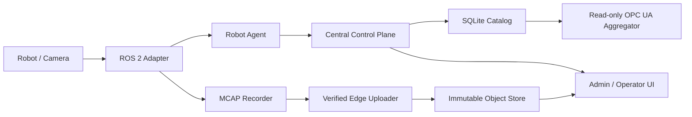

# SANG Robot/Camera Operations v1

Status: implementation complete with an observation-only LeRobot derivation extension; physical
deployment acceptance remains site-specific.

Public product and safety boundaries are defined in [requirements](requirements.md).
Acceptance of one site topology does not automatically accept another deployment;
repeat the applicable checks for the installed devices and configuration.

## Release boundary

This release registers and observes heterogeneous robots, cameras, Processing Nodes, Workcells and
Task Runs. It authenticates users and Edge services, relays one selected camera on demand, receives
already-finalized observation sessions, catalogs immutable objects, and exposes a read-only Central
OPC UA view. A separate bounded worker can derive a LeRobot v3 dataset from a quality-passed MCAP
session without changing the source recording.

It does **not** send robot commands, publish ROS command topics, call vendor command channels, switch
RB5 modes, operate an EEF, welder or feeder, expose writable OPC UA nodes, train policies, or invent
robot actions from measured state. Welding hardware remains a future asset/adapter addition.



## Storage contract

| Layer | Authoritative content | Not stored here |
|---|---|---|
| Versioned YAML/JSON manifests | Robot topic contracts, camera bindings, OPC UA mappings, capture profiles | Live values and media |
| Central SQLite schema v11 | Registry identity and revisions, Workcells, Task definitions/runs, reservations, users/service-token hashes and Agent scopes, browser sessions, security/config audit, latest Agent snapshots, health events, recording/quality/LeRobot derivation metadata and object SHA-256 | Raw images, video, MCAP payloads, plaintext passwords or service tokens |
| Central Object Store | Selected finalized `metadata.yaml`, `.mcap`, canonical session and quality manifests, plus immutable LeRobot tar/derivation manifests | Search indexes and mutable configuration |
| Future vector database | Derived image/text embeddings plus IDs pointing back to catalog objects | Original media, registry truth, safety state or live motor values |
| Future AAS layer | Standards mapping of stable asset identity, capabilities, documentation and relationships | High-rate telemetry payloads and camera frames |

The v1 Object Store backend is a confined filesystem namespace. Objects are streamed to temporary
files, checked by exact size and SHA-256, and published atomically without overwrite. Its interface
allows a later S3/MinIO backend without changing recording manifests or catalog rows. SQLite remains
the searchable metadata index; it is not a high-rate historian.

## First local installation

Build once in the ROS 2 Jazzy container:

```bash
cd "/home/sa08050/app developer/v2_ws"
source /opt/ros/jazzy/setup.bash
colcon build --symlink-install
source install/setup.bash
```

Create private state and bootstrap the first administrator before starting authenticated Central:

```bash
install -d -m 700 "$HOME/.local/share/sang-fleet" "$HOME/.local/share/sang-objects"
umask 077
printf '%s\n' 'replace-with-a-long-unique-password' > /tmp/sang-admin.password
ros2 run fleet_control_plane fleet_identity \
  --db-path "$HOME/.local/share/sang-fleet/fleet.db" \
  bootstrap-admin \
  --principal-id lab-admin \
  --display-name "Lab Administrator" \
  --password-file /tmp/sang-admin.password
rm /tmp/sang-admin.password
```

Start the local authenticated release profile:

```bash
export SANG_WORKSPACE="$PWD"
export SANG_CENTRAL_DATA="$HOME/.local/share/sang-fleet"
export SANG_OBJECT_STORE="$HOME/.local/share/sang-objects"
export SANG_CENTRAL_SECRETS="$HOME/.local/share/sang-secrets"
export CENTRAL_ALLOWED_HOST=manager.sang.local
docker compose -f docker/compose.operations-v1.yaml --profile local up -d
```

Open `http://127.0.0.1:18091/login.html`. `/config.html` manages registry objects and Task Run
transitions. `/catalog.html` is read-only and lists centrally completed recording sessions and
LeRobot derivations. The Operator page remains read-only except for its bounded capture workflow.

## Edge upload identity and selected sessions

The distributed deployment uses a dedicated recording data ingress on `${CENTRAL_RECORDING_PORT:-8444}`.
It reuses the enrolled Agent mTLS certificate and CRL but runs separately from heartbeat port `8443`,
so a multi-gigabyte transfer cannot occupy the heartbeat process. The Admin API remains loopback-only.

Start Central with the recording profile:

```bash
docker compose \
  --env-file runtime/phase3-lab1/config/central.env \
  -f docker/compose.phase3-central.yaml \
  -f docker/compose.phase3-lab1-preview.yaml \
  --profile recording up -d
```

On the Processing PC, set `CENTRAL_RECORDING_URL=https://<central-ip>:8444` and start the normal
`central` profile. `recording-uploader` scans only finalized directories matching `SANG_AGENT_ID` and
the configured `CAPTURE_PROFILE_ID`:

```bash
docker compose \
  --env-file runtime/processing-lab1/config/edge.env \
  -f docker/compose.rb5-lab1-observation.yaml \
  --profile central up -d agent recording-uploader
```

The uploader mounts captures read-only and records only retry/checkpoint state in
`/var/lib/sang/recording-upload.db`. It registers the immutable manifest first, hashes and streams only
Central's pending files in 1 MiB blocks, resumes partial sessions, and exponentially retries transient
failures. Once Central reports `COMPLETE`, restarts do not re-hash or re-upload the session. Central
independently verifies exact length and SHA-256 before atomically publishing each object.

For a one-shot Agent mTLS transfer, use `fleet_recording_upload` with `--client-certificate`,
`--client-private-key`, and `--ca-bundle`. The authenticated Operations Admin API also retains the
service-token mode for local/manual workflows, but a remote Processing PC should use the dedicated
mTLS data ingress rather than exposing the Admin API. v1 does not retrospectively clip a rolling
buffer: the desired interval must already be a finalized recorder session.

## Remote deployment

Use the `remote` Compose profile only after provisioning:

- a Central HTTPS server certificate/key and an allowed DNS name or IP;
- an Agent-ingress server certificate/key plus the Agent CA/CRL bundle;
- a dedicated recording-ingress port using the same Agent CA/CRL and server certificate;
- a Central preview-client certificate/key trusted by every Edge preview server;
- each Edge preview server's exact authorized Central client certificate SHA-256 pin;
- an Edge preview URL whose host is the same IP observed on that Agent's last successful mTLS heartbeat;
- an OPC UA server certificate/key, trust directory, CRL directory and authorized user certificate;
- firewall rules exposing only the chosen HTTPS and OPC UA ports.

```bash
docker compose -f docker/compose.operations-v1.yaml --profile remote up -d
```

Remote Central cannot start without authentication, HTTPS material and `CENTRAL_ALLOWED_HOST`.
The same profile also starts the dedicated mTLS Agent ingress on
`${CENTRAL_INGRESS_PORT:-8443}`. Remote Agents post heartbeat v2 there; they cannot use the Admin
API heartbeat route, which is intentionally loopback-only. Do not start the legacy
`docker/compose.phase3-central.yaml` against the Operations v1 database to supply ingress: the v1
profile already owns that service and mixing the stacks can bypass the release authentication
contract.
Remote OPC UA uses `Basic256Sha256` with `SignAndEncrypt`; insecure OPC UA is loopback-only. The
camera relay accepts only a registered camera assigned to the requested Task Run and never accepts an
upstream URL from the browser. Only the selected camera is fetched.

Restrict `${CENTRAL_ADMIN_PORT:-18443}` to the management subnet, expose
`${CENTRAL_INGRESS_PORT:-8443}` only to enrolled Edge subnets, and expose
`${CENTRAL_RECORDING_PORT:-8444}` only to enrolled Processing PCs. Expose
`${CENTRAL_OPCUA_PORT:-4850}` only to authorized OPC UA clients. On each Edge, allow its mTLS camera
preview port only from Central. No ROS 2 DDS or robot/vendor control port is opened by this profile.

## Backup, upgrade and rollback

Finalize or explicitly resolve all `STAGING` recording sessions first. Then create and verify a
versioned backup:

```bash
ros2 run fleet_control_plane fleet_backup backup \
  --db-path "$SANG_CENTRAL_DATA/fleet.db" \
  --object-store-root "$SANG_OBJECT_STORE" \
  --output "/srv/sang-backups/operations-$(date +%Y%m%d-%H%M%S)"

ros2 run fleet_control_plane fleet_backup verify \
  --backup /srv/sang-backups/<backup-directory>
```

Backups contain identities and session hashes and must be access-controlled like the live database.
The SQLite copy uses the online backup API; only catalog-referenced complete recording, quality and
LeRobot derivation objects are copied and verified. Upgrade Central before Edge Agents because
heartbeat fields are additive. Start the new
Central against a copied staging database, verify login/config/catalog/OPC UA, then switch the live
service.

Rollback never downgrades the live database in place. Stop Central, restore a verified pre-upgrade
backup to **new, empty** paths, point the previous image at those paths, verify, then switch traffic:

```bash
ros2 run fleet_control_plane fleet_backup restore \
  --backup /srv/sang-backups/<backup-directory> \
  --db-path /srv/sang-rollback/fleet.db \
  --object-store-root /srv/sang-rollback/objects
```

## Release checks

1. Login succeeds; anonymous Fleet/config/catalog requests return `401`.
2. Viewer writes return `403`; operator can transition Task Runs/upload sessions; only admin can
   mutate registry or identities. Browser writes without matching CSRF return `403`.
3. Registry replacement rejects stale revisions, terminal Task Runs cannot reactivate, and terminal
   transitions release reservations once.
4. Two Agents remain isolated when one sends malformed data or goes offline.
5. Selecting one assigned camera opens one bounded relay; unassigned and arbitrary URLs are rejected.
6. A finalized session survives upload, catalog lookup, download, backup verification and clean-path
   restore with identical SHA-256 values.
7. A quality-passed session can produce an idempotent observation-only LeRobot v3 tar whose source,
   quality, robot-manifest and output hashes remain queryable; it contains no `action` feature.
8. OPC UA conformance reports zero Methods and zero writable application Variables.
9. Full tests and `colcon build --symlink-install` pass before deployment.

Physical robot/camera validation, time synchronization acceptance and long soak reports remain tied
to each site, manifest, ROS domain and hardware serial. Software completion does not replace those
hardware acceptance steps.

## Known v1 operational limits

- Enforce login throttling and `security_audit` retention at the management gateway until Central
  owns a durable multi-instance rate-limit policy.
- Monitor and quota the Object Store filesystem per site. Manifest size/hash checks prevent corrupt
  objects but do not choose a lab-specific capacity policy.
- `shared_read` assignments are conservatively reserved across one READY/ACTIVE Task Run in v1.
  Concurrent read-only Task Run fan-out requires an explicit reservation migration in a later release.
