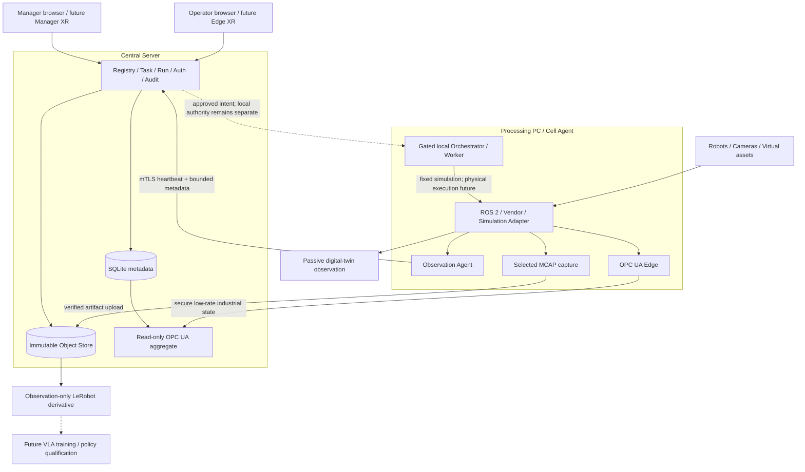

# SANG: OPC UA 기반 로봇 운영·데이터·디지털 트윈 플랫폼

기준일: 2026-09-10. 목적: 지금까지 합의한 제품 개념과 구현 결과를 한 번에 이해하기 위한 설명서.
필수 기능과 권한·안전 경계는 [요구사항](requirements.md)을 따릅니다.
이 문서는 별도의 로드맵이나 실물 운전 승인이 아닙니다.

## 1. 우리가 만드는 것

목표는 특정 회사 로봇 한 대를 보여주는 대시보드가 아닙니다. 여러 작업 셀의 로봇, 카메라,
이동체, 도구와 Processing PC를 고유 자산으로 등록하고, 이 자산들을 작업에 배정해
관측·기록·시뮬레이션·협업 실행을 관리하는 분산 시스템입니다.

첫 로봇군은 양팔 SO-101(Sang), ROBOTIS OMY, Rainbow Robotics RB5-850E입니다.
장기적으로 다른 로봇도 제조사별 Adapter와 자산/동작 계약을 추가해 연결해야 합니다.
특정 시나리오의 로봇 이름이나 IP를 중앙 프로그램의 제어 로직으로 하드코딩하지 않는 것이 목표입니다.

대표 작업은 다음과 같습니다.

1. 운반 로봇이 재료를 배송합니다.
2. OMY가 플레이트를 작업 위치에 배치합니다.
3. RB5가 지정한 작업 경로를 수행합니다.
4. OMY가 결과물을 회수합니다.
5. 운반 로봇이 복귀합니다.

최종 제품은 순차·병렬·조건 분기와 사람의 개입을 지원해야 합니다. 다만 현재 실제로 검증한
Isaac Scenario 1 Adapter는 위의 고정된 순차 5단계이며, 범용 병렬 다중 로봇 실행의 검증을
대신하지 않습니다. RB5 단계에서는 용접 아크나 와이어 피더를 켜지 않습니다.

## 2. “확장된 OPC UA”의 정확한 의미

프로젝트에서 사용하는 표현은 **OPC UA 표준 자체를 새로 정의한다는 뜻이 아닙니다.**
OPC UA의 산업용 정보 표현·교환을 한 계층으로 사용하고, 그 위와 옆에 자산 관리,
작업 편집, 실행 권한, 디지털 트윈, 데이터 저장과 학습 데이터 준비를 결합한다는 뜻입니다.

외부 설명에는 다음 명칭을 사용합니다.

> SANG is an OPC-UA-based distributed robot operations, data, and digital-twin platform.

| 계층 | 책임 | 대신하지 않는 것 |
|---|---|---|
| ROS 2 / 제조사 SDK | 장치별 관측, 향후 승인된 로컬 동작 실행 | 중앙 사용자·작업·데이터 관리 |
| OPC UA / Robotics 정보모델 | 장비 구조·상태·품질·시간의 표준적 표현과 상위 시스템 연계 | 고속 관절 제어 루프, 영상 저장, 안전 릴레이 |
| SANG Control Plane | 자산/Task/Run, 권한, 배정, 감사, 버전과 실행 의도 | 제조사 모터 컨트롤러 |
| Processing Orchestrator | 승인된 동작의 순서, 진행 상태, 중단·복구와 로컬 실행권 | 물리 E-stop·안전 PLC |
| Unity / Isaac | 관측 표시, 시뮬레이션, 검증용 증거 | 자동으로 안전이 보장되는 실물 대체품 |
| AAS | 자산의 장기 의미 정보와 문서/모델 참조 | 실시간 데이터 버스나 작업 명령 통로 |
| SQLite / MCAP / Object Store | 운영 메타데이터, 선택한 관측 원본, 불변 대용량 파일 | 하나의 만능 DB |

OPC UA Robotics 1.02는 장치 정보뿐 아니라 `SystemOperation`, `TaskControl` 관련
동작 모델과 Method도 정의합니다. “표준에는 Method가 없다”는 이전 설명은 잘못된 것입니다.
SANG의 현재 OPC UA 애플리케이션 객체가 읽기 전용이고 호출 가능한 명령을 제공하지 않는 것은
현재 제품 경계와 검증 상태에 따른 결정입니다. 향후 작업 수준 Method를 검토하더라도
기존 권한·버전·실행권·감사를 통과하는 같은 작업 요청 경로에 연결해야 하며,
그 경로가 모터/안전 검사를 우회해서는 안 됩니다.
[공식 OPC 40010-1 정의](https://reference.opcfoundation.org/specs/OPC-40010-1/full).

현재 웹의 시뮬레이션 버튼이 OPC UA Method를 호출한다고 설명하면 안 됩니다.
웹 요청은 SANG의 API·영속 큐·별도 Worker를 거칩니다. OPC UA 관측 경로와 구분됩니다.

## 3. PC와 사용자의 역할

| 역할 | 주된 책임 | 현재 상태 |
|---|---|---|
| Central Server | 자산/작업 registry, 사용자·권한, 감사, 업로드 검증, catalog, OPC UA 집계 | 구현됨 |
| Manager PC | 브라우저로 여러 작업·Processing PC·기록·상황 확인 및 허용된 관리 요청 | 구현됨; 원격 접속은 HTTPS/인증 필요 |
| Processing PC | 장치 가까이에서 관측·녹화·Adapter 실행; 장기적으로 Cell Orchestrator의 로컬 책임 | 관측·기록 구현, 현재 시뮬레이션은 전용 로컬 Worker로 검증 |
| Edge Operator | 배정된 Task Run 관측, 카메라 선택, 제한된 녹화 시작·중지, 현장 개입 | 녹화/관측 UI 구현; 실물 조종은 미승인 |
| Safety Officer | 실물 운전 전 현장 자료와 독립 안전 조건 검토 | 비동작성 증빙/검토 소프트웨어 존재; 현장 승인 미완료 |
| Build Owner | 동작 코드와 장면을 신뢰할 수 있는 실행 산출물로 빌드·검증·배포 | 수동/고정 빌드 경로 존재; 자동 서명 배포는 후속 |

Central Server와 Manager PC는 같은 개념이 아닙니다. Manager는 다른 노트북에서도
중앙 서버에 접속할 수 있습니다. Admin/Operator는 역할과 화면이 구분되지만,
현재는 공통 React·TypeScript·Ant Design 코드와 백엔드 계약을 공유합니다.

Processing PC 하나에 여러 독립 Cell Agent를 둘 수 있다는 설계이며,
Cell Agent는 단순 PC 이름이 아니라 장치 소유권·권한·장애를 분리하는 단위입니다.
별도 로봇 PC가 있는 OMY와 중앙 PC에 직접 붙는 SO-101도 같은 자산/Agent 계약으로 표현합니다.

Manager의 Meta Quest, Edge 작업자의 Galaxy XR 사용도 목표에 포함됩니다.
현재 XR는 입력 수신과 목표 자세 미리보기 개발 단계입니다. 시선·손 추적이나
네트워크가 끊겼다고 물리 E-stop이 수행되는 구현으로 표현하지 않습니다.

## 4. 시스템 구조

다음은 **목표 책임 분리**입니다. 점선 부분과 승인된 실물 실행은 아직 전체 배포가 검증되지 않았습니다.



**2026-09-09에 직접 검증한 Isaac 실행 경로**는 더 구체적입니다.

```text
Web Workflow
  -> Central API + immutable publication + SQLite simulation queue
  -> dedicated local Worker + short-lived permit
  -> pinned Isaac Scenario 1 executor (sole virtual motion authority)
  -> localhost-only ROS 2 domain 98 feedback
  -> receiver's validated local snapshots
  -> separately built, passive Unity observer
```

이 시험의 Central/Worker/Isaac/Unity는 같은 호스트에 있었습니다. 관측 Agent의 분산
mTLS 운영 실적과, 모든 시뮬레이션 Worker를 임의의 원격 PC에 배치할 수 있다는 주장은 다릅니다.
GPU 실행기, 장면 준비, 빌드 경로와 공유 런타임 경로의 자동 배포는 남아 있습니다.

## 5. 자산, 동작, 작업을 구분하는 방법

- **Asset**: 물리 또는 가상 로봇·카메라·도구의 안정적인 식별자입니다. IP는 변경 가능한 접속 정보이지 자산의 정체성이 아닙니다.
- **Manifest**: 관절명·단위·관측 토픽·정상 주기·Adapter·식별자 등의 버전 있는 계약입니다.
- **Action**: 로봇 종류에 속하는 이름 있는 동작입니다. C# 또는 Python 소스, 허용 입력값, 제한과 실행 구현을 버전·해시로 묶습니다.
- **Skill/Capability**: 어떤 기능을 어떤 입력 계약으로 수행할 수 있는지 설명하는 내부 계약입니다. 사용자는 Action 중심으로 편집합니다.
- **Task/Workflow**: 필요한 자산/역할, 동작 순서와 의존 관계를 정의한 게시 가능한 작업입니다.
- **Run**: 게시된 특정 버전을 한 번 실행한 기록입니다. 시뮬레이션 Run과 실물 자산의 권한은 별개입니다.
- **Capture Job/Recording Session**: 하나의 Task Run에 연결된 녹화 요청과 실제 원본 기록입니다.

게시된 Task/Workflow/Action은 덮어쓰지 않습니다. 변경은 새 버전으로, 작업 복사는 새 Task
정체성으로 생성합니다. 실행은 정확한 게시본·소스·빌드·장면·Adapter 해시에 연결합니다.

Action Library는 파일을 데이터로 저장하고 정적 검사할 수 있지만, 업로드했다고 실행하지 않습니다.
목표 계약은 신뢰할 수 있는 빌드 담당자가 설치한 정확한 해시와 해당 동작의 성공한 증거를 요구합니다.
다만 현재 등록 Gate는 등록된 정의와 완료된 Step을 매칭하며, 과거 Run의 profile 해시를 현재
Adapter 해시와 비교하는 검사가 부족합니다. 등록 정의를 실제 설치된 빌드로 인증하는 기능도
없으므로 이 Gate를 완전한 빌드 인증으로 부르면 안 됩니다. 마스터 계획의 `ACT-C01`로 기록했습니다.
브라우저에 임의 경로·제조사 주소·코드를 넘겨 즉시 실행하는 기능은 없습니다.

## 6. 저장소 설계: 무엇을 어디에 저장하는가

초기에 말한 “OOP 객체 + 실시간 DB + 영상 BLOB”은 다음처럼 구체화됐습니다.
OOP는 프로그램 내부의 모델링 방법이지 독립적인 영속 DB의 종류는 아닙니다.

| 정보 | 저장 위치 | 이유 |
|---|---|---|
| Asset ID, 관계, 배정, 사용자, Task, Run, 버전, 사건/감사 | SQLite | 조회·관계·트랜잭션·복구를 위한 운영 메타데이터 |
| 토픽, 단위, 속도/범위, 카메라 경로와 Adapter 계약 | 버전 관리된 manifest/config | 실행 전에 검증할 재현 가능한 설정 |
| 현재 관절값·카메라 수신 상태 | ROS 2와 Agent의 제한된 최신 상태 | 모든 샘플을 중앙 운영 DB에 쌓지 않음 |
| 사용자가 선택한 구간의 영상·관절 관측 원본 | MCAP 파일 | 시간·토픽·메시지를 함께 보존 |
| MCAP, AAS 원본/정규화본, 모델/빌드 패키지, 파생 영상·데이터셋 | 불변 Object Store + SQLite 참조 | 큰 바이트를 DB row와 분리하고 크기·SHA-256 검증 |
| 향후 의미 검색용 embedding | 향후 Vector DB + 원본 객체 참조 | 원본 영상이나 자산 registry를 대체하지 않는 파생 검색 계층 |

MCAP(Message Capture)은 이종 센서 메시지를 타임스탬프와 함께 담는 파일 포맷입니다.
현재 압축 카메라 원본은 이미 JPEG이면 불필요하게 다시 압축하지 않고 보존합니다.
파일 크기는 원본 압축률·카메라 수·프레임 수에 달려 있으며, MCAP이라는 이유만으로 작아지지 않습니다.

Object Store는 대용량 바이트 객체를 보존하는 저장 계층입니다. 현재 구현은 파일시스템 기반이며,
클라우드 S3나 Azure Blob 서비스가 자동 구성된 것은 아닙니다. Vector DB는 아직 없습니다.

브라우저 녹화 재생은 검증된 MCAP의 색인을 사용해 선택한 JPEG 프레임만 가져옵니다.
최대 네 카메라를 한 타임라인에서 보고, 요청 시간과 실제 프레임의 차이를 표시합니다.
지원되지 않는 코덱·원시 깊이 영상을 모두 일반 동영상처럼 재생하는 기능은 아닙니다.

## 7. 시간 동기화의 의미

상태가 최신인지, 두 PC의 시계가 얼마나 맞는지, 카메라 노출 시점과 로봇 샘플이 정확히 같은지는
서로 다른 문제입니다. 현재 시스템은 rate(수신 주기), gap(공백), timestamp regression(시간 역행),
skew(가까운 영상·관절 샘플 간 시간차)와 소프트웨어 시계 상태를 기록·평가합니다.

이는 하드웨어 동시 노출, 컨트롤러 시계의 정밀 동기화, 하드 실시간 제어 보장을 의미하지 않습니다.
Isaac의 시뮬레이션 시간과 권한 만료를 위한 실제 단조 시간도 구분합니다.
시뮬레이션이 멈췄다고 실행 허가가 무기한 남아서는 안 됩니다.

## 8. 디지털 트윈과 안전·사람의 개입

Unity의 두 용도를 혼동하지 않습니다.

1. 기존 분리형 Unity 실행 모드: Unity Adapter가 가상 동작을 실행하고 SANG이 작업을 관리합니다.
2. 새 Isaac 대체 장치 모드: Isaac만 움직임을 실행하고 Unity는 측정된 관절/물체 상태를 표시합니다.

장래 실물 대체는 Isaac 대신 별도 승인된 Device Adapter를 연결하는 방향입니다.
하지만 같은 화면·계약을 쓴다는 이유로 좌표계, 캘리브레이션, 동역학, 충돌, 작업공간,
정지 동작과 장치 권한의 실물 검증이 생략되지는 않습니다. `sim-to-real`은 자동 전환 스위치가 아닙니다.

장기 목표인 ZED X 사람 추적 -> Unity 장면 반영 -> 위험/작업 이상 판단 -> 현장 개입은
아직 현장 안전 시스템으로 완성되지 않았습니다. 현재 command-free Shadow 경로는
안전 평가 **증거만** 남깁니다. 별도 오케스트레이션 계약의 UNSAFE/UNKNOWN 처리,
HELD 상태, 명시적 재개 승인과 물리 안전망은 각각 구분됩니다.

소프트웨어 Hold/Abort/Reset은 물리 E-stop이 아닙니다. 제조사 E-stop, 인터록, 안전 릴레이/PLC와
위험성 평가가 독립적으로 필요합니다. G6b 자료 검토 소프트웨어가 있어도 G7 입회 승인이나
용접·피더를 위한 별도 G9 승인이 자동 부여되지 않습니다.

저장소의 `deploy/rb5_official_control/`에는 별도의 입회용 제조사 드라이버 실행 도구가 있습니다.
이 도구는 실제 제어 모드에 영향을 줄 수 있으며, 위의 SANG 웹/오케스트레이터와 별개입니다.
따라서 "저장소 전체에 실물 실행 코드가 없다"고 주장하지 않습니다. 이번 게시 작업에서
이 도구나 실물 로봇을 실행하지 않으며, 그 존재가 SANG의 G7 승인을 의미하지도 않습니다.

## 9. 구현 현황과 검증 범위

아래는 날짜가 고정된 요약입니다. “검증”은 당시 빌드·장비·시간 구간에만 해당하며,
현재 연결된 모든 실물이 정상이라는 보증이 아닙니다.

| 부분 | 현재 가능한 것 | 아직 아닌 것 |
|---|---|---|
| Fleet / Task 중심 관리 | 자산 등록·배정, Agent 상태, Task/Run, 역할 기반 화면·감사 | 임의 제조사 로봇의 자동 플러그앤플레이 제어 |
| 카메라/로봇 관측 | SO-101/OMY/RB5 관측 경로, 선택한 카메라 프리뷰 | 모든 카메라의 상시 전송 또는 무제한 동시 프리뷰 |
| 녹화/저장/재생 | Run 연결, 중복 요청 방지, 재시작 복구, 무결성 업로드, 다중 뷰 재생 | 자동 물리 노출 동기화, 모든 영상 포맷 지원 |
| OPC UA | SANG v1와 공식 NodeSet 기반 Robotics 읽기 전용 projection, 중앙 집계 | 공식 적합성 인증, 모든 필수 실물 속성의 확보, 작업 Method 제공 |
| AAS | IDTA 3.1.2 JSON/JSON을 담은 AASX 검증·보존·기존 Asset 연결 | XML-only AASX, 범용 편집기/쓰기 가능한 AAS Repository, AAS Operation 실행 |
| Workflow / Action | 복사·새 버전·게시, 제한된 소스 등록, 등록 동작 선택, 시뮬레이션 실행 | 완전한 설치 빌드 인증, 자동 서명 배포; Action 등록 Gate의 과거 profile 해시 비교 보완 필요 |
| Unity 자산 연결 | Scenario 1 자산 9개와 정확한 동작/패키지 버전 연결 | 모든 새로운 장면 자동 재사용, 기존 OMY IK 반복 오류 완전 해결 |
| Isaac + Unity | RB5 단일 시험과 고정 5단계 Scenario 1, 관절·물체·영상 관측 | 정밀 접촉 집기/모바일 동역학, 범용 충돌회피 계획기 |
| 학습 데이터 | 관측 전용 LeRobot v3 파생 데이터셋 | action feature, VLA 훈련 서비스, 정책 실행/배포 |
| XR / 실물 제어 / 용접 | 입력·preview 개발 및 계약/증거 흐름 | 실물 출력 승인, 용접기·피더 I/O 실행 |

공식 모델의 구현은 [NodeSet lock](../contracts/opcua/nodesets.lock.yaml)과
[로봇별 지원 행렬](../contracts/opcua/robotics-profiles.v1.yaml)을 따릅니다.
현재 실물 프로필은 `partial`이며, unknown 값을 정상값으로 꾸미지 않습니다.
공식 구조 생성기는 `partial` 실물 프로필을 거부하고 reference fixture를 기준으로 검증했습니다.
축 단위/범위의 완전한 채움과 독립적인 두 Client 교차 검증도 남아 있습니다.
NodeSet을 import하거나 타입 이름을 맞췄다는 것만으로 인증을 주장하지 않습니다.

## 10. 소스 구조와 GitHub의 역할

현재 코드 경계를 유지한 한 저장소에서 정리합니다. 앱을 더 쪼개거나 별도 DB를 추가하는 것
자체가 완성도를 높이지는 않습니다. 배포 역할과 실행 권한은 패키지·프로세스·계약으로 분리합니다.

| 경로 | 역할 |
|---|---|
| `src/fleet_control_plane/` | 중앙 API/registry, 작업, 기록, Action/Workflow, 시뮬레이션 Worker |
| `src/robot_agent/` | 로컬 관측 상태와 중앙 heartbeat |
| `src/sang_opcua_gateway/` | OPC UA Edge와 Robotics projection |
| `src/sang_security/` | 인증서·TLS·OPC UA 보안 도구 |
| `src/*readonly_adapter/` | 실제 로봇 관측 전용 Adapter |
| `src/sang_mcap_recorder/` | 선택 토픽 원본 기록 |
| `src/xr_*`, `src/sang_control_msgs/` | XR preview 및 명시적인 제어 계약 |
| `contracts/`, `manifests/`, `config/` | 버전 있는 정보·동작·보안·장비 계약 |
| `frontend/admin/` | 공통 Ant Design Admin/Operator UI 원본 |
| `sim/`, `unity/` | 시뮬레이션 연결 코드, 분리된 observer와 빌드 도구 |
| `docs/` | 공개 제품 안내, 운영 방법과 인터페이스 계약 |

공개 저장소는 소스·계약·사용 안내를 보관합니다. 내부 계획과 검토 기록은 비공개 저장소에서 관리합니다. 개인키, DB, 실제 녹화 영상, 런타임 토큰,
설치 프로그램, 대용량 생성물과 재배포 권한이 확인되지 않은 외부 에셋은 올리지 않습니다.
따라서 Git clone만으로 현재 랩의 DB·자산·인증서·Unity Player가 모두 복원되지는 않습니다.
별도 의존성과 재현 범위는 [소스 게시 정책](GITHUB_SOURCE_POLICY.md)을 따릅니다.

## 11. 표준 자료와 프로젝트 기준

- [OPC UA Robotics 1.02](https://reference.opcfoundation.org/specs/OPC-40010-1): 공식 정보모델과 프로필 기준.
- [고정 릴리스 NodeSet](https://github.com/OPCFoundation/UA-Nodeset/tree/Robotics-1.02-2025-09-08): 이 저장소 lock의 upstream 기준.
- [IDTA AAS 명세](https://industrialdigitaltwin.io/aas-specifications/index/home/index.html): AAS 의미·직렬화의 표준 자료. 실제 적용 버전은 [로컬 lock](../contracts/aas/metamodel.lock.yaml)을 확인합니다.
- [SANG 요구사항](requirements.md): 이 프로젝트의 필수 기능·권한·안전 경계.
- [오케스트레이션 계약](../contracts/orchestration/README.md): 버전 있는 인터페이스와 실행 권한의 경계.

**요약: OPC UA는 SANG의 표준 정보 연계 계층이고, SANG 전체는 그보다 넓은 작업 운영 플랫폼입니다.
현재 검증된 가상 실행과 관측/기록 제품을 기반으로 확장하되, 표준 적합성·안전·실물 실행·학습은
각각의 증거와 승인 기준을 갖습니다.**
