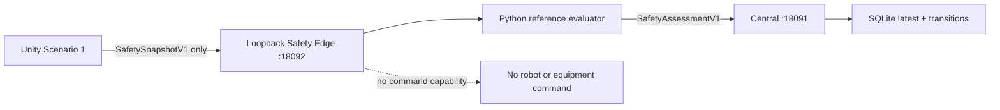

# Unity IITP Scenario 1 Phase 1 - 2026-08-27

## Result

The supplied Unity `6000.5.6f1` project is now represented as a versioned SANG Task and connected to
the command-free Safety Shadow pipeline. No Unity Sim-to-Real launcher, OMY/RB5 UDP client, robot
command, welding command, Task Pause, or E-stop path was started or added.

## Task contract

The authoritative stable definition is
`contracts/tasks/iitp-scenario1-shadow.v1.json`. It declares separate simulation assets, seven
read-only roles, the Unity scene mapping, and this ordered workflow:

1. `mobile_delivery`
2. `omy_pre_pick_place`
3. `rb5_waam`
4. `omy_post_pick_place`
5. `mobile_return`

Central stores the runtime projection in SQLite: Task Definition, Workcell, assets, assignments, and
Run lifecycle. The versioned bundle remains authoritative for stable ordered workflow and Unity scene
metadata. This avoids coupling the generic runtime registry to one simulator.

Live Central contains:

- Task Definition: `iitp-scenario1-coordinated-waam-shadow@1`
- Task Run: `iitp-scenario1-shadow-dev-20260827`
- Workcell: `workcell-iitp-scenario1-unity`
- State: `READY`
- Assignments at this 2026-08-27 validation: seven simulation assets, all `shared_read`

Applying the bundle a second time reused all ten objects and created none.

The later G0 contract freeze changed the bundle's carrier/OMY/RB5 roles to `exclusive` while keeping
observer and camera roles `shared_read`. The historical live row above is not rewritten in place;
G1 must create/migrate versioned registry state before relying on the new reservation semantics.

## Runtime flow

`docker/compose.unity-safety-shadow.yaml` runs the Edge on loopback. Its health response reports
`mode=shadow` and `command_capability=false`. Unity's automatically installed reporter reads
`Assets/StreamingAssets/sang_safety_shadow.json`, uses the existing XR distance tracker as a derived
fact source, and reports task progress through small adapters on the existing workflow controllers.
It accepts only `synthetic` or `replay` source kinds in this initial integration. It refuses to start
if either `IITP_RB5_SIM_TO_REAL=1` or `IITP_OMY_SIM_TO_REAL=1` is present, preventing Shadow evidence
from being mixed with an armed physical bridge process.

## Verification

- Focused final Task/Safety/Unity-contract tests: 13 passed.
- Fleet Control Plane regression: 176 passed with one pre-existing Starlette deprecation warning.
- Whole workspace regression: 416 passed with 14 existing dependency deprecation warnings.
- Clean ROS 2 build: `sang_security`, `robot_agent`, `sang_opcua_gateway`, and
  `fleet_control_plane` all passed.
- The supplied Unity project passed the cross-project config check for Editor `6000.5.6f1`, Task Run,
  simulation assets, loopback Edge route, and `SafetySnapshotV1` shape.
- Live Task registration: first apply created ten objects; second apply reused all ten.
- End-to-end synthetic Snapshot: `SAFE`, `shadow_mode=true`, `command_emitted=false`, transition stored.
- Live Central Safety query returned evaluator `sang-unity-edge-shadow` and policy
  `iitp-scenario1-shadow`.
- Pre-migration SQLite online backup:
  `runtime/phase3-lab1/central/fleet.before-unity-safety-phase1-20260827.db`, integrity `ok`.

## Remaining attended evidence

Unity Hub/Editor is not installed on this PC. Install and license exact Editor `6000.5.6f1`, open
`unity_IITP/100.Whole_integration/Scenario1_app`, wait for package import, then perform Editor compile
and Play Mode checks. The first Play Mode run remains synthetic and must keep the sibling physical
launcher scripts stopped.

The checked-in frame ID, scenario geometry, and distance thresholds are development values from the
handoff project. Before changing `source_kind` to `live`, measure and approve the cell/world transform,
tracking confidence semantics, camera calibration IDs, forbidden zones, and warning/unsafe distances.
Physical pause/stop remains outside this software route and under the independent safety chain.

## Development limitations

- The current Reporter stamps capture and signal sample time together and reports
  `clock_quality=synchronized`. Real stale-signal and clock-quality evidence requires a Processing PC
  clock adapter and per-source timestamps.
- Tracking confidence is currently unknown (`null`), so the policy confidence threshold does not yet
  carry real sensor confidence evidence.
- The local loopback development Central runs without a bearer token. Any non-loopback deployment must
  use the existing authenticated HTTPS/mTLS deployment path rather than exposing this Compose file.
- Unity Editor compile and Play Mode checks remain pending because Editor `6000.5.6f1` is not installed
  on this PC. No physical Task Pause, E-stop, robot, welder, or feeder command was tested or introduced.
