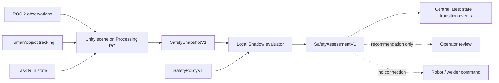

# Unity Safety Shadow Phase 0

## Purpose

This phase prepares the SANG application for a Processing-PC Unity scene that observes people,
robots, Task state, and calibrated cameras. It intentionally does not stop or move equipment.
Unity produces derived facts locally, a versioned evaluator returns a safety assessment, and Central
stores the latest assessment plus meaningful transitions for Admin/Operator visibility.



The final crossed path is a hard boundary: Phase 0 creates no actuator, vendor, welding, feeder,
Task Pause, or E-stop command. `UNSAFE` and `UNKNOWN` both recommend a future Task Pause candidate,
but the value is evidence only.

## Contract and rules

The machine contract is [`../contracts/safety/shadow-v1.schema.json`](../contracts/safety/shadow-v1.schema.json).
The Python evaluator is a reference oracle for Unity/replay development. It applies deterministic
precedence `UNSAFE > UNKNOWN > WARNING > SAFE` and evaluates:

1. Snapshot TTL, required-signal validity and age, and future timestamps.
2. Clock quality and human/scene tracking confidence.
3. Human-to-robot warning and unsafe distance thresholds.
4. Forbidden-zone occupancy.
5. Expected versus observed Task sequence step.

The policy is versioned; changing thresholds creates a new policy version. A breaking payload change
creates a new contract major version.

## Storage and API

- SQLite `safety_latest` stores one row per `agent_id + run_id + evaluator_id`.
- SQLite `safety_events` records only state or structured-reason changes and retains the newest
  10,000 transitions. High-value incident evidence must also reference retained MCAP/Object objects.
- MCAP/Object Storage remains authoritative for high-rate joints, images, poses, and incident media.
- Safety rows contain bounded metadata and evidence references, never image/video bytes.

Central endpoints:

- `POST /api/v1/safety/assessments`: operator/service-token ingest, Task Run and asset scoped.
- `GET /api/v1/safety/latest`: current Shadow assessments.
- `GET /api/v1/safety/events`: meaningful transition history.

Live assessments require an `ACTIVE` Task Run, every referenced asset must be assigned to it, and the
reporting Agent must be bound to one of the assigned assets or its Processing Node. Service identities
are restricted to their registered Agent scopes. Central rejects assessment timestamps over two
seconds in the future so one bad Edge clock cannot block later evidence. Immediate retries and retained
transition retries are idempotent. A delayed retry of a superseded, non-transition latest sample is
rejected as out of order and the sender must treat that `409` as terminal rather than retry forever.

## Replay

The reference CLI reads JSON only and has no network or command dependency:

```bash
PYTHONPATH="$PWD/src/fleet_control_plane" \
python3 -m fleet_control_plane.safety_shadow evaluate \
  --snapshot contracts/safety/examples/safe-snapshot.json \
  --policy contracts/safety/examples/default-policy.json \
  --assessed-at 2026-08-27T12:00:00Z
```

For MCAP replay, first derive the bounded snapshot facts at a selected record timestamp, then pass
that JSON to this evaluator. Raw images and joint samples remain in MCAP.

## Inputs the user must provide for Unity integration

No input is needed to build or test Phase 0. Before connecting the real Unity project, provide:

1. The Unity project directory and exact Editor/LTS version.
2. The canonical cell/world frame and the transform from Unity's coordinate system to that frame.
3. The person/object tracking source and fields, including timestamp and confidence semantics.
4. The first approved zone geometry and distance thresholds for the selected Task.
5. Camera intrinsics/extrinsics and the versioned calibration identifiers used by that Task Run.

These values are operational safety inputs and must be measured or approved; Codex must not invent
them. Initial deployment is MCAP replay, then live Shadow Mode, then an attended false-positive and
false-negative review. Physical pause/stop remains a later release behind the Control Mode Manager,
local command mux/lease/TTL gate, and the independent certified safety chain.
