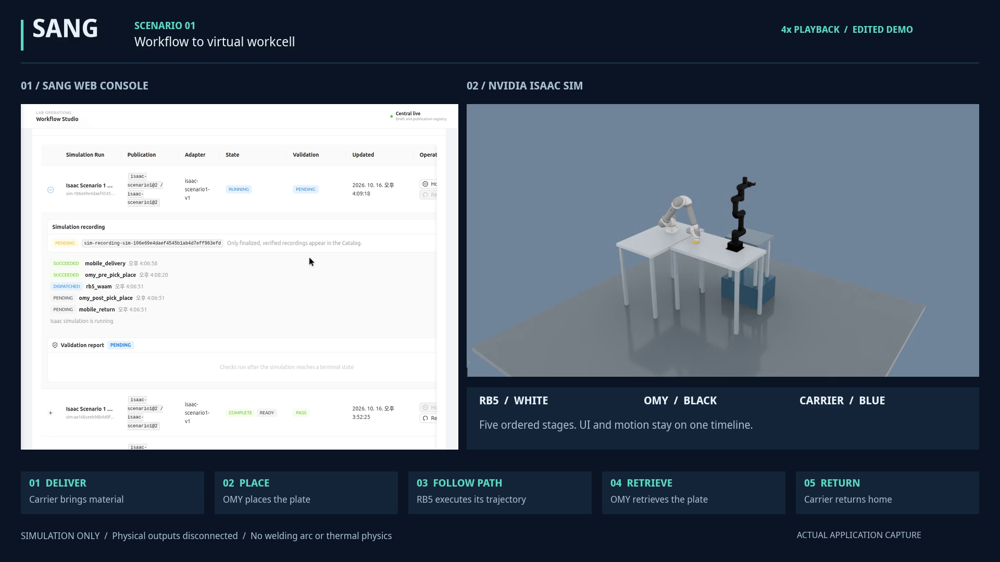

# Scenario 1 Demo

[Watch the demo](https://github.com/user-attachments/assets/32079579-3c66-48bb-a755-0d96c4eae799)

Captured on October 16, 2026. The presentation shows the SANG web console beside
NVIDIA Isaac Sim: queue a published Workflow, complete five ordered stages,
acknowledge Reset, and replay and seek the linked recording in Data Catalog.

- White robot: RB5. Black robot: OMY. Blue fixture: virtual carrier.
- Edited video: 125.833 seconds, 1920 x 1080, H.264, silent, 30 fps export.
- The original screen capture is 20 fps. Sections are explicitly labeled 1x or
  4x playback; idle time and navigation are cut from the presentation.
- `sang-isaac-scenario1-poster.png` is an actual frame from the video.

## Scope

This is actual application footage, not a UI mockup. It demonstrates a configured
simulation profile, not physical robot control. Physical outputs are disconnected.
Recorded trajectories and virtual transfer fixtures are used; welding arc and
thermal physics, physical grasp qualification, and certified safety functions are
not demonstrated. The shared screen-capture timeline is not evidence of hardware
clock synchronization or hard real-time control. Capture quality is not separately
qualified; the Catalog's `Q UNKNOWN` is not suppressed. Its source-offset label
mixes simulation and wall clocks and must not be interpreted as network latency.

The demo was recorded from the local development runtime. Publishing the footage
does not publish all pending implementation changes or make this repository a
self-contained simulator distribution. External assets and runtimes must still
be supplied separately.

The owner approved public upload of this edited presentation and poster on
October 16, 2026. The MP4 is hosted as a GitHub attachment associated with this
repository; the poster is versioned here. No repository visibility change was made. Raw
screen captures, MCAP data, runtime databases, credentials, and external robot
model files remain local. This is not a license grant for those external assets.

## Integrity

| Artifact | SHA-256 |
| --- | --- |
| Edited MP4 | `5bda0d09c9654a857ba6b9c45c03cf780978476e1004d70199ec3c8e8d07f986` |
| Poster PNG | `a552a2a2f800991d474489fe5dd7bc4c32941bb4d95dcf264a7efa6da1a99140` |

The MP4 passed complete error-fatal decoding before publication and uses
fast-start metadata placement for streaming playback.
